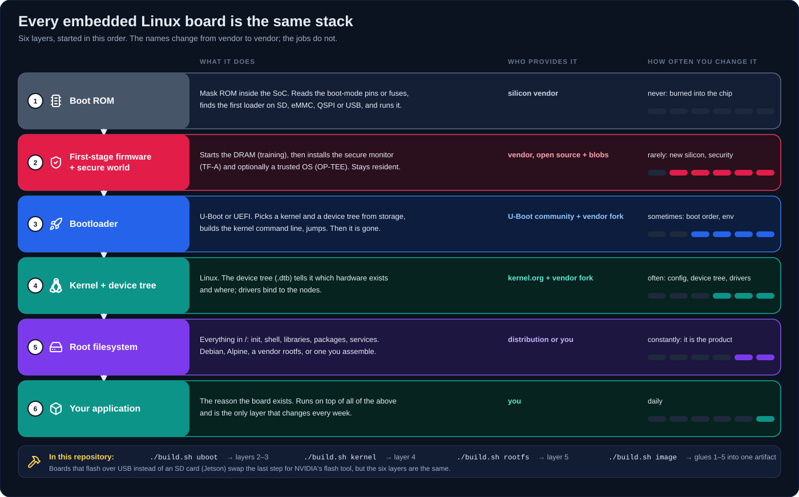
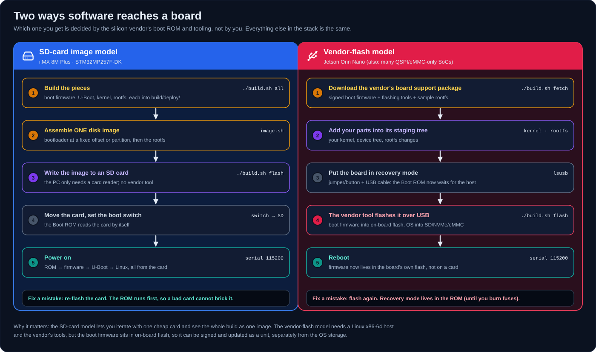

<div align="center">

# Embedded Linux Primer

**Build the whole software stack of an embedded Linux board from source, one small, readable board
directory at a time. No Yocto. Every command explained.**

[](https://github.com/N3b3x/embedded-linux-primer/actions/workflows/ci.yml)
[](https://n3b3x.github.io/embedded-linux-primer/)
[](https://github.com/N3b3x/embedded-linux-primer/actions/workflows/images.yml)

**[Read the documentation site →](https://n3b3x.github.io/embedded-linux-primer/)**

Interactive diagrams you can zoom and step through · a gallery of every diagram · a boot-chain explorer

</div>



This repository teaches what a board support package really contains by building one, by hand, for
five very different boards. Each board directory is self-contained: pinned sources, a pinned
compiler, scripts that print *why* each command runs, numbered chapters and diagrams.

## The boards

| Board | How software gets on | Sources | Status |
| --- | --- | --- | --- |
| **[i.MX 8M Plus](boards/imx8mp-variscite/README.md)**<br>Variscite DART, VAR-SOM, VAR-SMARC | SD-card image, or USB with `uuu` into the eMMC | Variscite's forks of NXP's U-Boot, TF-A and Linux 6.18 | built, flashed and **booted on hardware** (VAR-SOM on Symphony); DART and the `uuu` route not yet |
| **[STM32MP157F-DK2](boards/stm32mp1-dk2/README.md)**<br>STMicroelectronics, 32-bit | SD-card image (GPT) | upstream TF-A, OP-TEE, U-Boot, Linux 6.18 | built in a container; **not yet booted on the kit** |
| **[STM32MP257F-DK](boards/stm32mp2-dk/README.md)**<br>STMicroelectronics, 64-bit | SD-card image (GPT) | upstream stack, or ST's own tested set | built in a container; **not yet booted on the kit** |
| **[Zynq-7000](boards/zynq7000-eclypse-z7/README.md)**<br>Digilent Eclypse Z7 | SD-card image (MBR + `BOOT.BIN`) | mainline U-Boot and Linux 6.18 | built in a container, kernel and rootfs run under QEMU; **not yet booted on the board** |
| **[Jetson Orin Nano](boards/jetson-orin-nano/README.md)**<br>NVIDIA Developer Kit | vendor flash tool over USB | NVIDIA Jetson Linux R36.4.3 (kernel 5.15) | kernel recipe built in a container; **not yet flashed on a kit** |

Every board README opens with a status table that says exactly what was checked and how. Read it
before relying on a board. [How to choose →](docs/04-choosing-a-board.md)

## Download ready-built images

Builds are not run on every push; they run when
someone dispatches the **images** workflow or pushes a `v*` tag, and are published as GitHub Releases:
one release of images that have been booted on real hardware, and a separate `-preview` pre-release for
the rest. [Download and flash guide →](docs/downloads.md)

| Board | Image | Download | Booted on hardware |
| --- | --- | --- | --- |
| i.MX 8M Plus | Debian | [imx8mp-variscite-debian.img.xz](https://github.com/N3b3x/embedded-linux-primer/releases/latest/download/imx8mp-variscite-debian.img.xz) | yes |
| i.MX 8M Plus | Alpine | [imx8mp-variscite-alpine.img.xz](https://github.com/N3b3x/embedded-linux-primer/releases/latest/download/imx8mp-variscite-alpine.img.xz) | yes |
| STM32MP1, STM32MP2, Zynq-7000 | Debian and Alpine | [releases page](https://github.com/N3b3x/embedded-linux-primer/releases) (`-preview`) | not yet |
| Jetson Orin Nano | kernel bundle only | [releases page](https://github.com/N3b3x/embedded-linux-primer/releases) (`-preview`) | not yet |

Write an image to a card with `tools/flash-sd.sh <file>.img.xz` (Linux and macOS) or Raspberry Pi Imager
or balenaEtcher (Windows). The links work after the first release exists.

## Start here

1. **Read the concepts** (about 30 minutes): [what an embedded Linux board really is](docs/01-what-is-an-embedded-linux-board.md),
   [the boot chains compared](docs/02-boot-chains-compared.md), [two ways software reaches a board](docs/03-two-build-models.md).
2. **Pick a board** with [the decision guide](docs/04-choosing-a-board.md).
3. **Read its recipe without running anything:**

   ```bash
   cd boards/imx8mp-variscite
   ./build.sh --dry-run all | less -R
   ```

4. **Build it:** every board answers the same commands.

   ```bash
   ./build.sh deps --install      # host packages (once)
   ./build.sh all                 # sources to a flashable artifact in build/deploy/
   ./build.sh flash …             # write it to the board's medium, with guards
   ```

## What is in the repository

```text
README.md                this page
docs/                    the concepts, the board contract, the glossary, the diagrams
boards/
  imx8mp-variscite/      NXP i.MX 8M Plus on Variscite modules; SD card or eMMC through uuu
  stm32mp1-dk2/          STM32MP157F Discovery Kit (32-bit), all-upstream stack
  stm32mp2-dk/           STM32MP257F Discovery Kit (64-bit), upstream or ST's own stack
  zynq7000-eclypse-z7/   Digilent Eclypse Z7 (Zynq-7000), U-Boot SPL as the first loader
  jetson-orin-nano/      Jetson Orin Nano Developer Kit, vendor flash model
site/                    the landing page, styles and scripts of the documentation site
tools/                   site build, diagram generation, link and walkthrough checks,
                         flash-sd.sh and the release scripts (tools/release/)
.github/workflows/       CI and the Pages deployment
```



## The documentation site

The same Markdown you read here is built into a site with search, a diagram gallery and interactive
diagrams (zoom, pan, fit, side-by-side comparison, step-by-step walkthroughs).

```bash
pip install -r requirements-docs.txt
python3 tools/build-site.py --serve        # http://127.0.0.1:8000
```

A push to `main` that changes documentation publishes it to GitHub Pages. See
[CONTRIBUTING.md](CONTRIBUTING.md) for the checks to run first and
[authoring diagrams](docs/authoring-diagrams.md) for how to add a walkthrough.

## Contributing and licence

[The board contract](docs/board-contract.md) is the rulebook: same commands, pinned sources, numbered
chapters, required diagrams and an honest status table. This repository is internal; see
[LICENSE](LICENSE) and [THIRD_PARTY_NOTICES.md](THIRD_PARTY_NOTICES.md). The software the scripts download
is not part of this repository and stays under its own licences.
