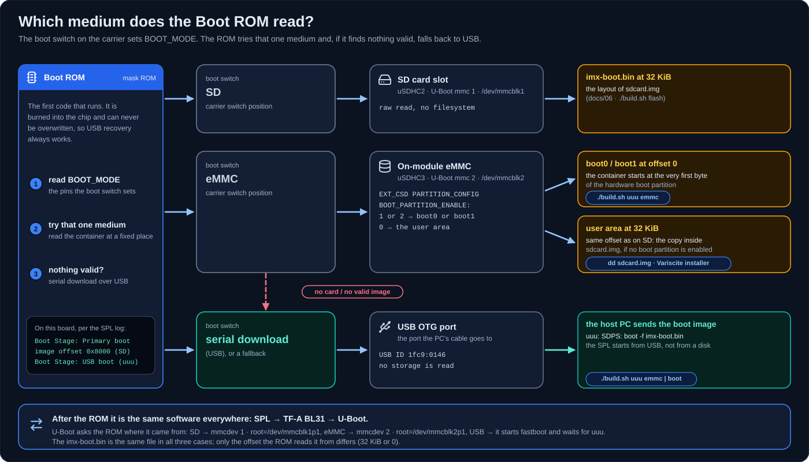
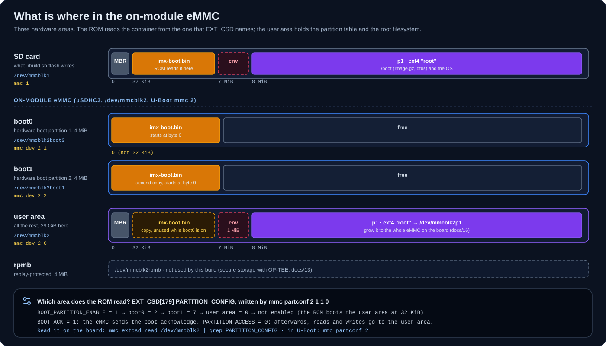
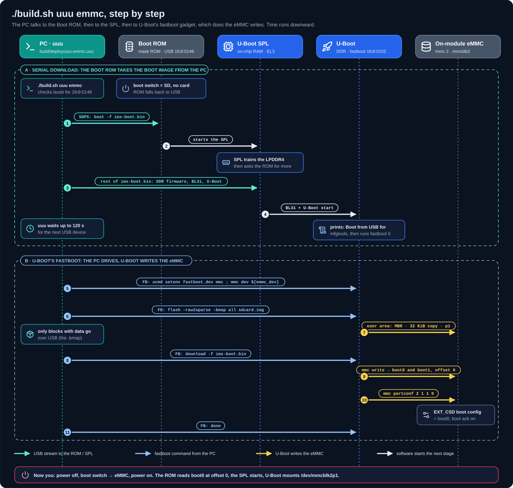

# 16 · Booting from the eMMC, and flashing it over USB with uuu

[Docs](README.md) › **16 · eMMC and uuu**

> **In this guide:** the three ways to get this build running on a Variscite module, how the
> Boot ROM chooses between them, and `./build.sh uuu`, which runs the build from RAM or
> flashes the on-module eMMC over USB, with no SD card and no installer image.
>
> **Status, honestly:** the scripts, the generated `.uuu` files and `uuu`'s own syntax check
> (`uuu -dry`) were run in a container. **Nothing in this chapter was run against a board by the
> author.** Every fact below names its source; where a number comes from reading code and not from
> a log, it says so. Section 9 lists what to capture when you test it.



## 1. Three ways to run this build

| # | Way | Command | Writes to | Boot switch |
| --- | --- | --- | --- | --- |
| 1 | **SD card** (the default, hardware-verified) | `./build.sh flash -d /dev/sdX` | the card | SD |
| 2 | **From RAM over USB** | `./build.sh uuu boot --dtb …` | nothing | SD with no card (see §3) |
| 3 | **eMMC, flashed over USB** | `./build.sh uuu emmc` | the module's eMMC | eMMC, after flashing |

There is no installer image. Ways 2 and 3 use the Boot ROM's own USB mode, and the files they send
are the ones `./build.sh all` already made: `imx-boot.bin`, `sdcard.img` (+ `.bmap`), `kernel.tar.gz`,
`rootfs.tar`.

## 2. Boot modes from zero

When the chip leaves reset, the first code that runs is the **Boot ROM**, burned into the SoC. It
cannot be changed or erased, which is why a board that cannot boot can always be revived over USB.
It does three things:

1. reads the **boot mode** (pins set by the boot switch on the carrier, plus fuses);
2. tries that **one medium** and reads a fixed place in it, looking for a container with the SPL;
3. if there is nothing valid, falls back to **serial download** (USB).

The fallback is described by Variscite for exactly this case: "SD boot with no SD card inserted" is
how their `uuu` page tells you to enter USB mode
([Variscite, Booting from USB using UUU](https://dev.variscite.com/dart-mx8m-plus/yocto/imx-uuu/)),
and U-Boot's own SPL code says the ROM can use "the serial downloader as a fall back (primary boot
source failed)" (`arch/arm/mach-imx/spl.c` in the pinned U-Boot).

| Mode | What the ROM does | Where `imx-boot.bin` must be |
| --- | --- | --- |
| **SD** | reads the SD slot (uSDHC2, U-Boot `mmc 1`, Linux `mmcblk1`) | raw, **32 KiB** from the start of the card |
| **eMMC** | reads the on-module eMMC (uSDHC3, `mmc 2`, `mmcblk2`) as its `PARTITION_CONFIG` says | boot partition boot0/boot1: **offset 0**. No boot partition enabled: user area at **32 KiB** |
| **Serial download** | enumerates on USB as `1fc9:0146` and waits for a host | sent by the host (uuu) |

The two eMMC offsets are the part that is easy to get wrong. The i.MX 8M Plus ROM "expects the
bootloader to sit directly at the start of the eMMC boot partition", and "the 32K offset is only
valid for eMMC user partitions and SD" (commit message of the barebox patch
[ARM: i.MX8MP: bbu: fix wrong flash header offset for eMMC boot partition](https://lists.infradead.org/pipermail/barebox/2021-August/037204.html),
quoting the reference manual). Variscite's U-Boot agrees: its fastboot code writes the `bootloader`
to "eMMC boot0 partition, bootloader offset is 0x0" for the i.MX 8M Plus
(`drivers/fastboot/fb_fsl/fb_fsl_partitions.c`). The same `imx-boot.bin` works at both places because
the SPL asks the ROM where the image is (`image offset 0x8000` on SD, in the real log of
[chapter 07](07-flashing-and-boot.md)) and computes the offset of U-Boot proper from that
(`spl_romapi_get_uboot_base()` in `arch/arm/mach-imx/spl_imx_romapi.c`).

U-Boot also asks the ROM which device it came from and sets `mmcdev`/`mmcblk` from it
(`board_late_mmc_env_init()` in `board/variscite/common/mmc.c`), so the kernel gets
`root=/dev/mmcblk1p1` from SD and `root=/dev/mmcblk2p1` from eMMC with no change to the image.
When it comes from USB, U-Boot starts fastboot instead (`common/autoboot.c`).



### The eMMC register that decides

An eMMC has an `EXT_CSD[179] PARTITION_CONFIG` register. `BOOT_PARTITION_ENABLE` (bits 5:3) holds
0 = none, 1 = boot0, 2 = boot1, 7 = user area (names in `drivers/mmc/mmc.c` of the pinned U-Boot).
`BOOT_ACK` (bit 6) makes the eMMC send an acknowledge when it boots. U-Boot sets it with

```text
mmc partconf <dev> <boot_ack> <boot_partition> <partition_access>     # mmc partconf 2 1 1 0
```

(`cmd/mmc.c`; it refuses on an SD card: `PARTITION_CONFIG only exists on eMMC`). `mmc partconf 2 1 1 0`
is also the sequence NXP's own `uuu` script uses for the eMMC (`uuu/emmc_burn_loader.lst` in mfgtools,
with `emmc_ack` = 0 unless set), and a bench-proven provisioning flow for these modules uses the same
call with acknowledge on, `imx-boot` in boot0 and boot1 at offset 0, and `force_ro` lifted when
writing from Linux.

## 3. What you need

### The PC

```bash
./build.sh deps --install       # now also installs libusb-1.0-0 and usbutils
./build.sh uuu deps             # downloads the pinned uuu 1.5.243, checks its sha256
./build.sh uuu udev             # once: USB access without sudo (asks first)
```

`uuu deps` fetches the release asset (`uuu` for x86-64, `uuu_aarch64` for arm64) from
[nxp-imx/mfgtools](https://github.com/nxp-imx/mfgtools/releases/tag/uuu_1.5.243) into `build/tools/`;
both sha256 values and the source tarball's are in `config/imx8mp-var-dart.conf`. On another
architecture it prints how to build from the pinned source. Variscite's page builds the same tag,
`uuu_1.5.243`, from source and warns that `-bmap` needs uuu 1.5.163 or newer.

`uuu udev` installs the rule that `uuu -udev` prints (`TAG+="uaccess"` for the NXP boot devices,
among them `1fc9:0146` and `1fc9:0152`). `uaccess` only works for the user logged in at the machine;
over ssh use `--sudo`, which runs uuu through sudo.

### Cabling

* Connect the carrier's **USB OTG** port straight to a PC port. No hub, no dock: a bench-proven flow
  found the ROM-to-U-Boot hand-over fails behind them (§8).
* Which connector is the OTG port, from Variscite's documents:
  * VAR-SMARC-MX8M-PLUS evaluation kit: "USB 2.0 OTG (J33)"; the debug UART is "USB Debug (J31)"
    ([quick start guide](https://variscite.com/wp-content/uploads/2026/04/VAR-SMARC-MX8M-PLUS_Quick-Start-Guide.pdf)).
  * DART-MX8M-PLUS custom board: a USB Type-C receptacle is the OTG port
    ([USB OTG](https://dev.variscite.com/dart-mx8m-plus/yocto/usb-otg/)).
  * Symphony-Board with VAR-SOM-MX8M-PLUS: **not found in the pages used for this chapter.** Look it up in
    the Symphony-Board user manual / quick start guide of your kit.
  * "If the board has only a regular USB type-A connector, use a male USB type-A to male USB type-A
    cable" (Variscite UUU page).
* U-Boot checks the port with the carrier's PTN5150 Type-C chip before it starts the fastboot gadget
  and gives up with an error if the port is not in device mode (`board_usb_init()` in
  `board/variscite/imx8mp_var_dart/imx8mp_var_dart.c`). Connect the cable **before** you power on.
* Keep the **serial console** connected as well (115200 8N1, `picocom -b 115200 /dev/ttyUSB0`): it is
  the only way to see what the SPL and U-Boot say ([chapter 07](07-flashing-and-boot.md)).

### The boot switch

| Carrier | Source | eMMC | SD | USB (serial download) |
| --- | --- | --- | --- | --- |
| VAR-SMARC-MX8M-PLUS evaluation kit, switch SW7 (4 switches) | quick start guide P/N VSS0243-L, drawings | 1 ON, 2 3 4 OFF | 1 OFF, 2 ON, 3 ON, 4 OFF | not drawn: use **SD with no card** |
| any DART / VAR-SOM carrier | Variscite Yocto page: "BOOT SELECT DIP switch … SW7: 0 = Boot from SD card, 1 = Boot from eMMC" | | | **SD with no card** (Variscite UUU page) |
| Symphony-Board (VAR-SOM-MX8M-PLUS) | **no position found in the pages used here** | see the Symphony-Board manual | see the manual | **SD with no card** |

Do not trust a position from this table for your carrier revision without checking its manual: the
Yocto page does not say which carrier its SW7 line is about, and the Variscite quick start guides name
the board differently in text and photo.

## 4. Way 3: flash the eMMC over USB

```bash
./build.sh --dry-run uuu emmc          # read the whole script, with a reason for each line
./build.sh --accept-eula all           # once: imx-boot.bin, sdcard.img and .bmap must exist
# boot switch on SD, SD slot EMPTY, USB cable on the OTG port, serial console open, power on
./build.sh uuu check                   # must say: Board in serial download mode (1fc9:0146)
./build.sh uuu emmc                    # asks for a yes, then writes
```



What the command does, in order (the generated file is `build/deploy/uuu-emmc.uuu`; every line has a
comment that says why it is there):

| Phase | Script lines | What happens | Source |
| --- | --- | --- | --- |
| A. ROM | `SDPS[-t 60000]: boot -f imx-boot.bin` | uuu streams the **whole** file to the ROM (`1fc9:0146`); the ROM starts the SPL; the SPL trains the DDR and asks for the rest, which comes over the same stream | mfgtools `libuuu/config.cpp` (SDPS for `0x1fc9:0x0146`, chip `MX865`), `libuuu/sdps.cpp` and `rominfo.cpp` (for ROM-API chips the size sent is the file size); U-Boot `spl_imx_romapi.c` |
| B. fastboot | `FB: ucmd setenv fastboot_dev mmc`, `setenv mmcdev ${emmc_dev}`, `mmc dev ${emmc_dev}`, `setenv fastboot_buffer 0x42800000` | U-Boot started from USB runs fastboot (`1fc9:0152`); these select the eMMC (`emmc_dev=2`; the SD slot is 1) and the download buffer | U-Boot `.env`, `defconfig` (`CONFIG_USB_GADGET_PRODUCT_NUM=0x0152`, `CONFIG_FASTBOOT_BUF_ADDR=0x42800000`), `drivers/fastboot/fb_common.c` |
| C1. user area | `mw.b` + `mmc write … 0x3800 0x800`, then `FB: flash -raw2sparse -bmap … all sdcard.img` | zeroes the 1 MiB at 7 MiB (saved environment), then writes the image: MBR, `imx-boot.bin` copy at 32 KiB, partition 1 at 8 MiB; only blocks with data are sent | `FB: flash`, `-bmap`: `uuu -h`; `CONFIG_ENV_OFFSET=0x700000` |
| C2. boot partitions | `FB: download -f imx-boot.bin`, `mmc dev 2 1` / `mmc dev 2 2`, `mmc write … 0x0 <blocks>`, `mmc dev 2 0` | `imx-boot.bin` into boot0 and boot1 at offset 0 | `fb_fsl_partitions.c` (offset 0), bench-proven flow |
| C3. ROM config | `mmc partconf 2 1 1 0`, then `mmc partconf 2` | boot0, acknowledge on; reads the register back | `cmd/mmc.c` |

Options: `--rootfs-only` writes only partition 1 from 8 MiB (`FB: write -skip 0x800000 -seek 0x800000`,
nothing else is touched, so the layout must already be this one); `--bootloader-only` writes boot0,
boot1 and the boot configuration; `--no-spl` skips phase A when U-Boot already runs in fastboot
(after `./build.sh uuu spl`, or when the script finds `1fc9:0152` itself).

`FB: ucmd` and `acmd` need `CONFIG_FASTBOOT_UUU_SUPPORT`, which is on by default for i.MX 8M and was
confirmed in the resolved `.config` of `imx8mp_var_dart_defconfig`.

### Guards

* `--dry-run` works anywhere: no uuu, no board, no build output needed.
* Before a real run: the pinned uuu must exist; every file must exist; `uuu -dry` must accept the
  script; the PC must see `1fc9:0146` (or `0152`), else a checklist explains the cabling and the switch;
  then you must answer **yes** to a summary of what will be overwritten (`-y` skips it).
* The SD slot is never addressed. A mistyped device number cannot reach it either, because the script
  uses U-Boot's own `${emmc_dev}`, and `mmc partconf` refuses SD cards.

### Expected output

`uuu` prints one line per device with the step number and a bar that turns into `Done`, and a
`Success n Failure m` summary. The exact strings below come from the sources (they were not captured
on a board):

| Where | Line | Source |
| --- | --- | --- |
| uuu, waiting | `Wait for Known USB Device Appear...` | `uuu/uuu.cpp` (confirmed by running it) |
| serial, SPL | `Boot Stage: USB boot`, `Find img info 0x… size …`, `Need continue download …` | `arch/arm/mach-imx/spl_imx_romapi.c` |
| serial, U-Boot | `Boot from USB for mfgtools` (then `Run bootcmd_mfg: …` and `Run fastboot …`), `Detect USB boot. Will enter fastboot mode!`, `flash target is MMC:2` | `common/autoboot.c`, `fb_fsl_common.c`, `fb_fsl_partitions.c` |
| uuu, in `-v` mode | the U-Boot reply of `mmc partconf 2`: `BOOT_ACK: 0x1`, `BOOT_PARTITION_ENABLE: 0x1 (boot0)` | `cmd/mmc.c` |

### Then boot from it

1. Power off. Set the boot switch to **eMMC** (§3).
2. Power on with the serial console open. **Expected** (from the code, not yet seen on a board):

   ```text
   Trying to boot from BOOTROM
   Boot Stage: Primary boot
   image offset 0x0, pagesize 0x200, ivt offset 0x0      <- 0x0: a boot partition (on SD it is 0x8000)
   ```

   then U-Boot, `MMC: FSL_SDHC: 1, FSL_SDHC: 2`, the kernel with `root=/dev/mmcblk2p1`.
3. The partition is only as large as the image. Grow it once on the board (not yet tested):

   ```bash
   # Debian (fdisk, parted and e2fsprogs are installed); Alpine: apk add sfdisk e2fsprogs-extra
   echo ', +' | sfdisk --no-reread -N 1 /dev/mmcblk2 && partprobe /dev/mmcblk2 && resize2fs /dev/mmcblk2p1
   ```

   Check first: `mmc extcsd read /dev/mmcblk2 | grep PARTITION_CONFIG` (package `mmc-utils`) or, in
   U-Boot, `mmc partconf 2`.

## 5. Way 2: run from RAM, write nothing

```bash
./build.sh --dry-run uuu boot --dtb imx8mp-var-som-symphony.dtb     # read it
./build.sh -r alpine all                                            # Alpine: small enough for RAM
./build.sh uuu boot --dtb imx8mp-var-som-symphony.dtb               # board in serial download mode
```

After phase A the PC sends Linux (`Image`, decompressed from `Image.gz`), the device tree and the whole
root filesystem as an **initramfs** into RAM, sets the kernel command line and runs
`booti ${loadaddr} ${initrd_addr} ${fdt_addr}`: the flow NXP's own mfgtools scripts use. Power-cycle and
the board is as before; neither SD nor eMMC is read or written.

Why it needs more from you than the other ways:

* U-Boot started from USB **resets its environment to the compiled-in default** (`env_set_default` in
  `common/autoboot.c`), so the module detection of `board_late_init()` is lost: `findfdt` cannot choose
  the device tree and `console` falls back to `ttymxc0`. You therefore pass `--dtb` (names:
  [chapter 04](04-kernel.md)) and the console is derived from it: DART `ttymxc0`, VAR-SOM and SMARC
  `ttymxc1` (`--console` overrides).
* The root filesystem lives in RAM and is unpacked, so Alpine (about 10 MB) is the safe choice. The
  script refuses an initramfs over U-Boot's 1 GiB download buffer and warns above 400 MiB.
* Debian under `rdinit=/sbin/init` runs systemd without a real root device; expect oddities.
* The files are built in `build/deploy/uuu-ram/`: `Image`, and `initramfs.cpio.gz.uboot` (made with
  `fakeroot`, `cpio`, `gzip` and U-Boot's `mkimage -T ramdisk`, all rootless).

This way has the lowest confidence of the three: phase A and the fastboot download are the same as in
way 3, but the `booti` phase has not been run on a board (see the status table in the
[README](../README.md)).

## 6. Back to SD boot, and recovery

* **Back to SD:** power off, switch to SD, insert the card. Nothing on the eMMC needs undoing. If you
  want the old way (user-area copy) to work again, disable the boot partition: U-Boot
  `mmc partconf 2 0 0 0`, or Linux `mmc bootpart enable 0 0 /dev/mmcblk2`.
* **eMMC will not boot** (empty, half written, wrong switch): set the switch to SD, **remove the card**,
  power on, and run `./build.sh uuu emmc` again. The ROM cannot be damaged, so this always works.
  If the PC does not see `1fc9:0146`, §8.
* **From a running SD system you can also fix it:** boot from SD, then write the user area with
  `dd` and the boot partitions with `echo 0 > /sys/block/mmcblk2boot0/force_ro`, `dd if=imx-boot.bin
  of=/dev/mmcblk2boot0`, then `mmc bootpart enable 1 1 /dev/mmcblk2`. The USB way avoids this.
* **Old settings keep coming back:** a saved U-Boot environment lives at 7 MiB of the boot device. A full
  `uuu emmc` and `./build.sh flash` both zero the 1 MiB there (`bmaptool` and sparse writes skip zero
  blocks, so without this an old `fdt_file` or `bootcmd` would survive a re-flash). `--rootfs-only` and
  `--bootloader-only` do not touch it; on the board `env default -a; saveenv` resets it.

## 7. How this differs from Variscite's installer

Variscite's `var-uuu-installer` script (`classes/var-uuu-installer.bbclass`, branch
`wrynose_6.18.20_2.0.0_var01` of meta-variscite-sdk-imx) boots the module with the same `SDPS`/`SDPV`
lines, writes the WIC image with `FB: flash -raw2sparse -bmap … all`, and runs `FB: flash -scanterm
-scanlimited 0x800000 bootloader <imx-boot>` with no `mmc partconf`. Its on-board installer
(`imx_v8_install_yocto.sh`) writes the bootloader into the **user area at 32 KiB** (`BLOCK=mmcblk2`,
`BOOTLOADER_OFFSET=32` for i.MX 8M Plus) and one partition from 8 MiB. This build offers the same
result (the user-area copy comes with `sdcard.img`) and, in addition, boot0/boot1 at offset 0 plus the
boot configuration, which is what NXP's eMMC script and the bench-proven flow do. Either layout boots
as long as `PARTITION_CONFIG` and the position of the copy agree.

The earlier advice in [chapter 07](07-flashing-and-boot.md) to `dd sdcard.img` to `/dev/mmcblk2` is
therefore correct only while no boot partition is enabled; it is now explained there.

## 8. Troubleshooting

| Symptom | First line to look at | Cause | Fix |
| --- | --- | --- | --- |
| `uuu check`: nothing | `lsusb \| grep 1fc9` empty | cable in the wrong port, or the board is not in download mode | OTG port; switch SD with the **slot empty**; power-cycle with the cable connected |
| `uuu: Wait for Known USB Device Appear...` forever (or `Timeout: Wait for Known USB Device`) | same | as above | as above |
| `Failure open usb device,Try sudo uuu` | uuu | no permission on the USB node | `./build.sh uuu udev` and replug, or `--sudo` |
| stops after the SPL; `Timeout: Wait for next USB Device` | serial: SPL banner, then nothing, or `Boot from USB…` but no `1fc9:0152` on the PC | the ROM-to-U-Boot hand-over broke (hub or dock, bad cable), or the Type-C port was not in device mode when U-Boot started fastboot | direct cable, connect **before** power-on; then `./build.sh uuu spl`, check `lsusb` shows `1fc9:0152`, then `./build.sh uuu emmc --no-spl` |
| serial dead after power-on, no SPL banner | serial | wrong console port (DART `ttymxc0`, VAR-SOM/SMARC `ttymxc1`), or DDR training failed | other UART; [chapter 09](09-troubleshooting.md) |
| `Stream(USB) download failure` or `Failure download …` | serial, SPL | USB transfer error | other cable or port, avoid USB 3 hubs |
| `FB: ucmd mmc dev …` fails | uuu red line | no eMMC on this module variant | check the part number; do not continue |
| `uuu -dry` fails: `image file not found` | our message: `uuu does not accept …` | `./build.sh all` was not run | run it |
| flash finishes, but the eMMC boots nothing | serial: no SPL banner with the switch on eMMC | switch not on eMMC, or `PARTITION_CONFIG` not set | `mmc partconf 2` in U-Boot must show `BOOT_PARTITION_ENABLE: 0x1 (boot0)`; rerun `--bootloader-only` |
| boots eMMC, old U-Boot/kernel behaviour | serial: build date of the SPL line | boot configuration points to an old boot partition | `--bootloader-only` |
| `Kernel panic … VFS: Unable to mount root fs` | serial, `Kernel command line:` | `root=` names the wrong device, or partition 1 is missing | `printenv mmcblk mmcpart`; expect `mmcblk=2` when booted from eMMC |
| wrong module or device tree after reflashing | serial: `fdt_file=` line | a saved environment survived, or the module is detected wrongly | see the DART checklist in [chapter 09](09-troubleshooting.md#first-boot-on-a-dart-checklist) |
| `uuu boot`: kernel starts, no login | serial | wrong console, or Debian initramfs problems | `--console ttymxc0` for DART; use Alpine |

## 9. What to capture when you test it

Please keep, for each way you try: the full serial log from power-on (`picocom -b 115200 --logfile
boot.log /dev/ttyUSB0`), the uuu terminal output (`./build.sh uuu emmc` also logs to
`build/logs/uuu-emmc.log`), `./build.sh info`, `lsusb | grep 1fc9` at each phase, and the output of
`mmc partconf 2` in U-Boot. These are exactly the lines that this chapter predicts but could not show.

## Sources

* NXP mfgtools at tag `uuu_1.5.243`: `libuuu/config.cpp`, `libuuu/sdps.cpp`, `libuuu/rominfo.cpp`,
  `libuuu/fastboot.cpp`, `libuuu/usbhotplug.cpp`, `uuu/emmc_burn_loader.lst`, `uuu/emmc_burn_all.lst`,
  and the output of `uuu -h` / `-H` / `-udev` of the pinned release.
* Variscite U-Boot at the pinned commit `9ee215f6a578` (`varigit/uboot-imx`): `board/variscite/imx8mp_var_dart/`,
  `board/variscite/common/mmc.c`, `configs/imx8mp_var_dart_defconfig`, `arch/arm/mach-imx/spl_imx_romapi.c`,
  `common/autoboot.c`, `drivers/fastboot/`, `cmd/mmc.c`, `drivers/mmc/mmc.c`.
* Variscite developer pages: [Booting from USB using UUU](https://dev.variscite.com/dart-mx8m-plus/yocto/imx-uuu/),
  [Yocto build release](https://dev.variscite.com/dart-mx8m-plus/yocto/yocto-build-release/),
  [Yocto recovery SD card](https://dev.variscite.com/dart-mx8m-plus/yocto/yocto-recovery-sd-card/),
  [USB OTG](https://dev.variscite.com/dart-mx8m-plus/yocto/usb-otg/); the
  [VAR-SMARC-MX8M-PLUS quick start guide](https://variscite.com/wp-content/uploads/2026/04/VAR-SMARC-MX8M-PLUS_Quick-Start-Guide.pdf);
  `meta-variscite-sdk-imx` (`var-uuu-installer.bbclass`, `imx_v8_install_yocto.sh`).
* The i.MX 8M Plus boot-partition offset: the barebox patch linked in §2.
* A bench-proven provisioning flow for these modules (boot0/boot1 at offset 0, `mmc partconf`, `force_ro`,
  `uuu` SDPS then fastboot, direct USB connection) for the parts that reading code cannot settle.

---

← [15 · Source tour](15-source-tour.md) · [Index](README.md) · [07 · Flashing & first boot](07-flashing-and-boot.md)
