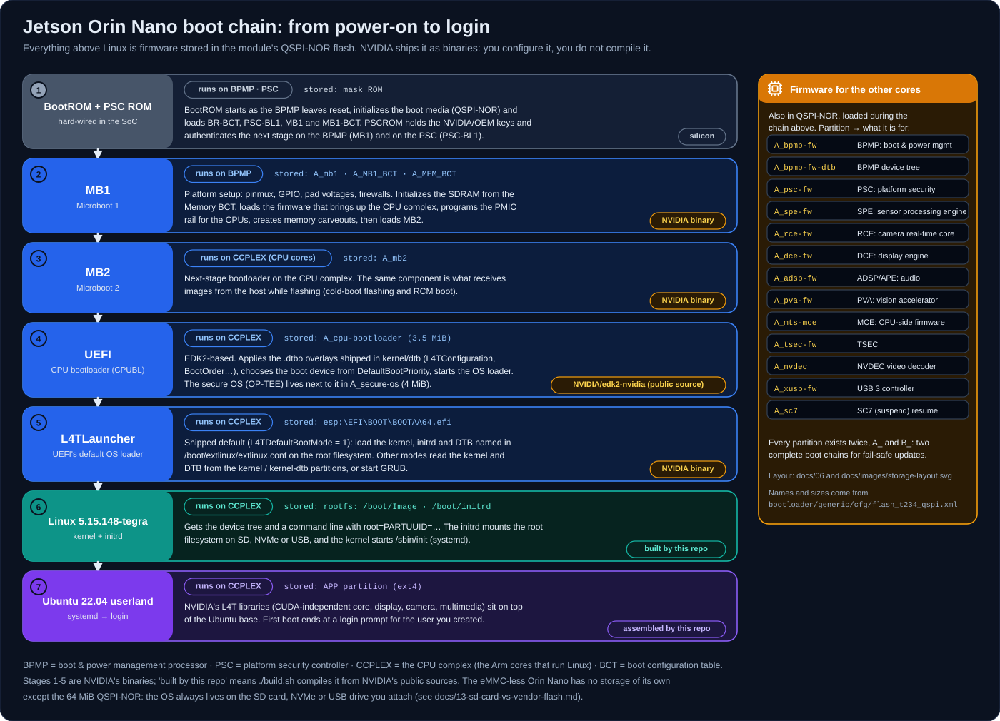
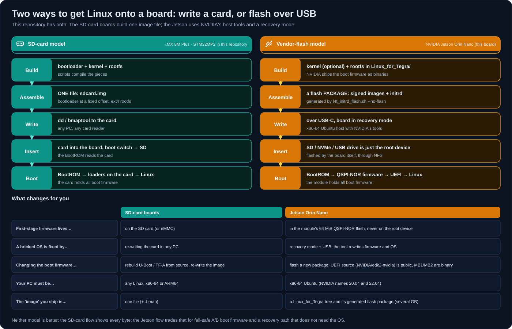
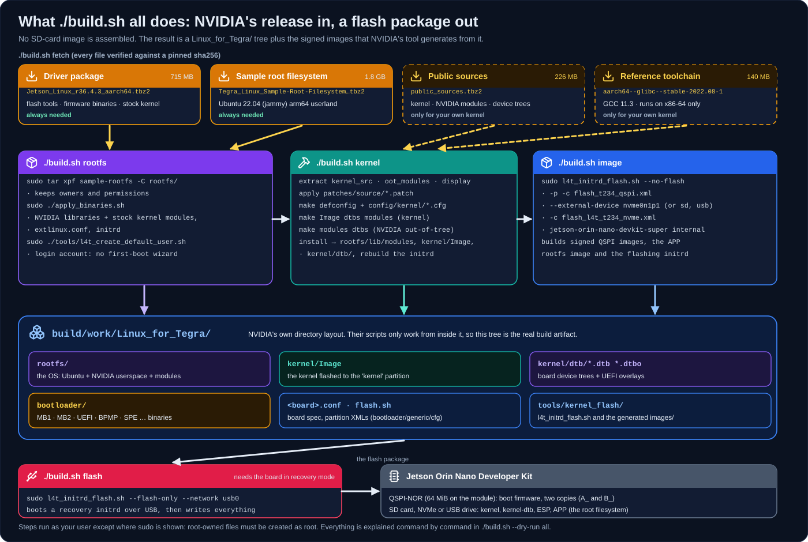
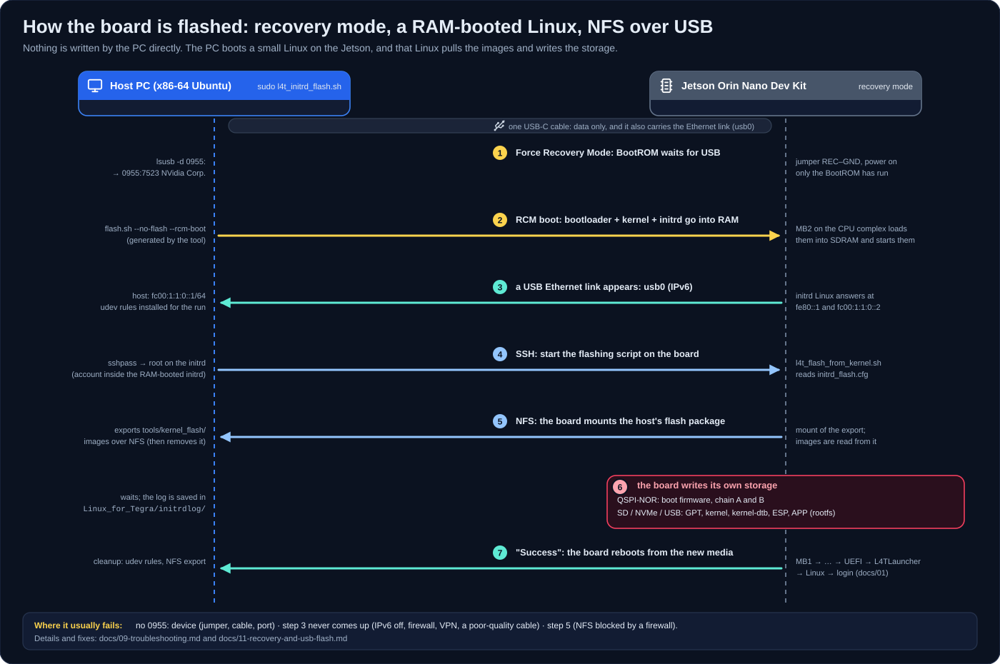
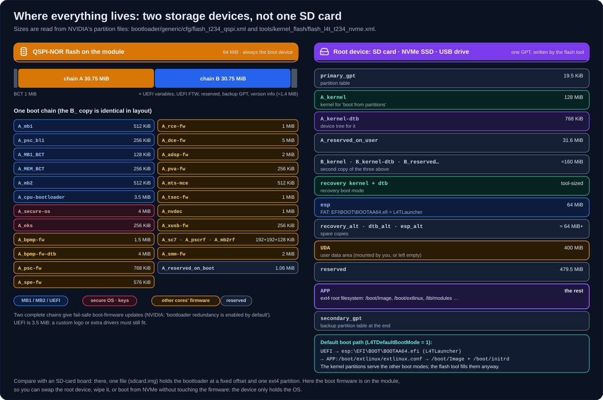
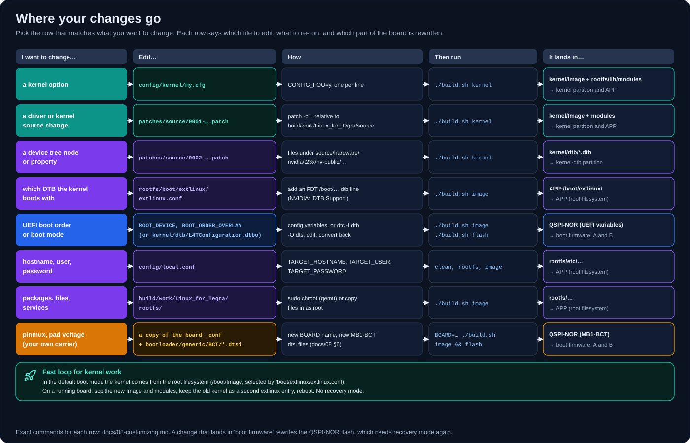
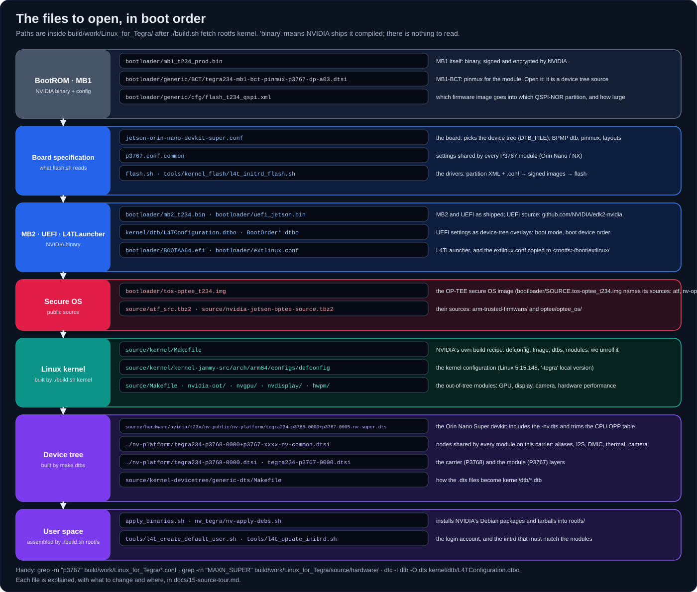

<div align="center">

# NVIDIA Jetson Orin Nano · Jetson Linux builder

**NVIDIA's Jetson Linux R36.4.3 for the Orin Nano Developer Kit, driven by readable
scripts: your own kernel and device trees, a root filesystem on SD, NVMe or USB, and
a flash over USB recovery mode. Every command is explained.**

[](https://github.com/N3b3x/embedded-linux-primer/actions/workflows/ci.yml)


[Quick start](#quick-start) · [Status](#what-has-been-verified) · [Two flashing models](#this-board-is-different-no-sd-card-image) · [Boot chain](#1-the-boot-chain) · [Build](#2-how-the-build-works) · [Flash](#3-how-the-board-is-flashed) · [Docs](docs/README.md)

</div>



```bash
./build.sh deps --install                  # once: host packages (Ubuntu 22.04, x86-64)
./build.sh --accept-license all            # download, root filesystem, kernel, flash package
./build.sh flash                           # board in recovery mode: write QSPI firmware + OS
```

- **Official release, readable steps.** The Jetson Linux R36.4.3 archives, a sample rootfs
  and the public kernel sources, each checked against a pinned sha256. The scripts are
  NVIDIA's own Quick Start and Kernel Customization procedures, split into steps you can read.
- **Your kernel, your device tree.** Kernel config fragments, patches over the kernel, the
  NVIDIA out-of-tree modules and the device trees, built with NVIDIA's reference toolchain.
- **Three root devices, one command line.** `-d nvme`, `-d sd` or `-d usb`.
- **Explains itself.** Every command is printed with the reason it runs, and `--dry-run`
  turns the whole build into a readable recipe, on any computer.
- **A different flashing model.** There is no `sdcard.img`. The comparison with the SD-card
  boards of this repository is a first-class part of the docs: [13](docs/13-sd-card-vs-vendor-flash.md).

---

## What has been verified

Read this before you trust a step. The columns say *how* each part was checked, never more.

| Part | Status | How |
| --- | --- | --- |
| Scripts lint | ✅ | `shellcheck -x` clean; runs in CI |
| `--dry-run` of every step | ✅ | run on Ubuntu 24.04 (arm64 container) and in CI |
| Downloads | ✅ | all four files fetched with the script and verified against the pinned sha256; the driver package and the rootfs also match the SHA-1 values NVIDIA publishes |
| Source unpack, patch, kernel config fragment | ✅ | run for real on Linux (x86-64 container): unpack, `patch`, `defconfig` + fragment → `CONFIG_PSI=y` |
| NVIDIA device trees from source | ✅ | `make dtbs` built 85 DTBs, including the Orin Nano Super kit, with the example patch visible in the result |
| Reference toolchain | ✅ | unpacked and run: `aarch64-buildroot-linux-gnu-gcc` GCC 11.3.0 |
| Kernel build (`Image`, in-tree + NVIDIA modules, device trees) | ✅ recipe, ⚠️ not with NVIDIA's compiler | `./build.sh kernel extract config build` ran start to finish in an arm64 Linux container with a native GCC 11 standing in for NVIDIA's x86-64 toolchain: `Image` (42 MB, `uname -r` string `5.15.148-tegra`), 921 in-tree and 165 NVIDIA out-of-tree modules (`nvgpu`, `nvidia-drm`, `tegra-camera` …), 85 DTBs, about 12 minutes with 8 jobs. With NVIDIA's own compiler under x86-64 emulation the compile got through ~1,800 objects before the emulator crashed (`Illegal instruction`) on one file: an emulation limit, not a script error, but also not a complete run with the pinned compiler |
| `rootfs` step (sudo, `apply_binaries.sh`) | ⚠️ not run | needs root, `qemu-user-static` binfmt and an x86-64 host; the commands are NVIDIA's Quick Start, cross-checked against the R36.4.3 tool sources |
| `image` step (flash package) | ⚠️ not run | same reasons; command line cross-checked against `README_initrd_flash.txt` |
| `flash` on hardware | ❌ **not yet flashed on a board** | the recovery-mode, USB IDs and flash flow come from NVIDIA's Quick Start and tool sources |

If you run the real flow on a kit, the most useful report is the first line of the log where it
stops: [09 · Troubleshooting](docs/09-troubleshooting.md).

---

## Before your first flash

Two choices make a first flash far more likely to work, both drawn from NVIDIA's own tool sources:

> **1. Flash the stock kernel first.** The only step NVIDIA has never tested is a kernel and modules built
> from source and swapped in. Run `./build.sh --accept-license --stock-kernel all`, confirm you reach a
> login, and only then build and add your kernel. If the stock image boots and yours does not, the problem is your
> kernel, not the board or the cable.
>
> **2. Always flash the QSPI firmware too.** The command here includes the internal QSPI flash
> (`internal`), which moves a kit that shipped with older firmware to the 36.x firmware set the Super
> configuration needs. Flashing only the external device later keeps the old firmware, which is the classic
> "UEFI cannot boot the new root filesystem" mismatch.

On the PC: the USB port must be direct (no hub, no virtual machine passthrough), the cable must carry data,
`nfs-kernel-server` must be running, and `usb0` must not be taken over by NetworkManager or a firewall.
When the log stops at `Waiting for target to boot-up...`, look there first
(`initrdlog/flash_*.log` in `Linux_for_Tegra`). After flashing, **remove the recovery jumper**, or the kit
re-enters recovery on every power-up.

## Quick start

| Step | Command | What happens |
| --- | --- | --- |
| **1. Host setup** (once) | `git clone https://github.com/N3b3x/embedded-linux-primer && cd embedded-linux-primer/boards/jetson-orin-nano`<br>`./build.sh deps --install` | installs the packages NVIDIA's flash scripts need, plus kernel build tools. **x86-64 Ubuntu only** ([02](docs/02-host-setup.md)) |
| **2a. First run: stock kernel** | `./build.sh --accept-license --stock-kernel all` | downloads about 2.6 GB, assembles the rootfs with NVIDIA's prebuilt kernel, generates the flash package. Needs `sudo` |
| **2b. Or build your own kernel** | `./build.sh --accept-license all` | adds 370 MB of sources and compiler, builds the kernel, NVIDIA's modules and the device trees |
| **3. Recovery mode** | jumper **REC–GND** on the 12-pin button header, USB-C to the PC, power on<br>`lsusb -d 0955:` | expect `ID 0955:7523 NVidia Corp.` ([11](docs/11-recovery-and-usb-flash.md)) |
| **4. Flash** | `./build.sh flash` | shows the plan, asks, then boots a Linux over USB that writes everything |
| **5. Boot** | remove the jumper, power-cycle | NVIDIA's setup wizard is skipped: log in as `jetson` / `jetson` (bench default, see [05](docs/05-rootfs.md)) |

`--accept-license` accepts NVIDIA's Tegra Software License Agreement for the root filesystem
you assemble. Re-running is cheap: unpacked trees are reused, and a finished step prints what it skipped.

Choose where the OS goes with `-d`: `./build.sh -d sd flash` for a microSD card (64 GB or larger,
NVIDIA's own rule for this kit), `-d usb` for a USB drive, default `nvme`.

---

## This board is different: no SD-card image



On the i.MX 8M Plus and STM32MP2 boards the build ends in one `sdcard.img`, and the boot
firmware sits on the card. A Jetson boots from firmware stored in the **64 MiB QSPI-NOR flash
on the module**, and the SD card, NVMe or USB drive only holds the operating system. NVIDIA's
tools write both, over a USB cable, with the board in a special **Force Recovery Mode**.
[13 · SD card vs vendor flash](docs/13-sd-card-vs-vendor-flash.md) walks through what that
changes.

---

## 1. The boot chain

The diagram at the top is the whole story. In one paragraph: the **BootROM** loads **MB1** on the
BPMP, MB1 sets up memory and starts the CPU complex, **MB2** and **UEFI** take over on the Arm
cores, UEFI starts **L4TLauncher** from the EFI system partition, and L4TLauncher loads the kernel,
initrd and device tree that `/boot/extlinux/extlinux.conf` names on the root filesystem.

| # | Stage | Runs on | Stored in | Source |
| --- | --- | --- | --- | --- |
| 1 | **BootROM + PSC ROM** | BPMP · PSC | the SoC | silicon |
| 2 | **MB1** | BPMP | `A_mb1`, `A_MB1_BCT`, `A_MEM_BCT` | NVIDIA binary |
| 3 | **MB2** | CPU complex | `A_mb2` | NVIDIA binary |
| 4 | **UEFI** (+ OP-TEE) | CPU complex | `A_cpu-bootloader`, `A_secure-os` | EDK2, [NVIDIA/edk2-nvidia](https://github.com/NVIDIA/edk2-nvidia) |
| 5 | **L4TLauncher** | CPU complex | the ESP: `\EFI\BOOT\BOOTAA64.efi` | NVIDIA binary |
| 6 | **Linux 5.15.148-tegra** | CPU complex | root device: `/boot/Image` | `public_sources.tbz2`, built here |
| 7 | **Ubuntu 22.04 userland** | CPU complex | root device: `APP` partition | assembled here |

Deep dive: **[01 · Boot flow](docs/01-boot-flow.md)**. The files behind every stage:
**[15 · Source tour](docs/15-source-tour.md)**.

---

## 2. How the build works



| Step | Command (runs on its own too) | Produces | Why it is needed |
| --- | --- | --- | --- |
| fetch | `./build.sh fetch` | four files in `build/downloads/` | NVIDIA publishes releases as archives, not git trees |
| rootfs | `./build.sh rootfs` | `Linux_for_Tegra/rootfs/` | Ubuntu base + NVIDIA's userspace + a login account. Needs root |
| kernel | `./build.sh kernel` | `kernel/Image`, `kernel/dtb/*`, modules in the rootfs | your kernel, config and device tree changes |
| image | `./build.sh image` | the flash package (signed images, initrd) | everything the board will be written with, generated without a board |
| flash | `./build.sh flash` | a written board | the only step that needs the kit |

Explain mode shows every command with its reason: `./build.sh --dry-run all | less -R`.
Deep dives: [04 · Kernel](docs/04-kernel.md) · [05 · Root filesystem](docs/05-rootfs.md) ·
[06 · Flash package](docs/06-flash-package.md).

---

## 3. How the board is flashed



The PC does not write the storage. It boots a small Linux on the Jetson over USB (RCM boot), the
two talk over an Ethernet link that the USB cable carries, the Jetson mounts the PC's flash
package over NFS and writes the QSPI-NOR flash and the root device itself.
[11 · Recovery mode and the USB flash](docs/11-recovery-and-usb-flash.md) explains every step.

### Where everything ends up



Two storage devices, two sets of partitions: [06 · Flash package](docs/06-flash-package.md).

---

## Everyday workflows

| I want to... | Run |
| --- | --- |
| do the first run with NVIDIA's own kernel | `./build.sh --accept-license --stock-kernel all` |
| rebuild after a kernel config fragment or patch | `./build.sh kernel`, then `./build.sh image`, then `./build.sh flash` |
| change just the kernel on a running board | scp `Image` + modules, keep a backup entry in `extlinux.conf` ([08 §7](docs/08-customizing.md)) |
| flash to a microSD card or USB drive | `./build.sh -d sd flash` · `./build.sh -d usb flash` |
| read the exact commands first | `./build.sh --dry-run all \| less -R` |
| generate the flash package without the board | `./build.sh image --offline` |
| check that the board is in recovery mode | `./build.sh flash --check` |
| see versions, URLs and the flash command | `./build.sh info` |
| start over | `./build.sh clean` (keeps downloads) · `./build.sh distclean` |

## Command reference

| Command | Does |
| --- | --- |
| `all` | `fetch` + `rootfs` + `kernel` + `image` (skips `kernel` with `--stock-kernel`) |
| `fetch [bsp\|rootfs\|sources\|toolchain]` | download and verify |
| `rootfs` | assemble the root filesystem (sudo) |
| `kernel [extract\|config\|build\|install]` | kernel, NVIDIA modules, device trees |
| `image [--offline]` | generate the flash package (sudo) |
| `flash [--full] [--check]` | flash over USB (sudo) |
| `deps [--install]` · `info` | host packages · versions and the flash command |
| `kernel-menuconfig` | interactive kernel configuration |
| `clean` · `distclean` | remove the working tree · remove all of `build/` |

| Option | Meaning |
| --- | --- |
| `-n`, `--dry-run` | **explain mode**: print every command with its reason, run nothing |
| `-b`, `--board X` | `jetson-orin-nano-devkit-super` (default) · `jetson-orin-nano-devkit` |
| `-d`, `--root-device X` | `nvme` (default) · `sd` · `usb` |
| `--stock-kernel` | keep NVIDIA's prebuilt kernel; skips the toolchain and the kernel build |
| `-u`, `--update` | unpack the kernel sources again |
| `-j N` · `-v` · `-y` | parallel jobs · full compiler lines · no prompts |
| `--accept-license` | accept NVIDIA's Tegra Software License Agreement |

Every setting lives in [`config/jetson-orin-nano.conf`](config/jetson-orin-nano.conf). Override
it in `config/local.conf` (git-ignored) or for one run: `ROOT_DEVICE=sd ./build.sh flash`.

---

## Learn the concepts

| | | |
| --- | --- | --- |
| [](docs/images/boot-chain.svg)<br>**[01 · Boot flow](docs/01-boot-flow.md)**: each stage, the processor it runs on, where it lives | [](docs/images/storage-layout.svg)<br>**[06 · Flash package](docs/06-flash-package.md)**: QSPI-NOR and root-device partitions | [](docs/images/flash-flow.svg)<br>**[11 · Recovery mode](docs/11-recovery-and-usb-flash.md)**: the USB flash, step by step |
| [](docs/images/customize-map.svg)<br>**[08 · Customizing](docs/08-customizing.md)**: where each change goes | [](docs/images/source-map.svg)<br>**[15 · Source tour](docs/15-source-tour.md)**: the files that run, in order | [](docs/images/two-models.svg)<br>**[13 · Two flashing models](docs/13-sd-card-vs-vendor-flash.md)** |

## Documentation

| Start here | Understand it | Make it yours |
| --- | --- | --- |
| [02 · Host setup](docs/02-host-setup.md) | [01 · Boot flow](docs/01-boot-flow.md) | [08 · Customizing](docs/08-customizing.md) |
| [07 · Flashing & first boot](docs/07-flashing-and-booting.md) | [03 · Boot firmware](docs/03-bootloader-and-firmware.md) | [10 · Versions](docs/10-versions.md) |
| [12 · Board tour](docs/12-board-tour.md) | [04 · Kernel](docs/04-kernel.md) · [05 · Rootfs](docs/05-rootfs.md) | [09 · Troubleshooting](docs/09-troubleshooting.md) |
| [14 · Acronyms](docs/14-acronyms.md) | [06 · Flash package](docs/06-flash-package.md) · [11 · Recovery mode](docs/11-recovery-and-usb-flash.md) | [Docs index](docs/README.md) |

## Supported hardware

| Module | Carrier | Config | Status |
| --- | --- | --- | --- |
| **Orin Nano 8GB, P3767-0005** (Developer Kit) | P3768 | `jetson-orin-nano-devkit-super` (default) | what the defaults target; not yet flashed by us |
| Orin Nano 8GB / 4GB, P3767-0003 / -0004 | P3768 | same | listed by NVIDIA for the same configs; identity values for `image --offline` differ ([06](docs/06-flash-package.md)) |
| Orin NX, P3767-0000 / -0001 | P3768 | same | NVIDIA lists the same configs; untested here |
| Jetson AGX Orin | P3737 | different (`jetson-agx-orin-devkit`, eMMC) | **not covered** |

**Your PC:** x86-64 Ubuntu 22.04 (NVIDIA names 20.04 and 22.04), 8 GB+ RAM, plan for 40-60 GB of free
disk, internet access, `sudo`, IPv6 enabled, a good USB-C cable. Details: [02](docs/02-host-setup.md).

## Versions

| Component | Version | Source |
| --- | --- | --- |
| Jetson Linux | R36.4.3 (JetPack 6.2) | `Jetson_Linux_r36.4.3_aarch64.tbz2`, sha256 pinned |
| Root filesystem | Ubuntu 22.04 (jammy) arm64 | `Tegra_Linux_Sample-Root-Filesystem_r36.4.3_aarch64.tbz2` |
| Kernel | 5.15.148-tegra | `public_sources.tbz2` → `kernel/kernel-jammy-src` |
| NVIDIA modules, device trees | R36.4.3 | `public_sources.tbz2` |
| Compiler | GCC 11.3 | Bootlin `aarch64--glibc--stable-2022.08-1`, NVIDIA's reference toolchain |

How these were checked and how to move to another release: [10 · Versions](docs/10-versions.md).

## Repository layout

```text
build.sh                         ← the only command you need
config/jetson-orin-nano.conf     every version, URL and setting (commented)
config/local.conf                your overrides (create it; git-ignored)
config/kernel/*.cfg              kernel config fragments
scripts/lib/common.sh            logging, explain mode, downloads, toolchain, flash helpers
scripts/{fetch,rootfs,kernel,image,flash}.sh   one script per step
patches/source/*.patch           your patches over the Jetson Linux sources
custom/examples/                 a ready-to-copy kernel fragment and device tree patch
docs/                            the manual · docs/images/ the diagrams (+ _src/ generators)
build/                           everything generated (git-ignored)
```

## FAQ

<details><summary><b>Can I run this on a Mac, on Windows or on an ARM64 PC?</b></summary>

No for building and flashing: NVIDIA's flash tools and its reference compiler are x86-64 Linux
programs. The scripts say so and stop. You can still read everything: `./build.sh --dry-run all`
works anywhere with bash 4+. Use a PC, a VM (with USB passthrough that follows the board) or a
cloud machine with Ubuntu 22.04 x86-64.
</details>

<details><summary><b>Do I need to build the kernel?</b></summary>

No. `--stock-kernel` uses the kernel NVIDIA ships in the driver package. Build your own when
you want a config option, a driver patch or a device tree change.
</details>

<details><summary><b>The board shows nothing after flashing</b></summary>

Remove the REC–GND jumper first (while it is fitted, every power-up returns to recovery mode).
Then check the boot device: [09 · Troubleshooting](docs/09-troubleshooting.md).
</details>

<details><summary><b>Is this the same as NVIDIA SDK Manager?</b></summary>

SDK Manager is NVIDIA's graphical installer. This repository does by script what NVIDIA documents
for a command-line install (Quick Start, Kernel Customization), adds explain mode, pinned checksums and
a place for your changes. It does not replace NVIDIA's documentation: [10](docs/10-versions.md)
lists the pages these steps come from.
</details>

## License note

The scripts and documentation in this directory belong to the repository's license. The files
`build.sh` downloads are NVIDIA's and are governed by NVIDIA's own terms: the Tegra Software License
Agreement (`Linux_for_Tegra/Tegra_Software_License_Agreement-Tegra-Linux.txt`) and the licenses
inside each archive. This repository does not redistribute them.
