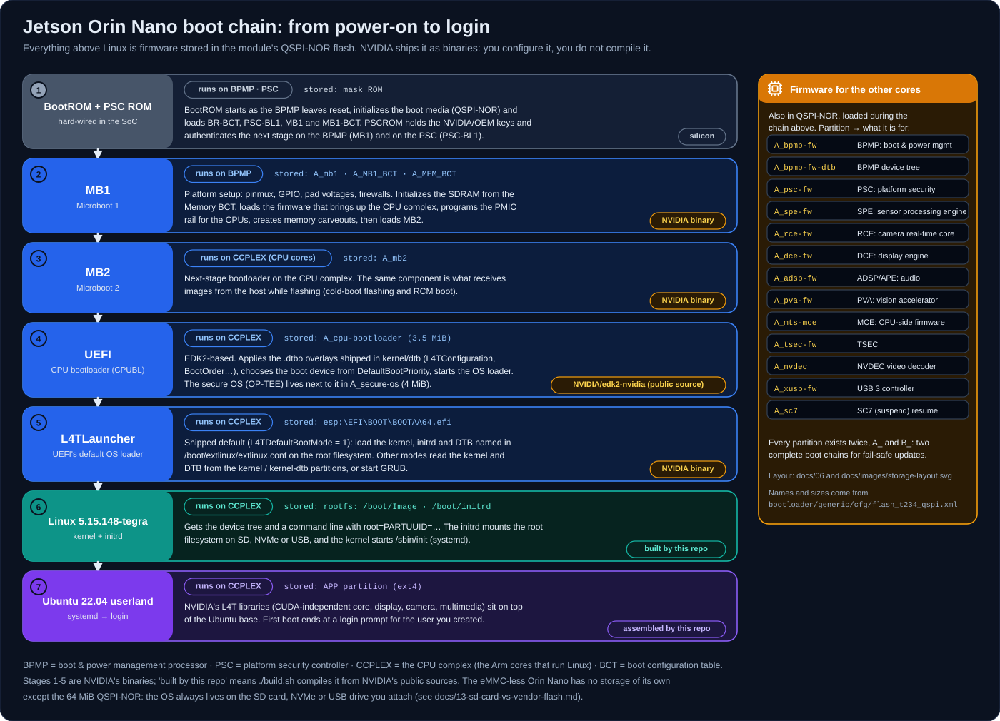

# 01 · Boot flow: from power-on to a login

[Docs](README.md) › **01 · Boot flow**

This chapter follows the Orin Nano from the moment power is applied until you see a login prompt.
Everything here comes from NVIDIA's Developer Guide (*Jetson Orin Series Boot Flow*, *UEFI*, *Partition
Configuration*) and from the files in the driver package; chapter [15](15-source-tour.md) shows where each fact lives.

## 1. The idea in one picture



Three things make this boot different from a typical SD-card board:

1. **The first stages live on the module, not on the storage you attach.** The BootROM reads a
   64 MiB **QSPI-NOR** flash soldered to the module. The SD card, NVMe drive or USB stick holds the OS only.
2. **Several small processors take part**, not just the Arm cores that will run Linux. The
   BootROM runs on the **BPMP**; MB1 also runs there. Only MB2 and later run on the CPU complex (**CCPLEX**).
3. **UEFI is the last firmware stage.** It is a standard EDK2-based UEFI, which then runs an OS loader
   (L4TLauncher) that reads a plain `extlinux.conf`.

## 2. The stages, one by one

| # | Stage | Runs on | Loaded from | What it does |
| --- | --- | --- | --- | --- |
| 1 | **BootROM** | BPMP | mask ROM | Starts as the BPMP leaves reset. Initializes the boot media (QSPI-NOR) and loads **BR-BCT, PSC-BL1, MB1 and MB1-BCT**, then halts |
| 1 | **PSC ROM** | PSC (platform security controller) | mask ROM | Holds the keys needed for NVIDIA and OEM authentication and decryption. Authenticates MB1 (on the BPMP) and PSC-BL1 (on the PSC) |
| 2 | **MB1** (Microboot 1) | BPMP | `A_mb1` + `A_MB1_BCT` + `A_MEM_BCT` | Pinmux, GPIO, pad voltages, firewalls. Initializes SDRAM from the Memory BCT. Loads the firmware that brings up the CPU complex, programs the PMIC rail for the CPUs, creates memory carveouts, loads MB2 |
| 3 | **MB2** (Microboot 2) | CCPLEX | `A_mb2` | The next-stage bootloader. It is also the stage that receives binaries from the host when flashing (cold-boot flashing, RCM boot) |
| 4 | **UEFI** (the CPU bootloader, CPUBL) | CCPLEX | `A_cpu-bootloader` (3.5 MiB) | Applies device-tree overlays (`L4TConfiguration`, `BootOrder*`), picks the boot device, runs the OS loader. The secure OS (OP-TEE) sits beside it in `A_secure-os` |
| 5 | **L4TLauncher** | CCPLEX | ESP: `\EFI\BOOT\BOOTAA64.efi` | UEFI's default OS loader. Chooses the kernel and device tree according to the *L4T boot mode* |
| 6 | **Linux** | CCPLEX | root device: `/boot/Image` + `/boot/initrd` | Mounts the root filesystem, starts `systemd` |
| 7 | **User space** | CCPLEX | root device: `APP` | Ubuntu 22.04 with NVIDIA's libraries |

Other processors get their firmware from the same flash while this runs (BPMP, PSC, SPE, RCE for the
camera, DCE for display, ADSP/APE for audio, PVA for vision …). They are the amber partitions in the
diagram and in [06](06-flash-package.md).

> **BPMP, PSC, CCPLEX.** BPMP is the *boot and power management processor*: a small controller that
> starts the chip and later manages clocks and power. PSC is the *platform security controller*.
> CCPLEX is NVIDIA's word for the CPU complex: the Arm cores Linux runs on.

## 3. Two copies of the boot firmware

Every firmware partition exists twice in QSPI-NOR, prefixed `A_` and `B_`. NVIDIA calls them **Slot A
and Slot B** and states that *bootloader redundancy is enabled by default*: the system boots one slot,
and a firmware update (a UEFI capsule) writes the other slot, so a failed update does not brick the board.
You can read the state from a running system:

```bash
sudo nvbootctrl dump-slots-info      # current slot, capsule update status
```

## 4. How UEFI chooses what to boot

### The boot device

UEFI keeps a variable, `DefaultBootPriority`. The file shipped in the driver package, `kernel/dtb/L4TConfiguration.dtbo`,
sets it to `usb,nvme,emmc,sd,ufs`. NVIDIA's UEFI chapter says the same in prose: removable devices
(SD, USB) are tried before non-removable ones (eMMC, NVMe). On a kit with a USB stick plugged in, the
USB stick is tried first. Check the file you actually built with: `dtc -I dtb -O dts kernel/dtb/L4TConfiguration.dtbo`.

That is why this repository passes a **boot-order overlay** when it generates the flash package:

| `ROOT_DEVICE` | Overlay (`ADDITIONAL_DTB_OVERLAY_OPT`) | Effect |
| --- | --- | --- |
| `nvme` | `BootOrderNvme.dtbo` | default boot device = `nvme` |
| `sd` | `BootOrderSD.dtbo` | default boot device = `sd` |
| `usb` | `BootOrderUsb.dtbo` | default boot device = `usb` |

`BootOrderNvme.dtbo` and `BootOrderUsb.dtbo` are documented in NVIDIA's `README_initrd_flash.txt`; the
SD one sits next to them in `kernel/dtb/` and has the same structure (you can decompile it, see [03](03-bootloader-and-firmware.md)).
Set `BOOT_ORDER_OVERLAY=none` in `config/local.conf` to keep NVIDIA's default order.

At runtime the order can be changed in the UEFI menu: press **ESC** when the screen says *Press ESCAPE for
boot options*, then *Boot Manager* or *Boot Options → Change Boot Order*.

### The boot mode

L4TLauncher's behaviour is the variable `L4TDefaultBootMode`:

| Value | Meaning |
| --- | --- |
| `00 00 00 00` | boot GRUB |
| `01 00 00 00` | boot the **kernel and DTB found in the root filesystem** |
| `02 00 00 00` | boot the kernel and DTB stored in the **partitions** (`A_kernel`, `A_kernel-dtb`) |
| `03 00 00 00` | boot the recovery kernel and DTB stored in partitions |

The shipped `L4TConfiguration.dtbo` sets mode **1**. In that mode L4TLauncher reads
`/boot/extlinux/extlinux.conf` from the root filesystem:

```text
TIMEOUT 30
DEFAULT primary

MENU TITLE L4T boot options

LABEL primary
      MENU LABEL primary kernel
      LINUX /boot/Image
      INITRD /boot/initrd
      APPEND ${cbootargs}
```

(This is `bootloader/extlinux.conf` from the driver package, copied into the rootfs by `apply_binaries.sh`.)
Two consequences you will use:

- Replacing `/boot/Image` on the root filesystem changes the kernel without reflashing anything
  ([08 §7](08-customizing.md)).
- An `FDT /boot/….dtb` line in that file selects another device tree.
  Without it, L4TLauncher picks the device tree by NVIDIA's selection rules (*DTB Support* in the UEFI chapter of the Developer Guide).

### The kernel command line

`${cbootargs}` is filled in by UEFI from the device tree and the flash tool. For the root device it
contains `root=PARTUUID=<uuid>` when the flash command ends in `internal` or `external`, which is what
this repository uses. A command line ending in a device name, such as `nvme0n1p1`, would produce
`root=/dev/nvme0n1p1` instead (`README_initrd_flash.txt` has the full table). The PARTUUID form survives device
renumbering, for example two NVMe drives.

## 5. Looking at the boot on a running board

```bash
cat /proc/device-tree/model        # which device tree booted
uname -r                           # 5.15.148-tegra, or your LOCALVERSION
cat /proc/cmdline                  # root=PARTUUID=…, console=…
sudo nvbootctrl dump-slots-info    # boot slot and capsule status (firmware)
lsblk -o NAME,SIZE,PARTLABEL,MOUNTPOINT
dmesg | less                       # kernel messages, including modules loading
```

On the host side, the flash tool keeps its logs in `build/work/Linux_for_Tegra/initrdlog/`.

## 6. What this repository builds, and what it does not

| Stage | Built here? |
| --- | --- |
| BootROM, PSC ROM | no: silicon |
| MB1, MB2, UEFI, L4TLauncher, BPMP/SPE/… firmware | **no**: NVIDIA's binaries from the driver package. You choose, configure and flash them |
| OP-TEE / TF-A secure OS image | no: binary `tos-optee_t234.img`; its sources are in `public_sources.tbz2` |
| Linux kernel, NVIDIA's out-of-tree modules, device trees | **yes** (`./build.sh kernel`) |
| Root filesystem | assembled from NVIDIA's pieces (`./build.sh rootfs`) |

NVIDIA publishes UEFI's source ([NVIDIA/edk2-nvidia](https://github.com/NVIDIA/edk2-nvidia)) and the OP-TEE
and TF-A sources, so a deeper build is possible; it is out of scope for first steps.

Next: [02 · Host setup](02-host-setup.md) · Prev: [Docs index](README.md)
