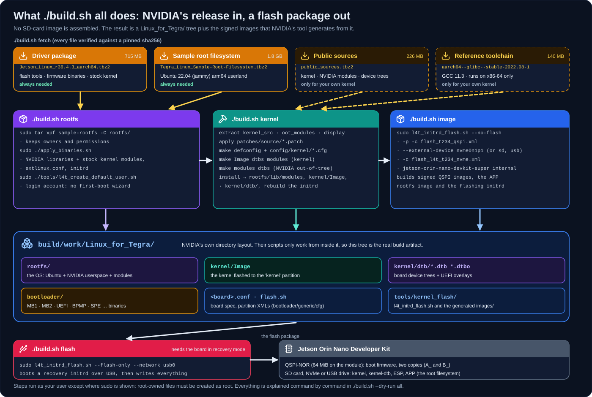

# 04 · The kernel, NVIDIA's modules and the device trees

[Docs](README.md) › **04 · Kernel**

`./build.sh kernel` follows NVIDIA's *Kernel Customization* procedure from the Developer Guide. A Jetson
kernel build has **four** products, not one, because NVIDIA keeps most of its drivers out of the kernel tree.



## 1. The four products

| Product | Source (inside `build/work/Linux_for_Tegra/source/`) | Built by | Installed to |
| --- | --- | --- | --- |
| **Kernel image** `Image` (Linux 5.15.148, local version `-tegra`) | `kernel/kernel-jammy-src/` | `make Image` | `kernel/Image` (flashed to the `kernel` partition) and `rootfs/boot/Image` |
| In-tree modules | same tree | `make modules` | `rootfs/lib/modules/5.15.148-tegra/` |
| **NVIDIA out-of-tree modules**: GPU (`nvgpu`), display (`nvdisplay`), camera and more (`nvidia-oot`), `hwpm`, `nvethernetrm` | `nvidia-oot/`, `nvgpu/`, `nvdisplay/`, `hwpm/`, `nvethernetrm/` | `make modules` in `source/` | `rootfs/lib/modules/…/updates/` |
| **Device trees** (`*.dtb`) for every Jetson | `hardware/nvidia/t23x/…`, built by `kernel-devicetree/` | `make dtbs` in `source/` | `kernel/dtb/` (flashed to `kernel-dtb`) |

Plus one chore: the **initrd** contains kernel modules, so `tools/l4t_update_initrd.sh` regenerates it after you
installed new ones.

## 2. The steps, in order

```bash
./build.sh kernel                 # extract + config + build + install
./build.sh kernel extract         # unpack the sources, apply patches/source/*.patch
./build.sh kernel config          # defconfig + your fragments
./build.sh kernel build           # compile all four products
./build.sh kernel install         # sudo: into rootfs/ and kernel/
./build.sh --dry-run kernel       # every command, with the reason
```

What each step runs (shortened; `--dry-run` prints the real command lines):

```bash
# extract
tar -xjf public_sources.tbz2 -C build/work                      # → Linux_for_Tegra/source/*.tbz2
cd build/work/Linux_for_Tegra/source
tar -xf kernel_src.tbz2 && tar -xf kernel_oot_modules_src.tbz2 && tar -xf nvidia_kernel_display_driver_source.tbz2
patch -p1 < patches/source/*.patch                              # yours, once each

# config
make -C kernel/kernel-jammy-src ARCH=arm64 CROSS_COMPILE=$TC/aarch64-buildroot-linux-gnu- LOCALVERSION=-tegra defconfig
scripts/kconfig/merge_config.sh -m …/.config config/kernel/*.cfg     # if you have fragments
make … olddefconfig

# build
make -C kernel/kernel-jammy-src … Image dtbs modules
KERNEL_HEADERS=$PWD/kernel/kernel-jammy-src make -C source modules      # NVIDIA's modules
KERNEL_HEADERS=$PWD/kernel/kernel-jammy-src make -C source dtbs

# install (sudo, because rootfs/ is root-owned)
INSTALL_MOD_PATH=…/rootfs/ make -C source/kernel install
INSTALL_MOD_PATH=…/rootfs/ INSTALL_MOD_DIR=updates make -C source modules_install
cp …/arch/arm64/boot/Image kernel/Image
cp kernel-devicetree/generic-dts/dtbs/* kernel/dtb/
./tools/l4t_update_initrd.sh
```

### Why not just `make -C kernel`?

NVIDIA's `source/kernel/Makefile` runs `defconfig`, then `Image`, `dtbs` and `modules`, in one target.
We run the same four `make` calls one by one, with the same `ARCH=arm64` and `LOCALVERSION=-tegra`, so that
your **config fragments are merged between `defconfig` and the compile**. If you have no fragments the result is
identical. (The real-time kernel, `generic_rt_build.sh enable`, is documented by NVIDIA and not wired in here.)

### What was verified

The `extract`, `config` and `build` steps were run to completion on Linux (an arm64 container with a native GCC 11 in place of
NVIDIA's x86-64 compiler, because the pinned compiler cannot run natively there). Results: `Image` of 42 MB whose release string is
`5.15.148-tegra`; 921 in-tree modules; 165 NVIDIA out-of-tree modules including `nvgpu.ko`, `nvhwpm.ko`, `nvidia.ko`,
`nvidia-modeset.ko`, `nvidia-drm.ko`, `tegra-camera.ko`; 85 device trees. The `install` step and the pinned compiler's full run are not verified: see the
[README status table](../README.md#what-has-been-verified).

### The toolchain

NVIDIA's reference compiler is Bootlin's `aarch64--glibc--stable-2022.08-1`, GCC 11.3. The compiler
prefix is `aarch64-buildroot-linux-gnu-`. It is x86-64 only, which is one more reason the build needs an
x86-64 host. `./build.sh` downloads it, verifies its sha256 and unpacks it into `build/toolchain/`; no
`apt` compiler is used.

## 3. Kernel configuration

The starting point is `arch/arm64/configs/defconfig` of NVIDIA's tree. Your changes go in fragments:

```bash
cp custom/examples/psi.cfg config/kernel/        # CONFIG_PSI=y: /proc/pressure/*
./build.sh kernel                                # the .config is regenerated when a fragment is newer
```

A fragment is a plain list, one `CONFIG_FOO=y` (or `=m`, or `# CONFIG_FOO is not set`) per line, applied by the kernel's own
`scripts/kconfig/merge_config.sh`, followed by `make olddefconfig`, which fills in symbols you did not mention.
**Check the result**: `grep CONFIG_PSI build/work/Linux_for_Tegra/source/kernel/kernel-jammy-src/.config`
(verified for this fragment: `CONFIG_PSI=y`).

For exploration use `./build.sh kernel-menuconfig` and save the *difference* as a fragment (the script prints the
`scripts/diffconfig` recipe).

> **Keep `LOCALVERSION` as `-tegra`.** Modules are found by the exact version string: the `Image`, the directory
> `/lib/modules/5.15.148-tegra/` and `uname -r` must agree. The scripts pass the same value to every `make`.

## 4. Device trees

The Orin Nano devkit device trees live in `hardware/nvidia/t23x/nv-public/nv-platform/` (and `staging/`):

| File | Role |
| --- | --- |
| `tegra234-p3768-0000+p3767-0005-nv.dts` | the P3768 carrier with the P3767-0005 module (the Orin Nano 8GB developer module) |
| `tegra234-p3768-0000+p3767-0005-nv-super.dts` | the same with the Super configuration: includes the `-nv` file and deletes the CPU operating point at 1510 MHz |
| `tegra234-p3768-0000+p3767-xxxx-nv-common.dtsi` | nodes shared by every module on the carrier |
| `tegra234-p3768-0000.dtsi`, `tegra234-p3767-0000.dtsi` | the **carrier** layer and the **module** layer |

The same layering idea as on every board: SoC → module → carrier → variant. `./build.sh kernel build` produces
**85** `.dtb` files (every Jetson that NVIDIA's tree knows); only the one named by the board file's `DTB_FILE` is
flashed for your board (`tegra234-p3768-0000+p3767-0005-nv-super.dtb` for the default configuration).

See your change take effect without a board:

```bash
dtc -I dtb -O dts build/work/Linux_for_Tegra/source/kernel-devicetree/generic-dts/dtbs/tegra234-p3768-0000+p3767-0005-nv-super.dtb | less
```

On the running board the same tree is `/proc/device-tree` (and `dtc -I fs /proc/device-tree`).

### A worked example: a one-line device tree change

`custom/examples/0001-dts-add-primer-build-property.patch` adds one property at the root of the shared
dtsi:

```diff
 / {
+	/* embedded-linux-primer example: shows up as /proc/device-tree/primer,build */
+	primer,build = "custom-dts-example";
+
 	aliases {
```

```bash
cp custom/examples/0001-dts-add-primer-build-property.patch patches/source/
./build.sh kernel          # applies it once, rebuilds the device trees
```

Verified for this repository: the patch applies cleanly to R36.4.3, `make dtbs` rebuilds the 85 trees, and
`dtc` shows `primer,build = "custom-dts-example"` in `tegra234-p3768-0000+p3767-0005-nv-super.dtb`. After
flashing, `cat /proc/device-tree/primer,build` answers on the board. That is the proof your device tree booted.

## 5. Patches

`patches/source/*.patch` are applied **once each, in name order, with `patch -p1` from
`Linux_for_Tegra/source/`**, so one patch can touch the kernel (`kernel/kernel-jammy-src/…`), NVIDIA's modules
(`nvidia-oot/…`) and device trees (`hardware/nvidia/…`). The applied names are remembered in
`source/.applied-patches`. To drop a patch, delete it and run `./build.sh -u kernel` (unpacks the sources again).

Make a patch from your edits with `diff -u` against a pristine copy, or `git`:

```bash
cd build/work/Linux_for_Tegra/source
git init -q && git add -A . && git commit -qm base          # in a scratch copy, not in your repository
# …edit files…
git diff > ~/my.patch                                        # then copy it to patches/source/0003-my-change.patch
```

## 6. Where the results go

After `./build.sh kernel`:

| File | What |
| --- | --- |
| `build/work/Linux_for_Tegra/kernel/Image` | the kernel the tool flashes into the `kernel` partitions |
| `build/work/Linux_for_Tegra/kernel/dtb/*.dtb` | device trees (and the `*.dtbo` overlays that came with the package) |
| `build/work/Linux_for_Tegra/rootfs/boot/Image` | the kernel UEFI loads in the default boot mode |
| `build/work/Linux_for_Tegra/rootfs/lib/modules/5.15.148-tegra/` | in-tree modules, with NVIDIA's in `updates/` |

Next: [05 · Root filesystem](05-rootfs.md) · Prev: [03 · Boot firmware](03-bootloader-and-firmware.md)
