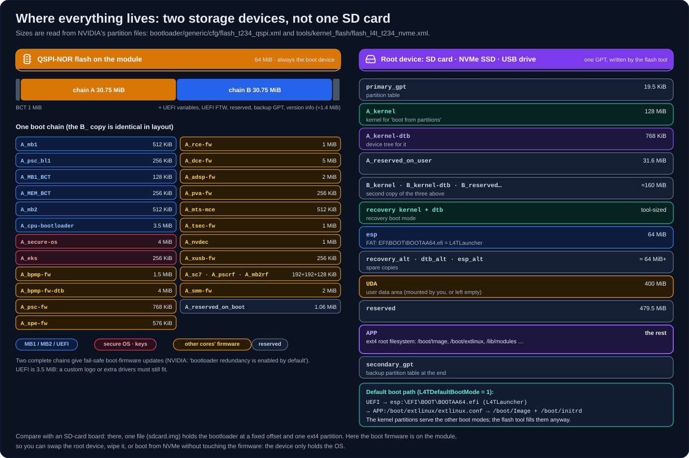

# 06 · The flash package (the Jetson's "image")

[Docs](README.md) › **06 · Flash package**

The SD-card boards end with a single file. The Jetson ends with a **flash package**: signed partition images plus
the initrd that will write them, generated by NVIDIA's tool from the `Linux_for_Tegra` tree. This chapter says what is in it and
how the partition layouts, which are *files you can read*, drive everything.

## 1. Two devices, two layouts



| Device | Layout file (relative to `Linux_for_Tegra/`) | What is written |
| --- | --- | --- |
| **QSPI-NOR** on the module (64 MiB = 131072 sectors of 512 B) | `bootloader/generic/cfg/flash_t234_qspi.xml` | `BCT`, two boot chains (`A_*` and `B_*`, 30.75 MiB each), UEFI variables, backup GPT and version blocks |
| **Root device**: microSD, NVMe or USB drive | `tools/kernel_flash/flash_l4t_t234_nvme.xml` | a GPT with `A_kernel`, `A_kernel-dtb`, `B_…`, recovery partitions, `esp`, `UDA`, `APP` |

`-p "-c bootloader/generic/cfg/flash_t234_qspi.xml"` tells the tool to flash the QSPI layout too (NVIDIA's Quick Start
for the Orin Nano uses exactly this). `--external-device nvme0n1p1 -c tools/kernel_flash/flash_l4t_t234_nvme.xml` gives
the layout and name of the root device. The *same* XML is documented for SD cards and USB drives (device `type` is
`nvme` for all external devices).

### Reading a layout file

Each `<partition>` has a name, a type, a size and optionally a file:

```xml
<partition name="A_cpu-bootloader" type="bootloader_stage2">
    <size> 3670016 </size>          <!-- 3.5 MiB: UEFI must fit -->
    <filename> TBCDTB-FILE </filename>
```

Words like `TBCDTB-FILE`, `APPSIZE` or `LNXFILE` are **keywords**. NVIDIA's `flash.sh` replaces them with values from the
board `.conf` and the command line, writes the translated result to `bootloader/flash.xml`, and `tegraflash.py` writes the
device from that (*Partition Configuration* in the Developer Guide).

| Keyword | Comes from |
| --- | --- |
| `TBCDTB-FILE` | UEFI: `TBCFILE` / `UEFIBL` in `p3767.conf.common` (`bootloader/uefi_jetson.bin` and its variants) |
| `MB1FILE` · `MB2BLFILE` · `BPFFILE` · `SPEFILE` · … | the same file: one variable per firmware |
| `LNXFILE` | `kernel/Image` |
| `DTB_FILE` | the board `.conf`: `tegra234-p3768-0000+p3767-0005-nv-super.dtb` |
| `APPFILE` · `APPSIZE` | the generated root filesystem image · `ROOTFSSIZE` (55GiB) or your `-S` |
| `EXT_NUM_SECTORS` | the external device's size (the tool does not discover it: the XML must be right) |

## 2. What `./build.sh image` runs

```bash
cd build/work/Linux_for_Tegra
sudo env ADDITIONAL_DTB_OVERLAY_OPT=BootOrderNvme.dtbo \
  ./tools/kernel_flash/l4t_initrd_flash.sh --no-flash \
  --external-device nvme0n1p1 -c tools/kernel_flash/flash_l4t_t234_nvme.xml \
  -p '-c bootloader/generic/cfg/flash_t234_qspi.xml' --network usb0 \
  jetson-orin-nano-devkit-super internal
```

Read it from the end: **`internal`** is the "root device" argument; with an external device it makes the tool put
`root=PARTUUID=…` on the kernel command line. **`jetson-orin-nano-devkit-super`** is the board file. `--network usb0` says the
flash will use the Ethernet-over-USB link. `--no-flash` is the important flag: *build everything and stop*.

What the tool then does (from `l4t_initrd_flash.sh`, `l4t_initrd_flash_internal.sh` and
`l4t_create_images_for_kernel_flash.sh`):

1. calls `flash.sh` to build, **sign** and place the QSPI images and the root-device images (the root filesystem becomes the `APP` image);
2. writes an *index* of every partition image: `tools/kernel_flash/images/internal/flash.idx` (QSPI) and
   `tools/kernel_flash/images/external/flash.idx` (the root device) (NVIDIA's README, *Flash individual partitions*);
3. builds the **flashing initrd** in `temp_initrdflash/`, with the settings (`initrd_flash.cfg`, `board_spec.txt`) and the flashing script
   `l4t_flash_from_kernel.sh` baked in;
4. saves the exact flash parameters in `tools/kernel_flash/initrdflashparam.txt`, which is what `--flash-only` later reads.

Everything stays inside `build/work/Linux_for_Tegra/`; `build/deploy/FLASH.txt` records the commands.

## 3. Online versus offline

The tool needs to know which module it builds for (SKU, FAB, board ID). Two ways:

| Mode | When | How |
| --- | --- | --- |
| **Online** | the board is in recovery mode, connected | the tool reads the module's identity through the USB link |
| **Offline** | no board connected, or `./build.sh image --offline` | you give the identity as environment variables: `BOARDID=3767 BOARDSKU=0005 FAB=300` |

The defaults in `config/jetson-orin-nano.conf` are the **Orin Nano 8GB (P3767-0005)** row of the table at the end of
`README_initrd_flash.txt`. Other rows of that table:

| Module | BOARDID | BOARDSKU | FAB |
| --- | --- | --- | --- |
| Orin NX 16GB | 3767 | 0000 | 300 |
| Orin NX 8GB | 3767 | 0001 | 300 |
| Orin Nano 4GB | 3767 | 0004 | 300 |
| Orin Nano 8GB | 3767 | 0003 | 300 |
| Orin Nano 8GB (development module) | 3767 | 0005 | 300 |

Set `OFFLINE_BOARDSKU=0003` (and so on) in `config/local.conf` for another module. If you flash with the board connected, you
do not need any of this.

## 4. Why not a single file?

Three reasons, all visible above:

- **Two devices.** Part of the system lives on the module's flash and part on a drive that you can swap.
- **Signing and identity.** NVIDIA's tool signs and assembles the boot images for one module identity (SKU, FAB, board ID),
  so a package is specific to the board family it was generated for.
- **A helper OS.** The tool needs the initrd on the board in order to write at all. That is why "the image" includes a
  flashing environment, not only data.

If you do need one artifact to archive: NVIDIA's README documents `--massflash <n>` (a tarball `mfi_<board>.tar.gz` to flash many units from another PC)
and the *backup / restore* workflow. Both are beyond first steps.

## 5. Sizes

| Item | Size |
| --- | --- |
| `build/downloads/` | 2.6 GB (+370 MB for your own kernel) |
| unpacked rootfs after `apply_binaries.sh` | several GB |
| generated images for the root device | the `APP` image plus 128 MiB kernel partitions (×2), 64 MiB ESP, 400 MiB UDA |
| the flash package as a whole | several GB: `du -sh build/work/Linux_for_Tegra/tools/kernel_flash/images` after `image` |

Next: [07 · Flashing & first boot](07-flashing-and-booting.md) · Prev: [05 · Root filesystem](05-rootfs.md)
