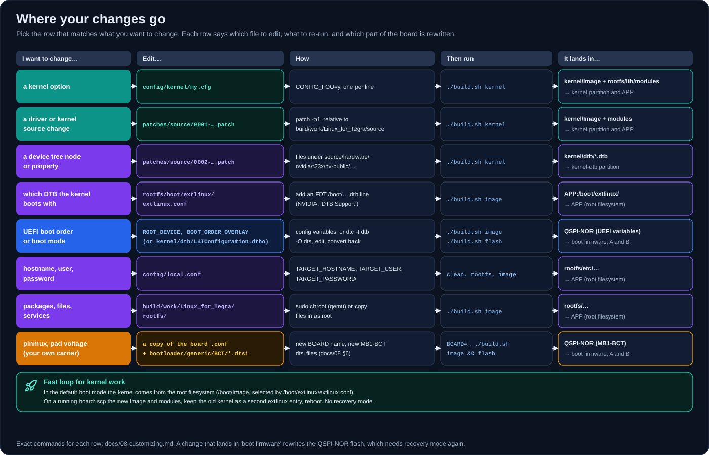

# 08 · Customizing

[Docs](README.md) › **08 · Customizing**



Start from the row that matches your change. Items marked **verified** were run for this repository on Linux (see the status
table in the [README](../README.md)); the rest follow NVIDIA's documented procedure.

## 1. A kernel configuration option

```bash
cat > config/kernel/my.cfg <<'EOF'
CONFIG_PSI=y
EOF
./build.sh kernel          # .config is regenerated because the fragment is newer
./build.sh image && ./build.sh flash
```

**Verified:** `custom/examples/psi.cfg` merged into NVIDIA's `defconfig` gives `CONFIG_PSI=y` in `.config`.
For an interactive search use `./build.sh kernel-menuconfig`, then turn the difference into a fragment
(`scripts/diffconfig` in the kernel tree compares two `.config` files).

## 2. A driver or kernel source change

Make a patch relative to `Linux_for_Tegra/source/` and put it in `patches/source/`:

```bash
cp ~/0001-my-driver-fix.patch patches/source/
./build.sh kernel          # applies new patches once (they are remembered), then rebuilds what changed
```

Patch paths look like `kernel/kernel-jammy-src/drivers/…` (kernel), `nvidia-oot/drivers/…` (NVIDIA's modules).
Order is the file-name order, so prefix numbers. A patch that no longer applies stops the build with the failing hunk.

## 3. A device tree change

**Verified** with the shipped example:

```bash
cp custom/examples/0001-dts-add-primer-build-property.patch patches/source/
./build.sh kernel
# on the board after flashing:
cat /proc/device-tree/primer,build        # custom-dts-example
```

Where the Orin Nano files are: [04 §4](04-kernel.md#4-device-trees). Common edits are enabling a node
(`status = "okay";`), changing a property, or adding an I²C device under the right bus node. Check the dtb builds without a board:
`dtc -I dtb -O dts …/kernel-devicetree/generic-dts/dtbs/tegra234-p3768-0000+p3767-0005-nv-super.dtb | less`.

For the **header pins** (40-pin expansion header: I²C, SPI, UART, PWM), NVIDIA ships a configuration tool,
`jetson-io` (the package `nvidia-l4t-jetson-io`, installed by `apply_binaries.sh`), which writes a device-tree overlay on a
running board: `sudo /opt/nvidia/jetson-io/jetson-io.py`. That is the simpler path for header functions; a patch is for everything else.

## 4. Which device tree the kernel boots with

In the default boot mode L4TLauncher reads `/boot/extlinux/extlinux.conf` from the root filesystem. Add a line to the entry
(NVIDIA's *UEFI* chapter, *DTB Support*):

```text
LABEL primary
      MENU LABEL primary kernel
      LINUX /boot/Image
      FDT /boot/dtb/my-board.dtb
      INITRD /boot/initrd
      APPEND ${cbootargs}
```

Put the file in `build/work/Linux_for_Tegra/rootfs/boot/dtb/` and re-run `./build.sh image` (or copy both to a running board).
Without `FDT`, UEFI selects the device tree itself.

## 5. UEFI behaviour: boot order and mode

- **Which device first:** `ROOT_DEVICE` and `BOOT_ORDER_OVERLAY` in `config/local.conf` (see [01 §4](01-boot-flow.md)).
- **Boot mode** (filesystem / partitions / recovery / GRUB): NVIDIA's procedure is to decompile
  `kernel/dtb/L4TConfiguration.dtbo` with `kernel/dtc -I dtb -O dts`, change `L4TDefaultBootMode`, compile back with
  `-I dts -O dtb`, and flash again. This is stored in QSPI, so it needs `./build.sh image` and a flash.

## 6. A different carrier board (your own hardware)

This is where the vendor-flash model asks for real work. The module's **pinmux, pad voltages, GPIO and PMIC settings are
in the boot configuration tables**, so a carrier that wires things differently from NVIDIA's P3768 needs its own
set of BCT files and its own board configuration:

1. Copy `jetson-orin-nano-devkit-super.conf` (from `build/work/Linux_for_Tegra/`) to `custom/boards/my-carrier.conf`. Files in
   `custom/boards/` are copied next to NVIDIA's before `./build.sh image`; files in `custom/BCT/` go to `bootloader/generic/BCT/`.
2. Point its `PINMUX_CONFIG` (pinmux) and `PMC_CONFIG` (pad voltage) variables at your own copies (in `custom/BCT/`) of
   `bootloader/generic/BCT/tegra234-mb1-bct-pinmux-p3767-dp-a03.dtsi` and `…-padvoltage-p3767-dp-a03.dtsi` (the names the
   shipped board file uses). NVIDIA's Developer Guide chapter *Bootloader → Pinmux and GPIO configuration* describes the
   spreadsheet-based flow that generates them.
3. Create the kernel device tree for the carrier: start from `tegra234-p3768-0000+p3767-xxxx-nv-common.dtsi`, in a patch that adds
   your `.dts` to `kernel-devicetree`'s build, and set `DTB_FILE` in your `.conf`.
4. `BOARD=my-carrier ./build.sh image && BOARD=my-carrier ./build.sh flash`.

Keep the variables and file list of the board `.conf` as NVIDIA ships them; add, do not remove. The board
specification is plain shell, readable top to bottom ([03 §2](03-bootloader-and-firmware.md)). This route follows NVIDIA's
module-adaptation chapters and is **not verified end to end here**.

## 7. Fast kernel loop on a running board

Because the default boot mode loads `/boot/Image` from the root filesystem, you can iterate on the kernel without recovery mode.
NVIDIA's own `extlinux.conf` has the recipe in its comments; as a script:

```bash
# on the PC, after ./build.sh kernel (use `build` + `install` as needed)
cd build/work/Linux_for_Tegra
scp rootfs/boot/Image jetson@<board>:/tmp/Image
sudo tar -C rootfs -cf - lib/modules/5.15.148-tegra | ssh jetson@<board> 'sudo tar -C / -xf -'

# on the board
sudo cp /boot/Image /boot/Image.backup       # once
sudo cp /tmp/Image /boot/Image
# add a backup entry to /boot/extlinux/extlinux.conf:
#   LABEL backup
#      MENU LABEL backup kernel
#      LINUX /boot/Image.backup
#      INITRD /boot/initrd
#      APPEND ${cbootargs}
sudo reboot                                   # pick 'backup kernel' in the extlinux menu if the new one fails
```

If you changed modules that the **initrd** needs (storage, filesystem), regenerate it on the board with `sudo nv-update-initrd`
(NVIDIA's note under *Building the NVIDIA out-of-tree modules*). A change that only affects the kernel image needs no initrd.
Anything in the **kernel partitions** (`A_kernel`, `A_kernel-dtb`) is only used when the boot mode is *partitions* ([01 §4](01-boot-flow.md)).

## 8. Changing users, hostname, packages

[05 §3-4](05-rootfs.md). Remember `./build.sh image` has to run again to write the `APP` image, and the whole root device is rewritten by `flash`.

## 9. Keeping your changes in git

`config/kernel/*.cfg`, `patches/source/*.patch`, `config/local.conf` (not committed: it holds your overrides and password), and
any files you generate from `custom/`. Everything under `build/` is disposable.

Next: [09 · Troubleshooting](09-troubleshooting.md) · Prev: [07 · Flashing & first boot](07-flashing-and-booting.md)
