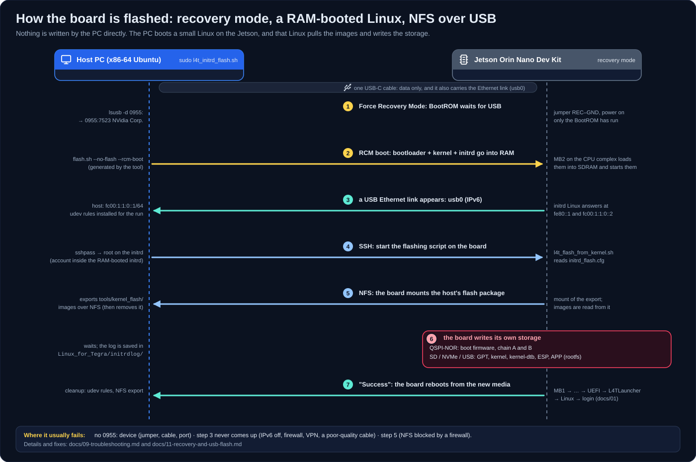

# 11 · Recovery mode and the USB flash, step by step

[Docs](README.md) › **11 · Recovery mode & USB flash**



This is the chapter to read when `./build.sh flash` stops, or when you want to know *why* a Jetson needs a jumper, a cable and
an NFS server to receive an operating system. Facts are from NVIDIA's *Quick Start*, *Flashing Support* and from reading
`l4t_initrd_flash.sh`, `l4t_initrd_flash_internal.sh` and `l4t_network_flash.func` of R36.4.3.

## 1. Why recovery mode exists

The module's **BootROM** is part of the chip and cannot be damaged by software. Normally it loads MB1 from the QSPI-NOR flash. If
the **recovery strap** is active at power-up, it instead **waits on USB** and identifies itself to the PC as an NVIDIA device
(vendor ID `0955`). From that state the PC can load code into RAM and run it, whatever the flash contains, even if it is
empty or damaged. That is the entire basis of flashing and of recovering a bricked board.

On the Orin Nano Developer Kit the strap is a jumper on the **12-pin button header**, between **REC** (force recovery) and
**GND**. NVIDIA's procedure: disconnect power, fit the jumper, connect USB-C to the PC, reconnect power.

### Which module are you? (`lsusb -d 0955:`)

| USB ID | Module |
| --- | --- |
| `0955:7523` | Jetson Orin Nano 8GB (P3767-0003 and P3767-0005, the developer-kit module) |
| `0955:7623` | Jetson Orin Nano 4GB (P3767-0004) |
| `0955:7323` · `0955:7423` | Jetson Orin NX 16GB (P3767-0000) · 8GB (P3767-0001) |
| `0955:7023` · `0955:7223` | Jetson AGX Orin (not covered by this repository) |
| `0955:7035` | the board **after** step 3 below: the initrd's USB Ethernet gadget (not an error) |

`./build.sh flash --check` runs this test with the IDs in `RECOVERY_USB_IDS`.

## 2. The protocol, step by step

All commands below are what `l4t_initrd_flash.sh` runs for you; the numbers match the diagram.

### Step 1: generate the package (host, no board needed)

If you ran `./build.sh image`, this is done. Otherwise the tool runs it first. See [06](06-flash-package.md).
It also writes the flashing parameters to `tools/kernel_flash/initrdflashparam.txt`.

### Step 2: RCM boot: load a Linux into RAM over USB

The tool builds a *flashing environment* (`temp_initrdflash/`) containing the bootloader binaries, a kernel, and an **initrd**
that holds `initrd_flash.cfg` (what to write and to which device) and the flashing script. It then
runs `flash.sh --no-flash --rcm-boot jetson-orin-nano-devkit-super mmcblk0p1` to generate the *tegraflash* command that
transfers them. In **RCM** (recovery mode) boot, MB2 on the CPU complex receives the binaries from the host and loads them
into SDRAM; the board then runs a small Linux entirely from RAM.

### Step 3: a USB Ethernet link appears

The recovery Linux exposes the USB cable as a network device (`usb0` on the board; on the PC an interface that NVIDIA's
`udev` rule marks as unmanaged by NetworkManager). Addresses used, per device instance 0:

```text
PC:      fc00:1:1:0::1/64          (the tool adds it with `ip a add`)
board:   fc00:1:1:0::2   and   fe80::1 (link-local)
```

This is why IPv6 must be enabled and why NVIDIA's README requires that *your firewall and network settings allow SSH to the Jetson
target and NFS requests from it*.

### Step 4: SSH starts the flash

The tool waits until `ping6 fe80::1%<interface>` answers, then connects with `sshpass` as `root` to the recovery
Linux (an account that exists only inside the RAM-booted initrd) and starts `l4t_flash_from_kernel.sh` on the board.

### Step 5: NFS delivers the images

The PC adds temporary entries to `/etc/exports` (marked `# Entry added by NVIDIA initrd flash tool`) that export the rootfs
and `tools/kernel_flash/images/`, and runs `exportfs -ra`. The board mounts them. When the tool exits it removes the entries again.

### Step 6: the board writes its own storage

`l4t_flash_from_kernel.sh` reads `initrd_flash.cfg` and writes:

- the **QSPI-NOR** flash: the images listed under `images/internal/` (index `flash.idx`, device `3:0`), and
- the **external device** (`external_device=/dev/nvme0n1`, `…/mmcblk0`, `/dev/sda`): partition table first, then each partition from
  `images/external/`, then the `APP` filesystem, which it formats and fills.

The progress log is on the PC: `build/work/Linux_for_Tegra/initrdlog/flash_<usb-path>_<instance>_<time>.log`.

### Step 7: done

`Success`. The tool removes the udev rules and the NFS export, restores the USB autosuspend setting it turned off
(`/sys/module/usbcore/parameters/autosuspend` is set to `-1` while flashing), and the board reboots into the new system.

## 3. Variations worth knowing

| Want | NVIDIA's option |
| --- | --- |
| Generate now, flash later | `--no-flash`, then `--flash-only` (what `image` and `flash` do) |
| Write one partition only | `-k <partition label>` (index file, *Workflow 9* in the README) |
| Skip the QSPI firmware, write only the root device | `--external-only` |
| Use the board's Ethernet jack instead of USB | `--network eth0:<target-ip>/<subnet>:<host-ip>` |
| Boot the recovery initrd and log in to look around | `--initrd` (prints `ssh root@fe80::1%<interface>`) |
| Flash many identical boards | `--massflash <n>` (README *Workflow 7/8*) |
| Run the tool inside Docker | NVIDIA's tool detects it and tells you which directories to export from the host |

These are documented in `Linux_for_Tegra/tools/kernel_flash/README_initrd_flash.txt`. `./build.sh` wraps only the common path.

## 4. Why it fails, and where to look

| Step | Typical failure | Look at |
| --- | --- | --- |
| 1 | no `0955:` device | jumper, cable, port |
| 2 | stalls after the RCM transfer | `lsusb` shows the device vanish: cable quality, hub, VM passthrough |
| 3 | no `usb0` / IPv6 off | `ip -6 addr`, `sysctl net.ipv6.conf.all.disable_ipv6` |
| 4 | `host cannot connect to its ssh server` | firewall/VPN; `ping6 -c1 fe80::1%<iface>` |
| 5 | board cannot mount | `nfs-kernel-server` running? `sudo exportfs -v`; firewall |
| 6 | `APPSIZE might be too small`, device errors | drive too small or failing; try another drive |

More in [09 · Troubleshooting](09-troubleshooting.md). The serial log of the board during step 2-6 is the most informative
source if you have a serial adapter (kernel console `ttyTCU0`, 115200).

## 5. Leaving recovery mode

Remove the jumper and power-cycle. The BootROM then loads MB1 from QSPI-NOR as described in [01](01-boot-flow.md).

Next: [12 · Board tour](12-board-tour.md) · Prev: [10 · Versions](10-versions.md)
