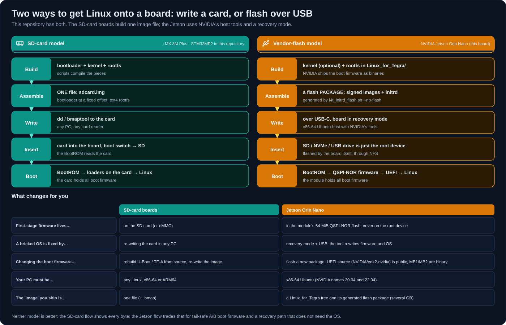

# 13 · SD-card image versus vendor flash

[Docs](README.md) › **13 · Two flashing models**

If you built the i.MX 8M Plus or STM32MP2 board of this repository first, the Jetson will feel backwards. This chapter lines the two
models up and says why NVIDIA's looks the way it does.

## 1. Same job, different division of labour

| Question | SD-card boards (this repository) | Jetson Orin Nano |
| --- | --- | --- |
| What does the build produce? | `build/deploy/sdcard.img` | a `Linux_for_Tegra/` tree and a **flash package** generated from it |
| Where is the first-stage firmware? | on the card (or eMMC), at a fixed offset or in named partitions | in the module's **QSPI-NOR** flash, outside any drive you attach |
| What does the BootROM read? | the SD card selected by the boot-mode switch | QSPI-NOR, always. Recovery mode only when the strap is set |
| Who builds the bootloader? | **you**, from source (U-Boot, TF-A, …), pinned commits | **NVIDIA** ships MB1/MB2/UEFI as binaries; UEFI source is public |
| How is it written? | `dd`/`bmaptool` on any PC | NVIDIA's `l4t_initrd_flash.sh` on an x86-64 Ubuntu PC, over USB-C |
| What if the OS is broken? | re-write the card | recovery mode: rewrite firmware and OS from the PC |
| Bootloader updates in the field | rebuild and re-flash | two firmware slots (A/B) and UEFI capsule updates |
| Root of trust | boot-ROM features per SoC (see each board's chapters) | NVIDIA's secure boot chain: fuses, signed binaries (see [03 §7](03-bootloader-and-firmware.md)) |
| The "image" you archive | one file | a tree plus several GB of generated images |

## 2. What you *can* do the same way

- **The documented command line is the same**: `./build.sh deps · info · all · flash · clean`, with `--dry-run` to read first.
- **Everything is pinned and verified**: hashes for downloads; here they stand in for the pinned git commits.
- **Config in one file**, overrides in `config/local.conf`.
- **Your changes live outside `build/`**: kernel fragments, patches, device trees.
- **The boot chain is the diagram you read first** ([01](01-boot-flow.md)).

## 3. What you cannot do the same way

- **Read every line of the bootloader.** MB1 and MB2 are binary. The board-specific parts are in the BCTs and the board `.conf`,
  which you can read ([03](03-bootloader-and-firmware.md)). UEFI you can read and rebuild (NVIDIA/edk2-nvidia).
- **Build and flash on any PC.** x86-64 Ubuntu only.
- **Write the OS without the board.** The flash tool needs the module in recovery mode (or you generate the package offline, and flash later).
- **Boot a card you prepared elsewhere**, without the firmware: the root device must belong to a Jetson that already has compatible firmware
  in QSPI. (NVIDIA also publishes ready-made SD card images for the Orin Nano dev kit; they work because the QSPI firmware must already be recent enough. That is outside this repository.)

## 4. Why NVIDIA does it this way

> Our reading of the design, not an NVIDIA statement. The facts behind it are in NVIDIA's Boot Flow and Partition Configuration chapters.

The Jetson modules ship **without** eMMC (Orin Nano and NX), because the product is meant to sit on *your* carrier with *your*
storage. If the firmware lived on that storage, every storage choice would need its own firmware image, and a wiped drive would leave
the module unrecoverable. Putting the firmware on a small flash on the module, and offering a ROM-level recovery path that works
over USB, gives:

- **one firmware, many storage choices** (SD, NVMe, USB; the AGX Orin has eMMC and uses the same tools);
- **a recovery path that does not depend on any storage**;
- **A/B firmware slots**: a failed update leaves the other slot bootable;
- **a signed chain** that starts in the chip (PSC ROM, BootROM) and ends at the OS loader.

The cost is the heavier tooling, the x86-64-only host and the fact that "write a card" is not enough.

## 5. A way to think about it

On an SD-card board **the card is the board's disk and its firmware**. On the Jetson **the module is the computer, the drive is its
disk**, and the flash tool is the only thing that is allowed to change the computer's firmware. Everything in
`./build.sh` follows from that.

Next: [14 · Acronyms](14-acronyms.md) · Prev: [12 · Board tour](12-board-tour.md)
