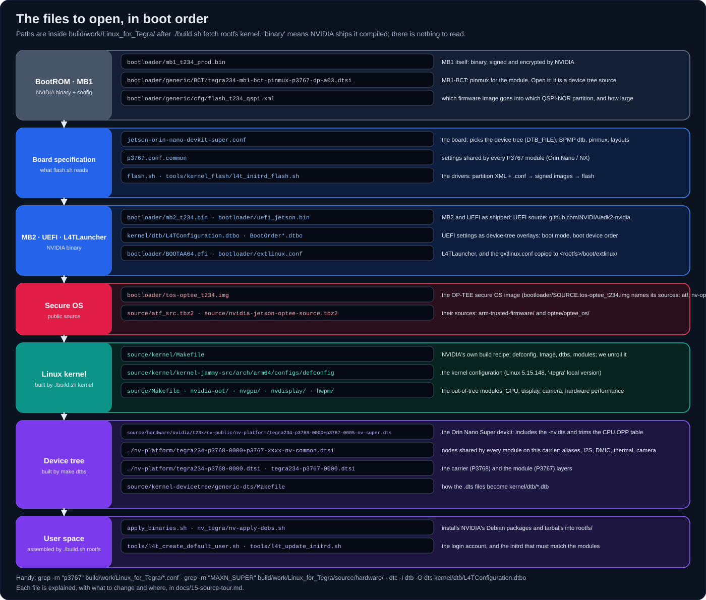

# 15 · Source tour: the files that decide the boot

[Docs](README.md) › **15 · Source tour**



Paths are relative to `build/work/Linux_for_Tegra/` unless they start with `source/`. Excerpts are copied from the R36.4.3 files and
shortened; open the originals to see the rest.

## 1. The board specification: `jetson-orin-nano-devkit-super.conf`

```bash
source "${LDK_DIR}/p3768-0000-p3767-0000-a0.conf";
p3767_super_overlay()
{
	if [ "${board_sku}" = "0000" ] || [ "${board_sku}" = "0002" ]; then
		…
		BPFDTB_FILE="tegra234-bpmp-3767-0000-3768-super.dtb";
		DTB_FILE="tegra234-p3768-0000+p3767-0000-nv-super.dtb";
	elif …
	elif [ "${board_sku}" = "0005" ]; then
		BPFDTB_FILE="tegra234-bpmp-3767-0003-3768-super.dtb";
		DTB_FILE="tegra234-p3768-0000+p3767-0005-nv-super.dtb";
	…
	TBCDTB_FILE="${DTB_FILE}";
}
update_flash_args() { update_flash_args_common; p3767_super_overlay; }
```

`board_sku` is read from the module's EEPROM, online, or comes from `BOARDSKU` in offline mode ([06 §3](06-flash-package.md)). One conf file
therefore covers several modules. Read the same file for the standard configuration (`jetson-orin-nano-devkit.conf` →
`p3768-0000-p3767-0000-a0.conf` → `p3767.conf.common`) and compare.

## 2. The common module settings: `p3767.conf.common`

```bash
OVERLAY_DTB_FILE="L4TConfiguration.dtbo,tegra234-carveouts.dtbo,tegra-optee.dtbo";
CMDLINE_ADD="mminit_loglevel=4 console=ttyTCU0,115200 firmware_class.path=/etc/firmware fbcon=map:0 nospectre_bhb video=efifb:off console=tty0"
ROOTFSSIZE=55GiB;
TEGRABOOT="bootloader/mb2_t234.bin";
TBCFILE="bootloader/uefi_jetson.bin";
MB1FILE="bootloader/mb1_t234_prod.bin";
BPFFILE="bootloader/bpmp_t234-TE980M-A1_prod.bin";
PINMUX_CONFIG / PMC_CONFIG …                      # in the carrier file p3768-0000-p3767-0000-a0.conf
```

This is the place where a **partition becomes a file**: each keyword in the XML maps to one of these variables.

## 3. The partition layout: `bootloader/generic/cfg/flash_t234_qspi.xml`

```xml
<device type="spi" instance="0" sector_size="512" num_sectors="131072">
  <partition name="BCT" type="boot_config_table"> <size> 1048576 </size> …
  <partition name="A_mb1" type="mb1_bootloader"> <size> 524288 </size> <filename> MB1FILE </filename>
  …
  <partition name="A_cpu-bootloader" type="bootloader_stage2"> <size> 3670016 </size> <filename> TBCDTB-FILE </filename>
  <partition name="A_secure-os" type="tos"> <size> 4194304 </size> <filename> TOSFILE </filename>
```

131072 × 512 B = 64 MiB. Change a size here and the next firmware image must fit; NVIDIA warns that UEFI is limited to the
3.5 MiB of its partition.

## 4. UEFI's settings: `kernel/dtb/L4TConfiguration.dtbo`

Decompile with `dtc -I dtb -O dts` (or `kernel/dtc`):

```dts
gNVIDIAPublicVariableGuid {
	L4TDefaultBootMode { data = <0x1000000>; runtime; non-volatile; };   /* 01 00 00 00: kernel+DTB in the filesystem */
	RootfsRetryCountMax { data = <0x3000000>; runtime; locked; };         /* 3 */
};
gNVIDIATokenSpaceGuid {
	DefaultBootPriority { data = "usb,nvme,emmc,sd,ufs"; locked; };
};
```

## 5. The OS loader's menu: `bootloader/extlinux.conf`

```text
LABEL primary
      MENU LABEL primary kernel
      LINUX /boot/Image
      INITRD /boot/initrd
      APPEND ${cbootargs}
```

## 6. The kernel build recipe: `source/kernel/Makefile`

```make
kernel:
	$(MAKE) ARCH=arm64 -C $(kernel_source_dir) $(O_OPT) LOCALVERSION=$(version) $(KERNEL_DEF_CONFIG)
	$(MAKE) -j $(NPROC) ARCH=arm64 -C $(kernel_source_dir) $(O_OPT) LOCALVERSION=$(version) --output-sync=target Image
	$(MAKE) -j $(NPROC) … dtbs
	$(MAKE) -j $(NPROC) … modules
```

with `version = -tegra` (or `-rt-tegra` for the real-time config) and defaults `KERNEL_SRC_DIR ?= kernel-jammy-src`,
`KERNEL_DEF_CONFIG ?= defconfig`. `./build.sh kernel` runs exactly these four, so a fragment can be merged after the first.

## 7. NVIDIA's modules and device trees: `source/Makefile`

```make
modules:           hwpm nvidia-oot nvgpu nvidia-display
dtbs:              nvidia-dtbs
modules_install:   hwpm nvidia-oot nvgpu nvidia-display-install
…
nvidia-dtbs:
	TEGRA_TOP=$(MAKEFILE_DIR) srctree=$(KERNEL_HEADERS) objtree=$(KERNEL_OUTPUT) oottree=$(MAKEFILE_DIR)/kernel-devicetree \
	$(MAKE) -f …/kernel-devicetree/scripts/Makefile.build obj=…/kernel-devicetree/generic-dts dtbs
```

Needs `KERNEL_HEADERS` (and `CROSS_COMPILE`) in the environment. The result is `kernel-devicetree/generic-dts/dtbs/*.dtb`.

## 8. The device tree of your kit

`source/hardware/nvidia/t23x/nv-public/nv-platform/tegra234-p3768-0000+p3767-0005-nv-super.dts`:

```dts
#include "tegra234-p3768-0000+p3767-0005-nv.dts"
/ {
	compatible = "nvidia,p3768-0000+p3767-0005-super", "nvidia,p3767-0005", "nvidia,tegra234";
	model = "NVIDIA Jetson Orin Nano Engineering Reference Developer Kit Super";
};
/delete-node/ &{/opp-table-cluster0/opp-1510400000};
/delete-node/ &{/opp-table-cluster1/opp-1510400000};
/delete-node/ &{/opp-table-cluster2/opp-1510400000};
```

Shared nodes: `…/nv-platform/tegra234-p3768-0000+p3767-xxxx-nv-common.dtsi`. It is where the example patch adds `primer,build`.
The module's operating points (`opp-1510400000 /* Max CPU freq for Orin Nano */`, `opp-1984000000 /* Max CPU freq for ONX */`) are in `tegra234-p3767-0000.dtsi`.

## 9. The flash tool: `tools/kernel_flash/`

`l4t_initrd_flash.sh` first lists the USB IDs it will accept:

```bash
case "${product}" in
…
"7323") ;; # Orin NX 16GB (p3767-0000)
"7423") ;; # Orin NX 8GB (p3767-0001)
"7523") ;; # Orin Nano 8GB (p3767-0003)
"7623") ;; # Orin Nano 4GB (p3767-0004)
```

then runs `l4t_initrd_flash_internal.sh` (generate package, RCM boot, wait for SSH). The command it composes for the RCM boot is, literally:

```bash
cmd="ROOTFS_AB= ROOTFS_ENC= ${LINUX_BASE_DIR}/flash.sh ${cmdarg} --no-flash --rcm-boot ${target_board} mmcblk0p1"
```

and on the board `l4t_flash_from_kernel.sh` does the writing. Read its `print_log` calls to follow a flash in the serial log.

## 10. Where to start reading

1. `p3767.conf.common`: what a module is, in about 235 lines of shell.
2. `bootloader/generic/cfg/flash_t234_qspi.xml`: what lives on the module's flash.
3. `source/kernel/Makefile` and `source/Makefile`: how the kernel side builds.
4. `tools/kernel_flash/l4t_initrd_flash_internal.sh`: how a flash is orchestrated.

Back to the [docs index](README.md) · Prev: [14 · Acronyms](14-acronyms.md)
