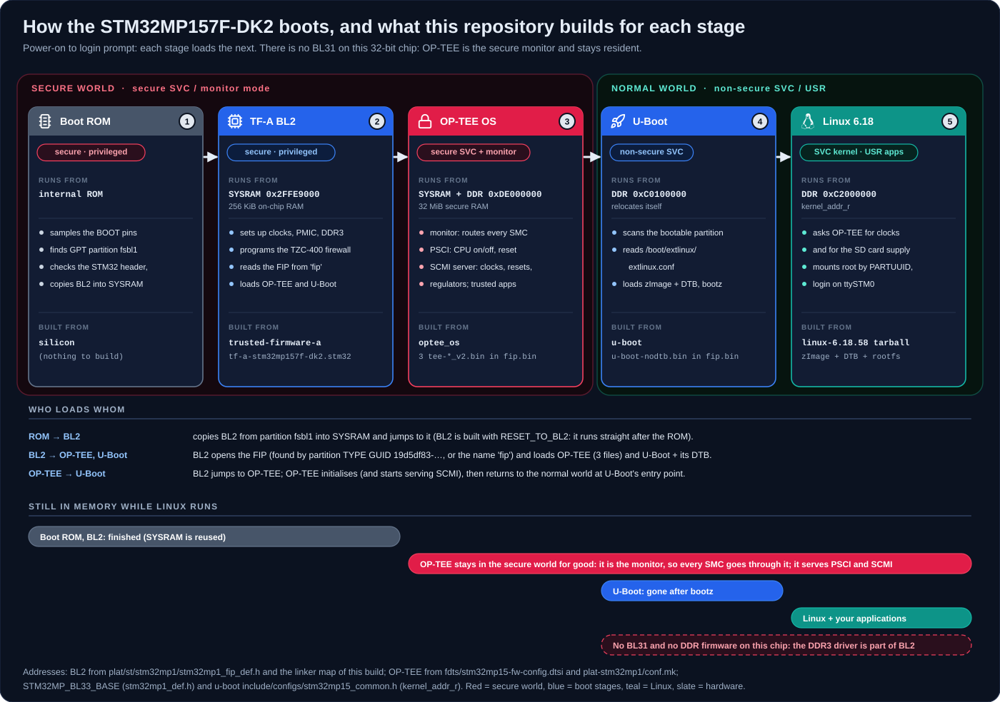
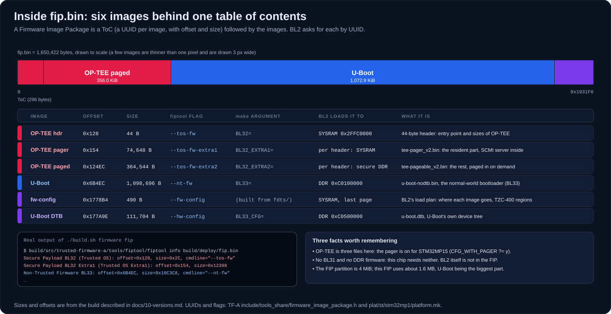
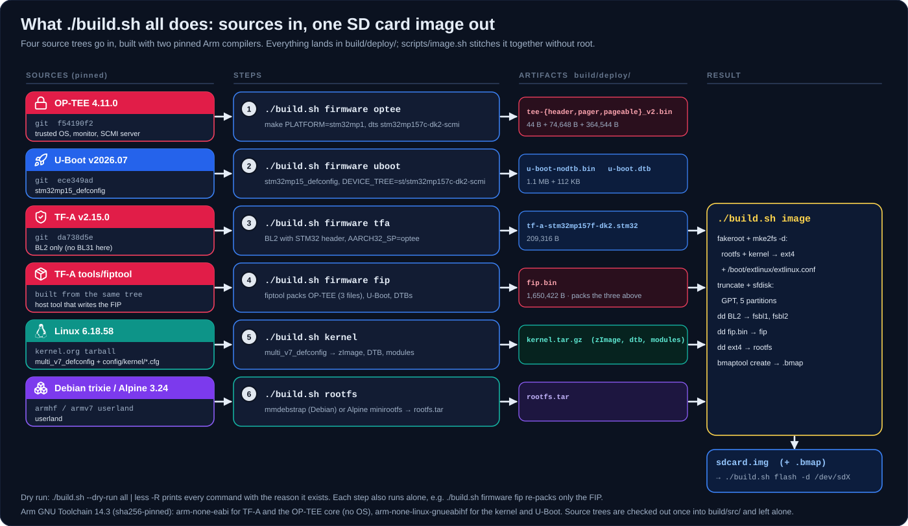
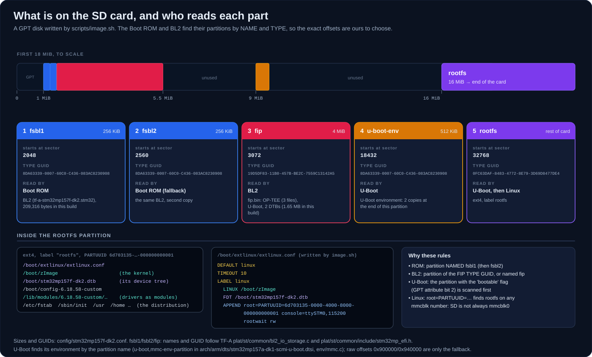
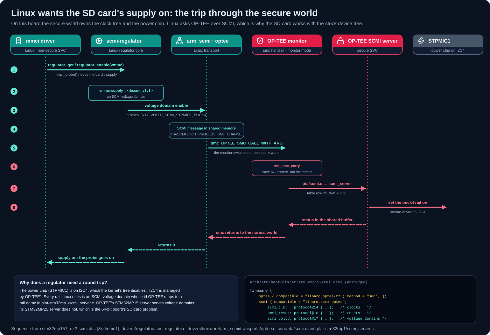
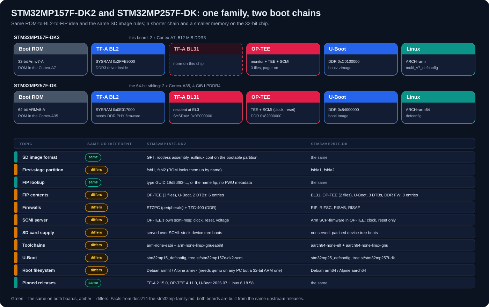

<div align="center">

# STM32MP157F-DK2 · first steps from source

**Secure firmware, OP-TEE, U-Boot, Linux and a bootable SD card for ST's STM32MP157F Discovery Kit (a 32-bit
Cortex-A7 board), built from the upstream projects with one command and no Yocto.**

[](https://github.com/N3b3x/embedded-linux-primer/actions/workflows/ci.yml)


[Quick start](#quick-start) · [Status](#what-has-been-checked) · [How it boots](#1-the-boot-chain) ·
[How the build works](#2-how-the-build-makes-the-sd-card) · [The secure world](#3-the-secure-world-in-one-page) ·
[MP1 or MP2?](#4-this-board-and-its-64-bit-sibling) · [First boot](docs/15-first-boot-checklist.md) ·
[Docs](docs/README.md) · [Acronyms](docs/13-acronyms.md)

</div>



```bash
./build.sh deps --install          # once: host packages
./build.sh all                     # firmware + kernel + rootfs → build/deploy/sdcard.img
./build.sh flash -d /dev/sdX       # write the card (asks first), then boot the board
```

- **All upstream:** TF-A, OP-TEE, U-Boot and the Linux kernel at the project's own release tags. No vendor
  fork, no Yocto. Every version is pinned to a commit or a sha256. The same releases as the
  [STM32MP257F-DK](../stm32mp2-dk/README.md) board.
- **Explains itself:** every command is printed with *why* it runs, and `--dry-run` turns the whole build
  into a readable recipe.
- **Two compilers, both from Arm:** `arm-none-eabi` for the bare-metal parts, `arm-none-linux-gnueabihf` for
  U-Boot and the kernel; downloaded with their checksum for your PC (x86-64 or ARM64).
- **Rootless:** compiling and image assembly run as your user. `sudo` is needed to install packages, to write
  the card, and only if your system forbids user namespaces for the Debian root filesystem.
- **A real secure world, one box shorter than on 64-bit:** on this Armv7-A chip OP-TEE is both the secure
  monitor and the SCMI server; there is no BL31 and no DDR firmware blob.
- **Built for a first boot:** [chapter 15](docs/15-first-boot-checklist.md) says what each stage should print,
  what to capture, and which first log line identifies each failure.

---

## What has been checked

Honesty first. This board was written and exercised in an Ubuntu 24.04 ARM64 container in October 2026.
**It has not yet been booted on a physical STM32MP157F-DK2.**

| Capability | State | How it was checked |
| --- | --- | --- |
| Scripts are `shellcheck`-clean | **done** | `shellcheck -x build.sh scripts/*.sh scripts/lib/common.sh scripts/rootfs/*.sh` |
| `--dry-run` of every step and of `all` | **done** | the whole recipe printed without errors |
| TF-A BL2, OP-TEE, U-Boot, FIP | **built in a container** | `./build.sh firmware` (first run, empty build directory, toolchains downloaded: 2.5 minutes with 4 jobs) → `fip.bin` (1,650,422 bytes), `tf-a-stm32mp157f-dk2.stm32` (209,316 bytes); `fiptool info` lists the 6 expected images |
| Linux 6.18.58 (`zImage`, DTB, modules) | **built in a container** | `./build.sh kernel`: `zImage` 11,911,680 bytes, `stm32mp157f-dk2.dtb` 55,849 bytes, 888 modules (33 MB stripped), the 20 options the boot path needs checked at configuration time; **24 min 41 s** the first time (4 jobs on a machine shared with other jobs), 88 s for a rebuild |
| Debian trixie `armhf` rootfs | **built in a container** | `./build.sh rootfs` (278,617,600-byte tar, 228 s), through the container's QEMU binfmt handler for 32-bit ARM; `/bin/bash` is an `armhf` ELF and `dpkg --print-architecture` prints `armhf` inside it |
| Alpine 3.24 `armv7` rootfs | **built in a container** | `./build.sh -r alpine rootfs` (5.7 MB tar); its `busybox` ELF is 32-bit ARM and ran under QEMU (`uname -m` prints `armv7l`). The Alpine *image* was not assembled |
| SD image assembly, partition table | **built and inspected in a container** | `./build.sh image` with the Debian rootfs (958 MiB apparent, 300 MB on disk, 21 s): `sfdisk --verify`; `fsbl1`, `fsbl2` and `fip` compared byte for byte with `tf-a-stm32mp157f-dk2.stm32` and `fip.bin`; `extlinux.conf` read back from the ext4; and a **U-Boot v2026.07 sandbox build** run on the image: it parses the GPT, `part list -bootable` answers partition 5, and `sysboot` reads `extlinux.conf`, offers both menu entries, loads `/boot/zImage` and the DTB and sets `bootargs=root=PARTUUID=… console=ttySTM0,115200 rootwait rw earlycon` |
| `flash.sh` | `shellcheck` + `--help` + `--dry-run` only | not run against a card or a loop device |
| Builds on an **x86-64** PC | not run | the x86-64 toolchain URLs return 200 and their checksums are pinned; the scripts pick them by `uname -m` |
| **Boots on the DK2** | **not tried** | see the decision and the risks below, and [15](docs/15-first-boot-checklist.md) |

**The boot path chosen, and why.** The mainline Linux device tree for the F variant of this kit
(`stm32mp157f-dk2.dts`) takes its clocks, resets and regulators from SCMI, so the firmware must be the "full
OP-TEE" kind: BL2 → OP-TEE (SCMI server) → U-Boot → Linux, with the SCMI device trees on the three
sides. That is also what ST's own tooling and a bench-proven configuration of this kit do. Details and the
alternatives that were rejected are in [11](docs/11-secure-world-and-scmi.md#which-boot-path-and-why-the-decision).

**The known risks** (none verified on hardware):

1. **OP-TEE 4.11.0 has no `stm32mp157f-dk2.dts`**, only the C-variant `stm32mp157c-dk2-scmi.dts`, which is what is
   embedded. The two differ in the crypto/frequency option letters, which that tree does not configure.
2. **U-Boot has no `-u-boot.dtsi` for the F tree**, so U-Boot is built with the C-variant SCMI tree (the one its own
   documentation lists for the DK2) and calls the board a "C-DK2 SCMI" in its banner; both trees were built and
   compared ([03](docs/03-firmware-and-uboot.md#step-2-u-boot)).
3. **The boot-switch positions** come from U-Boot's documentation, not from an ST page ([07](docs/07-flashing-and-booting.md#2-set-the-board-to-boot-from-the-sd-card)).
4. ST ships its own, older stack for this kit (a 6.6 kernel on ST's forks, [10](docs/10-versions.md#plan-b-sts-own-tested-set)),
   which is the fallback if the all-upstream stack gives trouble.

**What you get when it boots:** a console on the ST-LINK serial port (UART4), the microSD card, Ethernet and the
heartbeat LED. The display, touch, Wi-Fi and Bluetooth drivers are modules that probe when loaded, and the
Cortex-M4 is unused ([12](docs/12-board-tour.md)).

---

## Quick start

| Step | Command | What happens |
| --- | --- | --- |
| **1. Host setup** (once) | `git clone https://github.com/N3b3x/embedded-linux-primer && cd embedded-linux-primer/boards/stm32mp1-dk2`<br>`./build.sh deps --install` | installs ~35 Ubuntu/Debian packages (including `qemu-user-static`: the Debian root filesystem is 32-bit ARM). The cross-compilers are downloaded later, automatically |
| **2. Build** | `./build.sh all`<br>or `./build.sh -r alpine all` | firmware in minutes, kernel in the long step, Debian (full distro) or Alpine (tiny, no root). Ends with `SD card image: build/deploy/…img` |
| **3. Flash** | `lsblk -dpo NAME,SIZE,TRAN,MODEL`<br>`./build.sh flash -d /dev/sdX --expand` | refuses system disks, shows the card, asks, writes, wipes the old U-Boot environment, grows the partition to the whole card |
| **4. Boot** | boot switch → **SD** ([07](docs/07-flashing-and-booting.md#2-set-the-board-to-boot-from-the-sd-card)), then `picocom -b 115200 --logfile boot.log /dev/ttyACM0` | BL2, OP-TEE and U-Boot text, then the kernel, then a login |
| **5. Log in** | `root` or `dev`, password `stm32mp1` (a bench default: change it) | then read [07](docs/07-flashing-and-booting.md) and [12](docs/12-board-tour.md). **First time on a real board? Read [15](docs/15-first-boot-checklist.md) and keep `boot.log`** |

No board yet? `./build.sh --dry-run all | less -R` prints the entire build as an annotated recipe, and
`./build.sh firmware` is a few minutes of real compiling that shows every moving part of the boot chain.
For a first boot, add `TFA_LOG_LEVEL=40` to `config/local.conf` so that BL2 prints its INFO lines too.

---

## 1. The boot chain

The diagram at the top is the whole story. Five stages, each loads the next:

| # | Stage | Runs in | Its job | Built from |
| --- | --- | --- | --- | --- |
| 1 | **Boot ROM** | secure, privileged | finds partition `fsbl1`, copies BL2 into the on-chip SRAM | silicon |
| 2 | **TF-A BL2** | secure | sets up clocks, PMIC and DDR3, programs the TZC-400 firewall, loads the **FIP** | `trusted-firmware-a` |
| 3 | **OP-TEE** | secure SVC + monitor | the secure monitor (`smc`, PSCI) **and** trusted OS **and** SCMI server for clocks, resets, regulators | `optee_os` |
| 4 | **U-Boot** | non-secure SVC | finds `extlinux.conf` on the bootable partition, loads Linux | `u-boot` |
| 5 | **Linux 6.18** | non-secure SVC / USR | drivers, root filesystem, login on `ttySTM0` | `linux-6.18.58` + rootfs |

Stages 3 and 4 travel together in the **FIP**, one file written into one partition:



Deep dive: **[01 · Boot flow](docs/01-boot-flow.md)**, with the memory map and exactly which file in which
project does what ([source map](docs/images/source-map.svg)).

---

## 2. How the build makes the SD card



| Step | Command (runs on its own too) | Produces | Why it exists |
| --- | --- | --- | --- |
| optee | `./build.sh firmware optee` | `tee-{header,pager,pageable}_v2.bin` | the trusted OS, monitor and SCMI server |
| uboot | `./build.sh firmware uboot` | `u-boot-nodtb.bin`, `u-boot.dtb` | the bootloader (BL33) |
| tfa | `./build.sh firmware tfa` | `tf-a-stm32mp157f-dk2.stm32` | BL2: the one thing the Boot ROM can load |
| fip | `./build.sh firmware fip` | `fip.bin` | everything BL2 loads, in one container |
| kernel | `./build.sh kernel` | `zImage`, DTB, modules | the OS |
| rootfs | `./build.sh rootfs` | `rootfs.tar` | init, shell, libraries (32-bit ARM) |
| image | `./build.sh image` | `sdcard.img` + `.bmap` | lays out the card byte for byte, **without root** |
| flash | `./build.sh flash -d /dev/sdX` | the SD card | guarded `bmaptool`/`dd`, wipes the U-Boot environment, optional `--expand` |

The card is a GPT disk. The ROM and BL2 find their partitions by **name** and **type**, so those are
fixed; the offsets are ours. No FWU metadata partitions are needed: with `PSA_FWU_SUPPORT` off, BL2 finds the FIP by
type GUID, then by the name `fip` (`plat/st/common/bl2_io_storage.c`).



Deep dives: [03 · Firmware and U-Boot](docs/03-firmware-and-uboot.md) ·
[04 · Kernel](docs/04-kernel.md) · [05 · Rootfs](docs/05-rootfs.md) ·
[06 · SD card image](docs/06-sdcard-image.md).

---

## 3. The secure world in one page

On this board the root of the clock tree and the power chip belong to OP-TEE. Linux's own clock driver builds
gates and dividers on top of it, and asks OP-TEE over **SCMI** (Arm's System Control and Management Interface,
here carried in an `smc`) whenever it needs a root clock, a reset or a regulator. Unlike on the 64-bit sibling,
OP-TEE's SCMI server for this chip serves **voltage domains** too, so even the SD card's supply works with the
stock device tree:



[11 · The secure world and SCMI](docs/11-secure-world-and-scmi.md) explains it step by step, with the files to open.

---

## 4. This board and its 64-bit sibling

This repository has a directory for each STM32MP generation, because the CPU architecture, the toolchains, the
kernel and the boot components differ. They are built the same way and the scripts are kept structurally
identical, so `diff -ru ../stm32mp2-dk .` shows exactly the differences:



| | **STM32MP157F-DK2** (here) | [STM32MP257F-DK](../stm32mp2-dk/README.md) |
| --- | --- | --- |
| CPU | 2 × Cortex-A7, 32-bit | 2 × Cortex-A35, 64-bit |
| Chain | ROM → BL2 → **OP-TEE** → U-Boot → Linux | ROM → BL2 → BL31 → OP-TEE → U-Boot → Linux |
| First-stage partition | `fsbl1` / `fsbl2` | `fsbla1` / `fsbla2` |
| Kernel | `ARCH=arm`, `multi_v7_defconfig`, `zImage` | `ARCH=arm64`, `defconfig`, `Image` |
| SD card supply | works with the stock device tree | needs a patched device tree |

[14 · The STM32MP family](docs/14-the-stm32mp-family.md) has the full comparison and links to the sibling's chapters.

---

## Learn the concepts

| Chapter | You learn |
| --- | --- |
| [01 · Boot flow](docs/01-boot-flow.md) | processor modes, the five stages, who loads whom |
| [02 · Host setup](docs/02-host-setup.md) | packages, disk, time, containers, QEMU for 32-bit ARM |
| [03 · Firmware and U-Boot](docs/03-firmware-and-uboot.md) | the FIP, why the C-variant U-Boot tree, how U-Boot finds Linux |
| [04 · Kernel](docs/04-kernel.md) | `multi_v7_defconfig`, the SCMI device tree of this board |
| [05 · Root filesystem](docs/05-rootfs.md) | Debian vs Alpine vs yours (all 32-bit ARM) |
| [06 · SD card image](docs/06-sdcard-image.md) | GPT, partition names and GUIDs, `extlinux.conf` |
| [07 · Flashing and booting](docs/07-flashing-and-booting.md) | writing the card, the boot switch, what to see on the console |
| [08 · Customizing](docs/08-customizing.md) | where every kind of change goes |
| [09 · Troubleshooting](docs/09-troubleshooting.md) | by the last line you saw |
| [10 · Versions](docs/10-versions.md) | the pins, how to move, ST's own set as plan B |
| [11 · Secure world and SCMI](docs/11-secure-world-and-scmi.md) | the boot-path decision, ETZPC, SCMI over OP-TEE |
| [12 · Board tour](docs/12-board-tour.md) | the kit and what is enabled |
| [13 · Acronyms](docs/13-acronyms.md) | every three-letter word |
| [14 · The STM32MP family](docs/14-the-stm32mp-family.md) | this board against the 64-bit one |
| [15 · First boot checklist](docs/15-first-boot-checklist.md) | expected output per stage, what to capture, failure table |

## Layout of this directory

```text
build.sh                one entry point; ./build.sh help
config/                 versions and board constants (stm32mp157f-dk2.conf), kernel fragments, local.conf
scripts/                one script per step + lib/common.sh (logging, explain mode, git/fetch/toolchain helpers)
patches/                your patches to TF-A, OP-TEE, U-Boot and the kernel, applied once per checkout
custom/dts/             your device trees (empty: this board needs no workaround)
docs/                   the chapters above, and images/ with the SVG diagrams and their generators
build/                  everything generated (git-ignored): downloads, toolchains, sources, deploy/
```

## Licences

The scripts and documents of this directory are part of the repository (see the root of the repository for
its licence). The software they download keeps its own: TF-A BSD-3-Clause, OP-TEE BSD-2-Clause, U-Boot
GPL-2.0-or-later and Linux GPL-2.0. Unlike the 64-bit board there is no ST binary blob in this chain.
