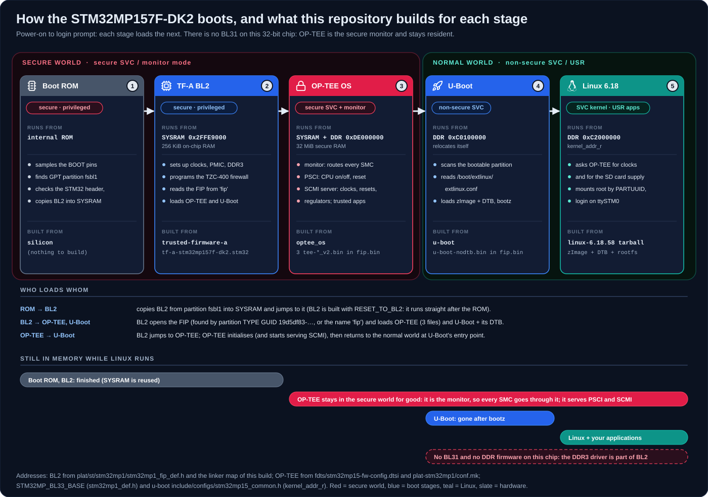
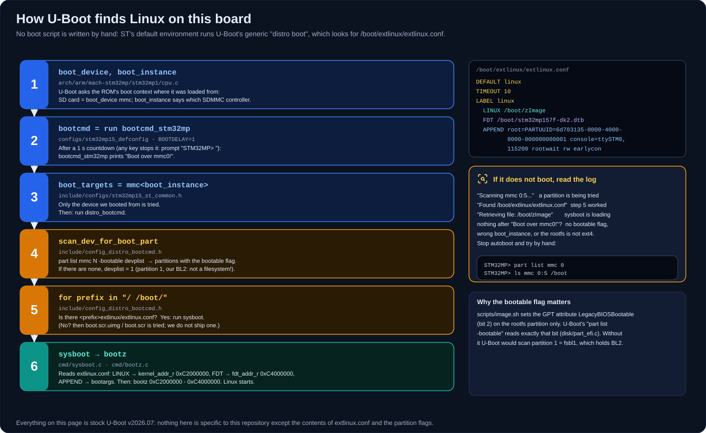
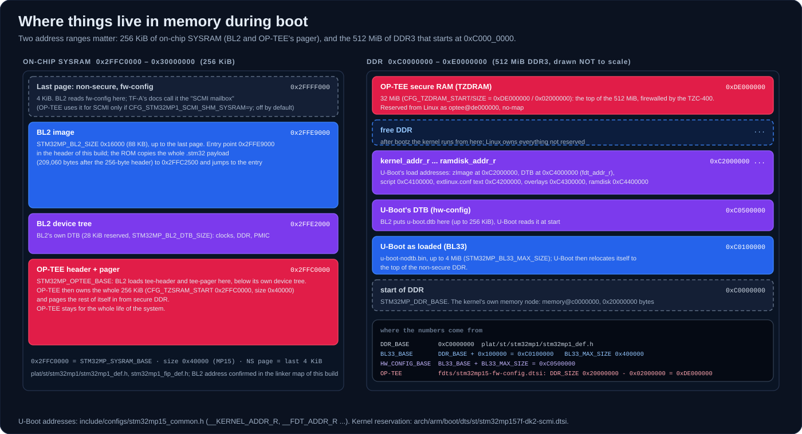

# 01 · Boot flow: from power-on to a login prompt

This chapter explains every box in the picture. If a word is new, [13 · Acronyms](13-acronyms.md) has it.
Every address and file name below was read from the pinned source trees; the file is named so you can
check.

## The big picture in one paragraph

A processor cannot start a big program like Linux straight from power-on: its RAM is not even working yet.
So boot is a **chain**. The first link is code burned into the chip (the **Boot ROM**). It can only do one
small thing: read a tiny program (**BL2**) from the SD card into the chip's on-board RAM (**SYSRAM**) and run
it. BL2's job is to make the big RAM (the **DDR3**) work, and then load everything else from the card. The
STM32MP15 is a 32-bit Cortex-A7 chip with a **secure world** that stays alive next to Linux. In the
configuration this board uses, that secure world (OP-TEE) also owns the clocks, resets and voltage regulators
(see [11](11-secure-world-and-scmi.md)). This is the 32-bit sibling of the
[STM32MP257F-DK](../../stm32mp2-dk/README.md); [14](14-the-stm32mp-family.md) compares the two.

## The five stages

| # | Stage | Runs in | Lives at | What it does | Built from |
| --- | --- | --- | --- | --- | --- |
| 1 | **Boot ROM** | secure, privileged | internal ROM | samples the boot pins, finds GPT partition `fsbl1`, checks the STM32 image header, copies the payload into SYSRAM | silicon |
| 2 | **TF-A BL2** | secure, privileged | SYSRAM `0x2FFE9000` | logs why it was reset, trains the DDR3, sets the TZC-400 memory firewall, loads every image from the FIP | `trusted-firmware-a` |
| 3 | **OP-TEE OS** | secure SVC + monitor mode | SYSRAM (pager) and secure DDR `0xDE000000`, 32 MiB | trusted OS **and secure monitor** (`smc`, PSCI); **SCMI server** for clocks, resets and regulators; trusted applications | `optee_os` |
| 4 | **U-Boot** (BL33) | non-secure SVC | DDR `0xC0100000`, then relocates | scans the card for `extlinux.conf`, loads the kernel and DTB, `bootz` | `u-boot` |
| 5 | **Linux** | non-secure SVC kernel, USR apps | DDR | drivers, root filesystem, `/sbin/init`, login | `linux-6.18.58` + rootfs |

Sources: SYSRAM addresses `plat/st/stm32mp1/stm32mp1_def.h` and `stm32mp1_fip_def.h` (and the linker map of
the build); OP-TEE `core/arch/arm/plat-stm32mp1/conf.mk` (`CFG_TZDRAM_START ?= 0xde000000` for the 512 MB
flavours); U-Boot `STM32MP_BL33_BASE` is `STM32MP_DDR_BASE + 0x100000` in TF-A's `stm32mp1_def.h`.

The picture has **one stage fewer** than the 64-bit board: there is no **BL31**. On AArch64 TF-A keeps a
resident secure monitor at EL3. On this Armv7-A chip TF-A BL2 is the only TF-A binary in the chain, and
**OP-TEE plays the monitor** as well (TF-A's own docs list the sequence as *ROM code -> BL2 -> OP-TEE -> BL33
(U-Boot)*, `docs/plat/st/stm32mpus.rst`).

### Privilege modes in one minute

A 32-bit ARM CPU has **processor modes** instead of the four exception levels of a 64-bit one: User (apps),
Supervisor ("SVC", an OS kernel), and, with the Security Extensions, a **Monitor** mode that is the only way to
switch between the *secure* and *non-secure* worlds. A second, orthogonal bit, the **security state**, splits
the machine into a secure and a normal world, exactly as on the 64-bit boards. Boot starts in the secure
world and walks towards the normal one.

| Where | Who runs there on this board |
| --- | --- |
| secure SVC / monitor | the Boot ROM, BL2, then OP-TEE (its `smc` handler runs in monitor mode) |
| non-secure SVC | U-Boot, then the Linux kernel |
| non-secure USR | your applications |
| non-secure HYP | unused: no hypervisor in this build |

## Stage by stage

### 1. The Boot ROM

On power-on or reset the CPU starts in the ROM. It reads the **boot pins** (on the DK2, two switches: see
[07](07-flashing-and-booting.md)), which choose the medium: SD card, eMMC, NAND, or a serial/USB download mode
used for recovery. For an SD card it reads the GPT and looks for the partition **named `fsbl1`**; if that
image is bad, **`fsbl2`**. The file in that partition is `tf-a-stm32mp157f-dk2.stm32`: BL2 with a 256-byte
STM32 header that the ROM checks. The ROM copies the payload to SYSRAM and jumps into it. Nothing here is
configurable, which is why the partition names in [06](06-sdcard-image.md) are not negotiable.

### 2. TF-A BL2: memory, then everything else

BL2 is TF-A built with `RESET_TO_BL2`: it is the first normal piece of software. `bl2_early_platform_setup2()`
and `bl2_platform_setup()` in `plat/st/stm32mp1/bl2_plat_setup.c` bring up the clocks, the PMIC and the DDR3
controller (`drivers/st/ddr/stm32mp1_ddr.c`). The MP15 needs **no separate training firmware**: the controller
and PHY are configured from the "DDR" description in the device tree (`fdts/stm32mp15-ddr3-1x4Gb-1066-binG.dtsi`:
one 4 Gbit DDR3, 512 MB, 533 MHz). Then BL2 programs the **TZC-400** memory firewall from the `fw-config` tree
(`fdts/stm32mp15-fw-config.dtsi`: the top 32 MiB of DDR is secure, the rest non-secure) and loads the images
the `fw-config` names: OP-TEE (three files), U-Boot and U-Boot's DTB.

BL2 finds the FIP by **partition type GUID** `19d5df83-11b0-457b-be2c-7559c13142a5`, or failing that by the
partition name `fip` (`plat/st/common/bl2_io_storage.c`, `STM32MP_FIP_GUID` in
`plat/st/common/include/stm32mp_efi.h`; the TF-A build here has `PSA_FWU_SUPPORT=0`, so the A/B firmware-update
partitions ST's Yocto images add are not needed). [03](03-firmware-and-uboot.md) opens the FIP.

### 3. OP-TEE: the trusted OS, the monitor and the SCMI server

BL2 ends by jumping straight into the OP-TEE entry (`plat/st/stm32mp1/bl2_plat_setup.c`, `BL32_IMAGE_ID`):
its entry point and the address of the pageable image come from the 44-byte OP-TEE header. OP-TEE sets up the
secure world, installs the **`smc` handler** (`CFG_SM_PLATFORM_HANDLER`, `CFG_PSCI_ARM32`), brings its SCMI
server up, and then returns to the normal world at U-Boot's entry point (`ep_info.lr_svc = BL33 pc`).

On most SoCs OP-TEE is optional. **For the kernel this build boots, it is not**: Linux's `stm32mp157f-dk2.dts`
includes `stm32mp157f-dk2-scmi.dtsi`, which takes clocks, resets and the SD card's power supply from SCMI
nodes under `firmware { optee … scmi … }`. [11 · Secure world and SCMI](11-secure-world-and-scmi.md) tells the
whole story, and why this board does *not* have the voltage-domain problem its 64-bit sibling has.

### 4. U-Boot: find the kernel on the card

U-Boot is the normal-world bootloader. Its default environment runs `bootcmd_stm32mp`, which prints
`Boot over mmc0!`, sets `boot_targets=mmc<boot_instance>` (the card it was loaded from) and runs U-Boot's
**distro boot**. That scans the *bootable* partition for `/boot/extlinux/extlinux.conf`, loads the kernel and
device tree it names, and starts Linux with `bootz` (a 32-bit `zImage`). The decision flow is drawn in

and described in [03](03-firmware-and-uboot.md#how-u-boot-finds-linux).

### 5. Linux: from `zImage` to `login:`

`bootz` hands the kernel the device tree address in register `r2`. The kernel decompresses itself, parses the
DTB, creates a device for every enabled node, and **probes drivers** for them: the serial port (`ttySTM0`),
the SD controller, the Ethernet MAC. It mounts the root filesystem named by `root=PARTUUID=…`, starts
`/sbin/init`, and `init` starts a login on the serial console. [04](04-kernel.md) and [05](05-rootfs.md)
cover each step.

## What stays resident after boot

BL2 and U-Boot are gone once Linux runs (their memory is reused). **OP-TEE stays**: if you
`sudo dmesg | grep -i optee` on the board, you are looking at the driver that talks to it.

## Where each address came from

| Name | Value | Source |
| --- | --- | --- |
| `STM32MP_SYSRAM_BASE` / size (MP15) | `0x2FFC0000` / `0x40000` | `plat/st/stm32mp1/stm32mp1_def.h` |
| last page of SYSRAM | `0x2FFFF000`, non-secure (`STM32MP_NS_SYSRAM_*`) | same file; TF-A's docs call it the "SCMI mailbox" |
| BL2 image / its DTB | `0x2FFE9000` / `0x2FFE2000` | `stm32mp1_fip_def.h` (`STM32MP_BL2_SIZE` 88 KB, `STM32MP_BL2_DTB_SIZE` 28 KB); confirmed in the linker map of this build |
| `STM32MP_DDR_BASE` | `0xC0000000` (512 MB fitted) | `stm32mp1_def.h`; `DDR_SIZE 0x20000000` in `fdts/stm32mp157f-dk2-fw-config.dts` |
| OP-TEE secure RAM | `0xDE000000`, 32 MiB (top of the 512 MB) | `fdts/stm32mp15-fw-config.dtsi`; `CFG_TZDRAM_START` in OP-TEE's `plat-stm32mp1/conf.mk` |
| U-Boot as loaded | `0xC0100000` (`STM32MP_BL33_BASE`), up to 4 MiB | `stm32mp1_def.h` |
| U-Boot's DTB | `0xC0500000` (`STM32MP_HW_CONFIG_BASE`) | `stm32mp1_fip_def.h` |
| Kernel / DTB load addresses | `0xC2000000` / `0xC4000000` | U-Boot `include/configs/stm32mp15_common.h` |

Next: [02 · Host setup](02-host-setup.md).
