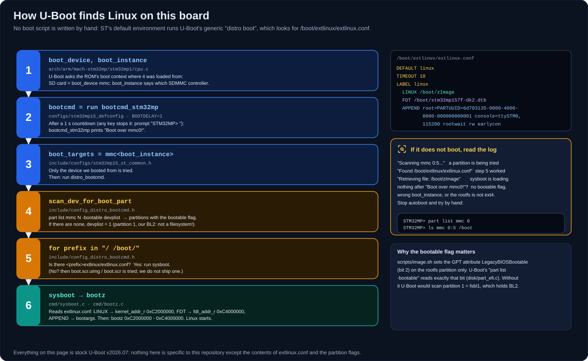
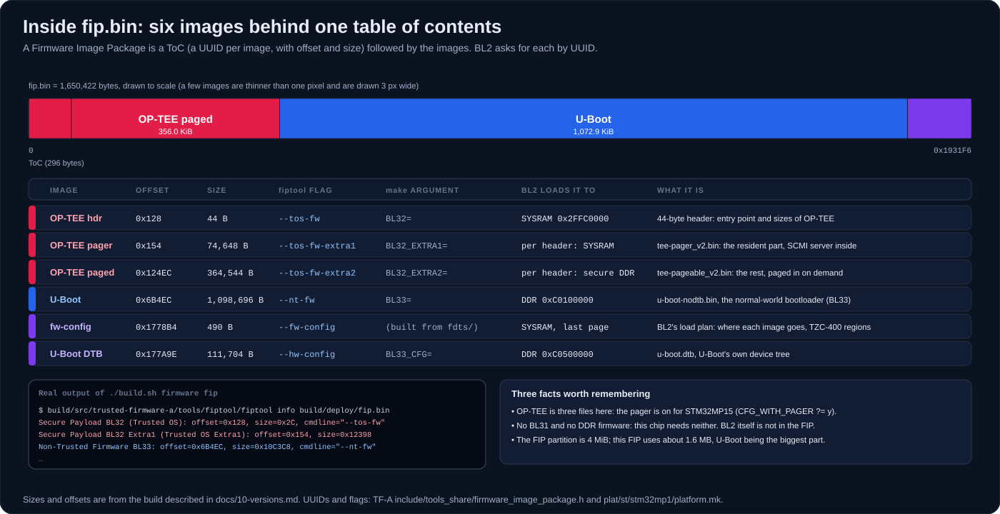

# 03 · Firmware and U-Boot: building the boot chain

Everything before Linux is built by one script, [`scripts/firmware.sh`](../scripts/firmware.sh), called with
`./build.sh firmware [step]`. This chapter walks through each step, shows what it produces, and explains
what is inside.

```bash
./build.sh --dry-run firmware     # read the whole recipe with the reasons, run nothing
./build.sh firmware               # all four steps
./build.sh firmware fip           # just one step
```

| Step | Command | Source | Produces |
| --- | --- | --- | --- |
| 1 | `firmware optee` | OP-TEE 4.11.0 | `tee-header_v2.bin`, `tee-pager_v2.bin`, `tee-pageable_v2.bin` |
| 2 | `firmware uboot` | U-Boot v2026.07 | `u-boot-nodtb.bin`, `u-boot.dtb` |
| 3 | `firmware tfa` | TF-A v2.15.0 | `tf-a-stm32mp157f-dk2.stm32` (BL2) |
| 4 | `firmware fip` | TF-A's `fiptool` | `fip.bin` |

Everything lands in `build/deploy/`. The order matters only for `fip`, which needs the outputs of 1-3;
`firmware all` runs them in order. Two compilers are used (see [10](10-versions.md)):
`arm-none-eabi-` for TF-A and OP-TEE (bare metal) and `arm-none-linux-gnueabihf-` for U-Boot.
Unlike the 64-bit sibling there is **no DDR firmware step** and **no BL31**: the DDR3 driver is inside BL2
and OP-TEE is the monitor ([01](01-boot-flow.md)).

## Step 1: OP-TEE and its SCMI server

```bash
make -C build/src/optee_os O=build/work/optee \
     CROSS_COMPILE32=arm-none-eabi- ARCH=arm PLATFORM=stm32mp1 \
     CFG_EMBED_DTB_SOURCE_FILE=stm32mp157c-dk2-scmi.dts \
     CFG_TEE_CORE_LOG_LEVEL=2 all
```

* `PLATFORM=stm32mp1` selects `core/arch/arm/plat-stm32mp1/`. Its `conf.mk` makes the core 32-bit
  (`include core/arch/arm/cpu/cortex-a7.mk`), turns the **pager** on for STM32MP15 (`CFG_WITH_PAGER ?= y`),
  and puts the secure memory at `CFG_TZDRAM_START ?= 0xde000000` (size `0x02000000`, 32 MiB) for the
  512 MB board flavours.
* `CFG_EMBED_DTB_SOURCE_FILE=stm32mp157c-dk2-scmi.dts` embeds the **board's device tree as the secure world
  sees it** (`core/arch/arm/dts/stm32mp157c-dk2-scmi.dts`): which peripherals are secure (ETZPC), the RCC in
  its secure mode (`st,stm32mp1-rcc-secure`), the PMIC on I²C4. The same file name selects the *flavour*:
  `conf.mk` lists it in `flavorlist-cryp-512M`, which fixes the DDR size and where the secure RAM sits.
  OP-TEE 4.11.0 has no `stm32mp157f-dk2.dts`; why this one is right is in
  [11](11-secure-world-and-scmi.md#what-is-not-verified).
* The SCMI server is OP-TEE's *own* (`CFG_SCMI_PTA ?= y` forces `CFG_SCMI_MSG_DRIVERS=y`), not Arm's
  SCP-firmware: no extra repository, no `cmake`.
* Only `CROSS_COMPILE32` is passed. OP-TEE's `all` target builds the core and also the user-space libraries
  for trusted applications; with the bare-metal `arm-none-eabi-` compiler these built without a Linux C
  library, as OP-TEE's TAs link against OP-TEE's own `libutee`.

Outputs, from `build/work/optee/core/`:

| File | Size in this build | What it is |
| --- | --- | --- |
| `tee-header_v2.bin` | 44 bytes | header that tells BL2 the entry point and sizes of the OP-TEE image |
| `tee-pager_v2.bin` | 74,648 bytes | the initial, always-resident part of OP-TEE (runs from on-chip SRAM) |
| `tee-pageable_v2.bin` | 364,544 bytes | the rest, **paged** into the SRAM on demand from DDR |

## Step 2: U-Boot

```bash
make -C build/src/u-boot O=build/work/u-boot ARCH=arm CROSS_COMPILE=arm-none-linux-gnueabihf- stm32mp15_defconfig
make -C build/src/u-boot O=build/work/u-boot ARCH=arm CROSS_COMPILE=arm-none-linux-gnueabihf- \
     DEVICE_TREE=st/stm32mp157c-dk2-scmi all
```

* `stm32mp15_defconfig` is the "trusted boot with FIP" configuration (`doc/board/st/stm32mp1.rst`); it
  turns on `CONFIG_TFABOOT`, `CONFIG_SCMI_FIRMWARE`, `CONFIG_OPTEE` and the SCMI clock, reset and regulator
  drivers.
* `DEVICE_TREE=st/stm32mp157c-dk2-scmi`: recent U-Boot versions build their board trees from a copy of the
  *Linux* device trees (`OF_UPSTREAM`, `dts/upstream/src/arm/`), so the name includes the vendor directory.
  **Why the C-variant name, on an F kit.** U-Boot's copy has `st/stm32mp157f-dk2.dts`, but U-Boot adds its own
  board settings from `arch/arm/dts/<name>-u-boot.dtsi`, and v2026.07 has none for the F tree (nor does
  v2026.10 or `master` at the time of writing). The two trees were built and compared:

  | | `st/stm32mp157c-dk2-scmi` | `st/stm32mp157f-dk2` |
  | --- | --- | --- |
  | `bootph-*` markers (what U-Boot needs before it relocates, such as the UART) | 26 | **0** |
  | `u-boot,mmc-env-partition` (where `saveenv` writes) | present | **absent** |
  | model string | `…STM32MP157C-DK2 SCMI Discovery Board` | `…STM32MP157F-DK2 Discovery Board` |

  Without the `bootph` markers a U-Boot may come up without a console. The DK2 is the same board whatever the
  chip letter, and U-Boot's own documentation lists the `stm32mp157c-dk2-scmi` tree for "dk2". The visible
  cost is that U-Boot calls the board a "C-DK2 SCMI" in its banner. The kernel does not care: it gets its own
  tree from `extlinux.conf`.
* U-Boot is called `ARCH=arm` here as on every board; `CONFIG_ARM64` is simply off.

Outputs: `u-boot-nodtb.bin` (1,098,696 bytes in this build, the program itself) and `u-boot.dtb` (111,704
bytes, U-Boot's own device tree). TF-A takes both: the program as BL33, the DTB as `BL33_CFG` (the "hardware
config"). U-Boot does not need to know where it is loaded: BL2 puts it at `0xC0100000` and it relocates itself.

### How U-Boot finds Linux



The three things in the environment that matter are, in order (all from stock U-Boot, none written here):

1. `bootcmd=run bootcmd_stm32mp` (`CONFIG_BOOTCOMMAND` in `configs/stm32mp15_defconfig`).
2. `bootcmd_stm32mp` (`include/configs/stm32mp15_st_common.h`) prints `Boot over mmc0!`, runs `env_check`,
   sets `boot_targets` to `mmc<boot_instance>` and runs `distro_bootcmd`.
3. `distro_bootcmd` (`include/config_distro_bootcmd.h`) calls `scan_dev_for_boot_part`, which lists the
   partitions with the **bootable flag** (`part list mmc N -bootable devplist`), or partition **1** if none
   has it. For every candidate it tries the prefixes `/` and `/boot/` for `extlinux/extlinux.conf`, then for
   `boot.scr.uimg` / `boot.scr`.

This is why [`scripts/image.sh`](../scripts/image.sh) sets the `LegacyBIOSBootable` attribute on the
root partition: without it U-Boot would try partition 1, which is `fsbl1` (BL2, not a filesystem), find
nothing and drop to its prompt. `sysboot` (`cmd/sysboot.c`) then parses `extlinux.conf`, loads the kernel to
`kernel_addr_r` (`0xC2000000`) and the device tree to `fdt_addr_r` (`0xC4000000`), and `bootz` starts it.

### Where U-Boot keeps its environment

U-Boot's device tree for this board sets `u-boot,mmc-env-partition = "u-boot-env"`
(`arch/arm/dts/stm32mp157a-dk1-scmi-u-boot.dtsi`, included by the `dk2-scmi` one). `env/mmc.c`
(`mmc_offset_try_partition()`) then stores the environment **in the GPT partition of that name, two copies at
its end**. Only if the partition does not exist does it use the raw offsets `0x900000` and `0x940000` from
`configs/stm32mp15_defconfig`. Hence the 512 KiB partition `u-boot-env` in the SD layout
([06](06-sdcard-image.md)).

## Step 3: TF-A BL2

```bash
make -C build/src/trusted-firmware-a PLAT=stm32mp1 ARCH=aarch32 ARM_ARCH_MAJOR=7 \
     CROSS_COMPILE=arm-none-eabi- DTB_FILE_NAME=stm32mp157f-dk2.dtb STM32MP_SDMMC=1 \
     AARCH32_SP=optee LOG_LEVEL=20 BUILD_BASE=build/work/tf-a all
```

| Argument | Meaning |
| --- | --- |
| `PLAT=stm32mp1`, `ARCH=aarch32`, `ARM_ARCH_MAJOR=7` | `plat/st/stm32mp1/` (and the shared `plat/st/common/`), as 32-bit Armv7-A (`docs/plat/st/stm32mp1.rst`) |
| `DTB_FILE_NAME=stm32mp157f-dk2.dtb` | which board tree to use from TF-A's own `fdts/`: clocks, the 512 MB DDR3 description, PMIC, `fw-config`. It also names the output file. TF-A, unlike OP-TEE and U-Boot, *has* an F-DK2 tree (`fdts/stm32mp157f-dk2.dts`, which includes the C one) |
| `STM32MP_SDMMC=1` | BL2 reads the FIP from SD/eMMC. Other media have other flags; TF-A allows only one |
| `AARCH32_SP=optee` | the next stage is OP-TEE (BL32). The alternative `sp_min` is "not recommended" |
| `LOG_LEVEL=20` | NOTICE: 10 error, 20 notice, 30 warning, 40 info, 50 verbose. Set it to 40 to watch BL2 work |
| `BUILD_BASE=…` | build out of the source tree |

The result is `build/work/tf-a/stm32mp1/release/`: `bl2.bin` and **`tf-a-stm32mp157f-dk2.stm32`**, which is
BL2 plus its device tree plus a 256-byte STM32 header (a magic `STM2`, version 1.0, the payload length,
checksum, load address and entry point that the **Boot ROM** validates). The header of this build says: entry
point `0x2FFE9000`, payload length 209,060 bytes. The file is 209,316 bytes and goes into the two 256 KiB
`fsbl` partitions.

## Step 4: the FIP

```bash
make -C build/src/trusted-firmware-a <same arguments as step 3> \
     BL33=build/deploy/u-boot-nodtb.bin BL33_CFG=build/deploy/u-boot.dtb \
     BL32=build/deploy/tee-header_v2.bin BL32_EXTRA1=build/deploy/tee-pager_v2.bin \
     BL32_EXTRA2=build/deploy/tee-pageable_v2.bin fip
```

A **FIP** (Firmware Image Package) is TF-A's container format: a table of contents (a UUID, an offset and
a size per entry) followed by the images. `fiptool` (built from `tools/fiptool/` in the same tree) writes it.



`./build.sh firmware fip` finishes by running `fiptool info` on the result:

```text
Secure Payload BL32 (Trusted OS): offset=0x128, size=0x2C, cmdline="--tos-fw"
Secure Payload BL32 Extra1 (Trusted OS Extra1): offset=0x154, size=0x12398, cmdline="--tos-fw-extra1"
Secure Payload BL32 Extra2 (Trusted OS Extra2): offset=0x124EC, size=0x59000, cmdline="--tos-fw-extra2"
Non-Trusted Firmware BL33: offset=0x6B4EC, size=0x10C3C8, cmdline="--nt-fw"
FW_CONFIG: offset=0x1778B4, size=0x1EA, cmdline="--fw-config"
HW_CONFIG: offset=0x177A9E, size=0x1B458, cmdline="--hw-config"
```

(Real output of this build; the whole file is 1,650,422 bytes and has to fit the 4 MiB `fip` partition.) Two
device trees travel inside it: **FW_CONFIG** is BL2's load plan (where each image goes, and the TZC-400 memory
firewall regions), and **HW_CONFIG** is U-Boot's DTB. Note what is **not** there compared with the 64-bit
board: no BL31, no BL31 device tree, no DDR firmware. The pager's image is in two files, so OP-TEE appears as
*three* entries (`--tos-fw`, `--tos-fw-extra1`, `--tos-fw-extra2`).

The build does not sign anything. A **closed** device (secure-boot fuses blown) makes BL2 stop with
`Secure chip: TRUSTED_BOARD_BOOT must be enabled`; ST's development kits are shipped open. Signing is TF-A's
`TRUSTED_BOARD_BOOT`, which needs `mbedtls` and keys, and is out of scope here.

## Licences

TF-A (BSD-3-Clause, `docs/license.rst` in the tree) and OP-TEE (BSD-2-Clause) are permissive; U-Boot and
Linux are GPL-2.0-or-later / GPL-2.0. There is no vendor binary blob in this chain (the 64-bit board has ST's
DDR training firmware under SLA0044). A product that ships these must keep the notices and, for GPL parts,
offer the source.

## Menuconfig

```bash
./build.sh uboot-menuconfig      # opens U-Boot's menu on build/work/u-boot/.config
```

Make a change permanent by adding a patch under `patches/u-boot/` (they are applied once, in name order,
after checkout) or by editing the defconfig in a patch ([08](08-customizing.md)).

Next: [04 · The kernel](04-kernel.md).
