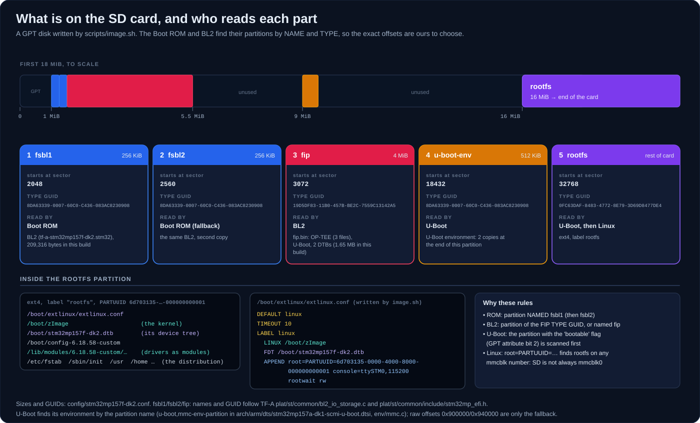

# 06 · The SD card image, byte for byte

```bash
./build.sh image          # needs the outputs of firmware, kernel and rootfs
```

[`scripts/image.sh`](../scripts/image.sh) assembles `build/deploy/sdcard.img` **without root**: the ext4
filesystem is made from a directory with `mke2fs -d` inside a `fakeroot` session, and the partition table is
written to an ordinary file with `sfdisk`.



## The partition table

A GPT disk with five partitions. Real output from the build (`sfdisk -d`, device name shortened):

```text
label: gpt
label-id: 6D703135-0000-4000-8000-000000000000
unit: sectors
first-lba: 2048
sector-size: 512

IMG1 : start=  2048, size=   512, type=8DA63339-0007-60C0-C436-083AC8230908, name="fsbl1"
IMG2 : start=  2560, size=   512, type=8DA63339-0007-60C0-C436-083AC8230908, name="fsbl2"
IMG3 : start=  3072, size=  8192, type=19D5DF83-11B0-457B-BE2C-7559C13142A5, name="fip"
IMG4 : start= 18432, size=  1024, type=8DA63339-0007-60C0-C436-083AC8230908, name="u-boot-env"
IMG5 : start= 32768, size=<rest>, type=0FC63DAF-8483-4772-8E79-3D69D8477DE4, name="rootfs",
       uuid=6D703135-0000-4000-8000-000000000001, attrs="LegacyBIOSBootable"
```

(Each partition also has a random unique GUID, left out; sizes are in 512-byte sectors; the last one is the rest
of the image. `sgdisk -i 5` shows the attribute flags as `0000000000000004`: bit 2, "legacy BIOS bootable".)

| # | Name | Start | Size | Content | Who needs the layout to be this way |
| --- | --- | --- | --- | --- | --- |
| 1 | `fsbl1` | 1 MiB | 256 KiB | `tf-a-stm32mp157f-dk2.stm32` (BL2, 209,316 bytes) | **Boot ROM**: looks for this *name* |
| 2 | `fsbl2` | 1.25 MiB | 256 KiB | the same BL2, a second copy | **Boot ROM**: the fallback if copy 1 is bad |
| 3 | `fip` | 1.5 MiB | 4 MiB | `fip.bin` (1,650,422 bytes) | **BL2**: finds it by *type GUID* `19d5df83-…`, or by the name `fip` |
| 4 | `u-boot-env` | 9 MiB | 512 KiB | empty until U-Boot runs `saveenv` | **U-Boot**: `u-boot,mmc-env-partition = "u-boot-env"` |
| 5 | `rootfs` | 16 MiB | rest of the card | ext4, label `rootfs`, **bootable flag** | **U-Boot** scans bootable partitions; **Linux** `root=PARTUUID=` |

### What each rule comes from

* **`fsbl1`/`fsbl2`**: the Boot ROM looks for these *names*. U-Boot's `doc/board/st/stm32mp1.rst` says the
  minimal card has *"2 fsbl partitions, named fsbl1 and fsbl2, size at least 256KiB"* and *"one partition named
  fip"*; the second copy may be left out, it only gives the ROM a fallback. ST's own layouts, and a bench-proven
  configuration of this kit, give them the type GUID `8DA63339-0007-60C0-C436-083AC8230908` (the generic "Linux
  reserved" type) and note that the ROM finds them by name, not by type; this repository does the same. The
  64-bit board calls the same partitions `fsbla1`/`fsbla2`. TF-A's documentation says *"The SD-card has to be
  formatted with GPT. It should contain at least those partitions: fsbl … and fip (GUID 19d5df83-…)"*
  (`docs/plat/st/stm32mpus.rst`).
* **`fip`**: `plat/st/common/bl2_io_storage.c` (lines 544-556 of the pinned tree) calls
  `partition_init(GPT_IMAGE_ID)`, then `get_partition_entry_by_type(&fip_guid)` and, if that finds nothing,
  `get_partition_entry("fip")`. TF-A is built without its optional A/B firmware-update feature
  (`PSA_FWU_SUPPORT=0`), and that is the only case in which this code runs: the `metadata1`/`metadata2`
  partitions and the `fip-a`/`fip-b` pair that ST's Yocto layout writes belong to the `#if PSA_FWU_SUPPORT`
  branches of the same file, so they are *not* needed here. One limit does apply: BL2 keeps at most
  `PLAT_PARTITION_MAX_ENTRIES` GPT entries, which is `STM32_TF_A_COPIES` (2) + `STM32_EXTRA_PARTS` (4) = **6**
  on this platform (`plat/st/common/common.mk`, `plat/st/stm32mp1/platform.mk`). The card has five, and `fip`
  is the third; do not put more than three partitions in front of it.
* **`u-boot-env`**: [03](03-firmware-and-uboot.md#where-u-boot-keeps-its-environment). Two copies at the end
  of the partition, so the whole 512 KiB is reserved and nothing else may live there. The raw offsets in
  the defconfig (`0x900000`, `0x940000`, i.e. 9 MiB: where this partition is) are only the fallback.
* **The bootable flag on `rootfs`**: [03](03-firmware-and-uboot.md#how-u-boot-finds-linux). Without it
  U-Boot scans partition 1.
* **`rootfs` by PARTUUID**: the kernel command line says `root=PARTUUID=6d703135-0000-4000-8000-000000000001`,
  the `uuid=` in the sfdisk script. It does not matter whether Linux enumerates the SD card as `mmcblk0` or
  `mmcblk1` (the numbering follows the probe order of the controllers; this kit has only the microSD slot), nor which name udev gives the partition.

### Why these offsets

* The GPT itself takes sectors 0 to 33; the first aligned MiB is left alone (`first-lba: 2048`).
* BL2 is 209,316 bytes; 256 KiB leaves room for a build with more log strings. `image.sh` stops if it
  grows past `FSBL_SIZE_KB`.
* The FIP is 1,650,422 bytes; 4 MiB is the size ST's own layouts use for it. `image.sh` stops if it
  outgrows `FIP_SIZE_KB`, or if the partition would reach the environment at 9 MiB.
* The rootfs starts at 16 MiB (`ROOTFS_PART_START_MB`): a round number past everything above, and
  aligned for flash.

All of these are variables in the config file ([08](08-customizing.md)); the names and GUIDs are not.

## Inside the rootfs partition

```text
/boot/extlinux/extlinux.conf       written by image.sh (below)
/boot/zImage                       the kernel
/boot/stm32mp157f-dk2.dtb          the device tree extlinux.conf names
/boot/config-6.18.58-custom        the .config the kernel was built from
/lib/modules/6.18.58-custom/…      the modules
…                                  the distribution (/etc, /usr, /sbin/init, …)
```

`/boot/extlinux/extlinux.conf` (this is the real file the script wrote, read back from the image):

```text
DEFAULT linux
TIMEOUT 10
MENU TITLE Boot menu

LABEL linux
  MENU LABEL Linux
  LINUX /boot/zImage
  FDT /boot/stm32mp157f-dk2.dtb
  APPEND root=PARTUUID=6d703135-0000-4000-8000-000000000001 console=ttySTM0,115200 rootwait rw earlycon

LABEL linux-debug
  MENU LABEL Linux, verbose (loglevel 7, deferred probes listed after 5 s)
  LINUX /boot/zImage
  FDT /boot/stm32mp157f-dk2.dtb
  APPEND root=PARTUUID=6d703135-0000-4000-8000-000000000001 console=ttySTM0,115200 rootwait rw earlycon loglevel=7 deferred_probe_timeout=5
```

* `TIMEOUT 10` is in tenths of a second. The second entry, `linux-debug`, boots the same files with more messages: select it in the menu when the first one fails ([15](15-first-boot-checklist.md)).
* `LINUX`/`FDT` paths are relative to the root of the partition that holds the file.
* `APPEND` is the kernel command line: the root, the console (`TARGET_CONSOLE`, `CONSOLE_BAUD`), and
  `KERNEL_CMDLINE_EXTRA` (`rootwait`: wait for the SD card to appear; `rw`: mount read-write; `earlycon`: kernel messages from the first instruction, on the UART the device tree names in `stdout-path`, UART4 at `0x40010000`, driver `st,stm32h7-uart`). There is
  **no `rootflags=`**: see [09](09-troubleshooting.md#kernel-panic-with-an-ext4-unknown-parameter-message).

## How the file is assembled

1. In one `fakeroot` session: unpack the rootfs tarball, unpack the kernel overlay over it (with
   `--keep-directory-symlink`: on Debian `/lib` is a link to `/usr/lib`), write `extlinux.conf`, measure the
   content, and `mke2fs -t ext4 -L rootfs -d <dir> rootfs.ext4` with *content + 512 MiB (`IMAGE_EXTRA_MB`) +
   10 % + 64 MiB*. `fakeroot` makes every file look root-owned although no one is root.
2. `truncate` creates a sparse image file: 16 MiB + the filesystem + 1 MiB (the GPT keeps a backup copy of
   its table at the very end of the disk).
3. `sfdisk` writes the table above from a small script, with `label-id` fixed so that the image does not
   differ between builds for that reason.
4. `dd conv=notrunc` writes BL2 twice and the FIP at their sectors; `dd conv=notrunc,sparse` writes the ext4
   image into partition 5 and skips blocks of zeros.
5. `bmaptool create` writes `sdcard.img.bmap`, which lists the blocks that contain data: flashing a mostly
   empty 4 GB image then writes a few hundred MB.

The checks that were run on the result, so you can repeat them on your own (output of the real build in the
comments):

```bash
IMG=build/deploy/sdcard.img
sfdisk --verify $IMG                       # "No errors detected."
sfdisk -d $IMG                             # the table above
sgdisk -i 5 $IMG | grep -E 'unique|Attribute'     # Attribute flags: 0000000000000004
# BL2 and the FIP are in their partitions, byte for byte:
BL2=build/deploy/tf-a-stm32mp157f-dk2.stm32
dd if=$IMG bs=512 skip=2048 count=512  status=none | head -c $(stat -c %s $BL2) | cmp - $BL2                       # fsbl1 identical
dd if=$IMG bs=512 skip=2560 count=512  status=none | head -c $(stat -c %s $BL2) | cmp - $BL2                       # fsbl2 identical
dd if=$IMG bs=512 skip=3072 count=8192 status=none | head -c $(stat -c %s build/deploy/fip.bin) | cmp - build/deploy/fip.bin   # fip identical
# the filesystem and its boot file:
dd if=$IMG of=/tmp/root.ext4 bs=512 skip=32768 status=none
debugfs -R 'cat /boot/extlinux/extlinux.conf' /tmp/root.ext4
```

All three `cmp` calls printed nothing (identical), `sfdisk --verify` reported no errors, and the user space inside
the filesystem is `armhf`: `/usr/bin/bash` is `ELF 32-bit LSB pie executable, ARM, EABI5 … interpreter
/lib/ld-linux-armhf.so.3`.

### Asking real U-Boot about the image

U-Boot can be built to run on your PC (the *sandbox*), with the same partition-table and `sysboot` code as
on the board. This is how the image was checked against U-Boot without a board:

```bash
cd build/src/u-boot && make O=/tmp/sbx sandbox64_defconfig && make O=/tmp/sbx NO_SDL=1 -j4 u-boot dts/dt.dtb
/tmp/sbx/u-boot -T -d /tmp/sbx/arch/sandbox/dts/test.dtb -c \
  "host bind 0 $PWD/../../deploy/sdcard.img; part list host 0 -bootable devplist; echo devplist=[\$devplist]; ls host 0:5 /boot; \
   setenv kernel_addr_r 0x2000000; setenv fdt_addr_r 0x4000000; setenv ramdisk_addr_r 0x5000000; \
   sysboot host 0:5 any 0x3000000 /boot/extlinux/extlinux.conf"
```

What it printed (abridged): `devplist=[5]`, the listing of `/boot` (`config-6.18.58-custom`, `extlinux/`,
`stm32mp157f-dk2.dtb`, `zImage`), then

```text
Retrieving file: /boot/extlinux/extlinux.conf
Boot menu
1:	Linux
2:	Linux, verbose (loglevel 7, deferred probes listed after 5 s)
Retrieving file: /boot/zImage
append: root=PARTUUID=6d703135-0000-4000-8000-000000000001 console=ttySTM0,115200 rootwait rw earlycon
Retrieving file: /boot/stm32mp157f-dk2.dtb
```

`devplist=[5]` is the whole point of the bootable flag. Booting itself is not supported by the sandbox
(`Booting is not supported on the sandbox`; the `overlay` lines and `Address not mapped` that precede it are
artefacts of the sandbox's address space), but `sysboot` runs up to that point: it retrieves
`/boot/extlinux/extlinux.conf`, `/boot/zImage` and the DTB, and sets `bootargs`.

Next: [07 · Flashing and booting](07-flashing-and-booting.md).
