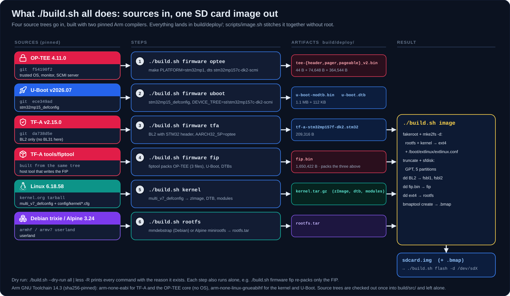

# 08 · Customizing: where each kind of change goes

The build never edits the upstream sources by hand and never edits `config/stm32mp157f-dk2.conf` for you.
Your changes live in a few small places that are meant to be committed to git, so the whole board stays
reproducible.



| I want to … | Put it in | Rebuild with |
| --- | --- | --- |
| change a version, URL, hostname, password, console, partition size | `config/local.conf` (git-ignored) **or** an environment variable for one run | the affected step |
| patch TF-A (BL2/BL31) | `patches/tf-a/*.patch` | `./build.sh firmware tfa` + `fip` |
| patch OP-TEE | `patches/optee/*.patch` | `firmware optee` + `fip` |
| patch or reconfigure U-Boot | `patches/u-boot/*.patch`, or `./build.sh uboot-menuconfig` for experiments | `firmware uboot` + `fip` |
| change the kernel configuration | `config/kernel/*.cfg` | `FORCE_CONFIG=1 ./build.sh kernel` |
| patch the kernel | `patches/kernel/*.patch` | `./build.sh kernel` |
| change or add a device tree (Linux) | `custom/dts/*.dts` (copied to `arch/arm/boot/dts/st/`) | `./build.sh kernel` |
| change the secure world's view of the board (which peripherals are secure) | a patch to `core/arch/arm/dts/stm32mp157c-dk2-scmi.dts` in `patches/optee/`, or `OPTEE_DTS` | `firmware optee` + `fip` |
| change the kernel command line | `KERNEL_CMDLINE_EXTRA` in `config/local.conf` | `./build.sh image` |
| add packages / change the Debian system | `DEBIAN_PACKAGES`, `scripts/rootfs/debian-customize.sh` | `./build.sh rootfs image` |
| add my application | into your rootfs (a tarball, or the customize hook) | `./build.sh rootfs image` |
| change the partition sizes or layout | `config/local.conf` (`FIP_SIZE_KB`, `ROOTFS_PART_START_MB`, …) | `./build.sh image` |

## Overriding configuration

Every setting in [`config/stm32mp157f-dk2.conf`](../config/stm32mp157f-dk2.conf) has the form
`: "${NAME:=default}"`, meaning *"keep NAME if the environment already sets it"*. So for one run:

```bash
TFA_LOG_LEVEL=40 ./build.sh firmware tfa
TARGET_HOSTNAME=bench-07 ./build.sh -r alpine rootfs
```

and for good, in `config/local.conf` (loaded first, ignored by git):

```bash
TARGET_PASSWORD='something-not-stm32mp1'
KERNEL_CMDLINE_EXTRA='rootwait rw loglevel=7'
BUILD_DIR=/mnt/fast-disk/mp1
```

`./build.sh info` shows what the build will use.

## Patches

A patch is a `git format-patch` file. Put it in the folder of the component it changes, named so that name
order is the order of application (`0001-…`, `0002-…`). They are applied **once per checkout**, with
`git apply`, and recorded so a second run skips them.

```bash
cd build/src/u-boot                       # edit the checked-out tree, then:
git diff > ../../../patches/u-boot/0001-my-change.patch
```

To re-apply a patch you edited, delete the checkout (`rm -rf build/src/u-boot build/work/u-boot`) or use
`./build.sh --update firmware uboot`, which refuses when the tree has uncommitted edits. For the kernel
(a tarball, not a git tree) delete `build/src/linux-6.18.58`; the script unpacks it again and re-applies.

## Worked examples

### A. Make the kernel less quiet

```bash
echo "KERNEL_CMDLINE_EXTRA='rootwait rw loglevel=8'" >> config/local.conf
./build.sh image && ./build.sh flash -d /dev/sdX --kernel-only      # or re-write the card
```

The command line ends up in `/boot/extlinux/extlinux.conf` on the card, so you can also edit it *on the
card* (mount the rootfs partition on your PC) to try a value without rebuilding anything.

### B. Turn a kernel option on

```bash
echo 'CONFIG_DYNAMIC_DEBUG=y' > config/kernel/10-debug.cfg
FORCE_CONFIG=1 ./build.sh kernel
```

`FORCE_CONFIG=1` makes the script rebuild `.config` from the defconfig plus every fragment; without it an
existing `.config` is kept. After `./build.sh kernel-menuconfig`, `diff` the old and new `.config` to turn
your clicks into a fragment.

### C. Change the device tree

Copy the DK's tree, include it, and override what you need (the 64-bit board ships exactly such a
file as a workaround; this one needs none):

```dts
#include "stm32mp157f-dk2.dts"
&uart4 { status = "disabled"; };         /* example only: this would disable the console! */
```

Save it as `custom/dts/my-board.dts`, put `st/my-board.dtb` **first** in `KERNEL_DTBS`, rebuild the kernel
and the image. `extlinux.conf` then says `FDT /boot/my-board.dtb`.

To see the effect before flashing, decompile the result: `dtc -I dtb -O dts build/deploy/kernel/boot/my-board.dtb | less`.

### D. A different SD-card layout

The numbers in `config/stm32mp157f-dk2.conf` (see [06](06-sdcard-image.md)) describe the layout
`scripts/image.sh` writes. Changing `FIP_SIZE_KB` or `ROOTFS_PART_START_MB` is safe as long as the
checks in `image.sh` pass (BL2 fits its partition, the FIP fits its partition, the partitions do not overlap
the environment). Do **not** rename `fsbl1`, `fsbl2` or `fip`, and do not change their type GUIDs: the ROM and
BL2 find them by those.

### E. Use your own userland

Build with Buildroot or Yocto's `core-image-minimal` for 32-bit ARM (`armv7a`, hard-float), take the root tarball, and
`./build.sh -r /path/to/rootfs.tar.zst image`. [05](05-rootfs.md#bring-your-own) lists the two things it
must contain.

## What is *not* meant to be customized here

* The partition **names** and **type GUIDs** (`fsbl1`, `fsbl2`, `fip`), the 4 MiB FIP size limit set by
  the partition, and `u-boot-env`'s name: they are contracts with the ROM, BL2 and U-Boot.
* Signing keys: no secrets belong in this repository. If you add secure boot, keep keys outside the tree and
  point to them from `config/local.conf`.

Next: [09 · Troubleshooting](09-troubleshooting.md).
