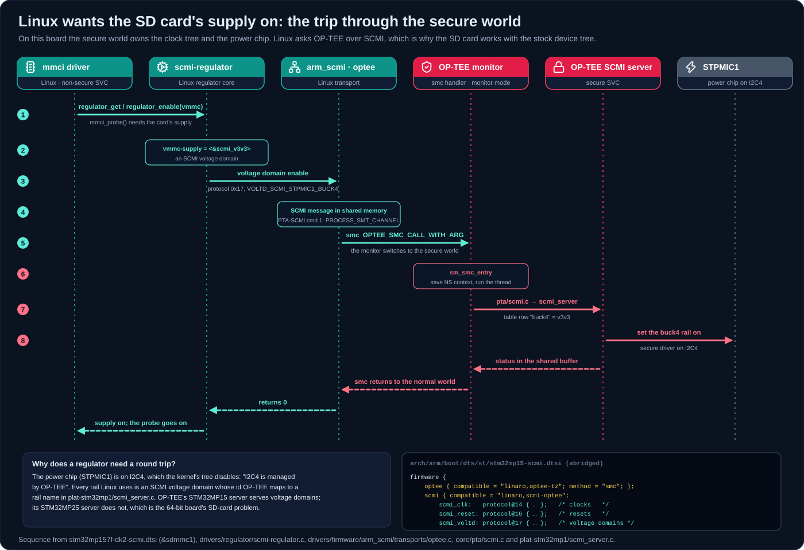

# 11 · The secure world and SCMI: why Linux asks for its clocks

On the STM32MP15 the secure world is an option: ST's older device trees give Linux the whole clock tree and
leave OP-TEE only the crypto and key functions. **This board does not use that option.** It uses the layout
ST calls *SCMI*, in which OP-TEE owns the clock and reset controller and Linux asks for what it needs. This
chapter explains why that was chosen, how the two worlds talk, and the one thing that makes this board easier
than its 64-bit sibling.

## Which boot path, and why (the decision)

The Discovery Kit's silicon and board can be driven in three ways. The sources pinned by this repository say:

| Option | What it is | Verdict here |
| --- | --- | --- |
| **A. Full OP-TEE, SCMI device trees** (chosen) | BL2 → OP-TEE (SCMI server) → U-Boot → Linux. Linux uses `stm32mp157f-dk2.dts` | The only DK2 tree for the **F** chip that mainline Linux 6.18 ships (see below), and the one U-Boot's `doc/board/st/stm32mp1.rst` calls "recommended by STMicroelectronics". Needs a secure-world SCMI server. |
| B. OP-TEE, no SCMI | OP-TEE only for crypto/keys; Linux owns the RCC and the PMIC (`stm32mp157c-dk2.dts`) | Exists for the **C** chip variant only; mainline has no non-SCMI tree for the F chip. A different DTB, and a different OP-TEE tree, for a chip you do not have. |
| C. TF-A `sp_min` instead of OP-TEE | TF-A's minimal monitor | TF-A's docs say "not recommended … very limited support" (`docs/plat/st/stm32mp1.rst`). No SCMI server at all, so it cannot serve option A's device tree. |

In Linux 6.18.58, `arch/arm/boot/dts/st/stm32mp157f-dk2.dts` ends its `#include` list with
`stm32mp157f-dk2-scmi.dtsi`: there is **no** F-chip DK2 tree without it. A bench-proven configuration of this
very kit (ST's own OpenSTLinux, "full OP-TEE" boot scheme, `stm32mp157f-dk2.dtb`, console `ttySTM0,115200`)
uses the same structure, so this build follows it, with upstream components instead of ST's forks.

## Two worlds, one CPU

The Cortex-A7 cores run in one of two **security states**: *secure* or *non-secure* (normal). The state is
carried on every memory access, and the hardware **firewalls** between the cores and everything else decide
by it. `smc` ("secure monitor call") is the only instruction that moves between the worlds; on this 32-bit
chip it traps to **monitor mode**, which OP-TEE's `sm` code handles (`CFG_SM_PLATFORM_HANDLER`).

| Firewall | Guards | Where you can see it |
| --- | --- | --- |
| **ETZPC** | each peripheral, one DECPROT entry per peripheral: secure only, non-secure read-only, non-secure full | `&etzpc { st,decprot = … }` in OP-TEE's `stm32mp157c-dk2-scmi.dts`; e.g. `STM32MP1_ETZPC_I2C4_ID`, `STM32MP1_ETZPC_RNG1_ID` |
| **TZC-400** | DDR regions | the `st-mem-firewall` node of TF-A's `fdts/stm32mp15-fw-config.dtsi`: the top 32 MiB of DDR are `TZC_REGION_S_RDWR`, the rest non-secure |
| **RCC TZEN** | the clock/reset controller itself | OP-TEE sets `RCC_TZCR.TZEN` when the RCC node is `st,stm32mp1-rcc-secure` (U-Boot `doc/board/st/stm32mp1.rst`: "secured with RCC_TZCR.TZEN=1 in OP-TEE") |

The 64-bit STM32MP2 uses a newer scheme, RIF, for the same purpose ([14](14-the-stm32mp-family.md)).

## What is on the secure side on this board

* **The clock tree and resets.** The oscillators, PLLs and bus clocks belong to OP-TEE once TZEN is set.
  The kernel's device tree says so: `stm32mp15-scmi.dtsi` and `stm32mp157f-dk2-scmi.dtsi` replace the clock
  inputs of the RCC and several devices by `<&scmi_clk CK_SCMI_…>` (HSE, HSI, CSI, LSE, LSI, MPU, RNG1, CRYP1…)
  and give the RCC the compatible `st,stm32mp1-rcc-secure`. Linux's own RCC driver builds the gates and
  dividers **below** those roots.
* **The regulators.** The device tree's power tree is made of **SCMI voltage domains**: `scmi_reguls` with
  `VOLTD_SCMI_STPMIC1_BUCK4` named `v3v3`, `LDO1` `v1v8_audio`, and so on. The STPMIC1 power chip is on I²C4,
  which the kernel's tree **disables** ("I2C4 is managed by OP-TEE", `stm32mp157f-dk2.dts`): Linux never talks to
  the PMIC, it asks OP-TEE.
* **The watchdog.** `arm_wdt` (`arm,smc-wdt`, SMC id `0xbc000000`): Linux's watchdog driver is a thin `smc` client.
* **OP-TEE's own 32 MiB** at `0xde000000`, reserved in the kernel's tree (`optee@de000000`, `no-map`).

## SCMI in two paragraphs

**SCMI** is Arm's *System Control and Management Interface*: a standard message protocol between an *agent*
that wants a service (here: Linux, and also U-Boot) and a *platform* that provides it (here: OP-TEE). A
message names a **protocol** (clock `0x14`, reset `0x16`, voltage `0x17`, power `0x11`, performance `0x13`,
sensor `0x15` …), a **message id** and parameters (which clock). The reply carries a status.

A **transport** says how the bytes move. Here the doorbell is a call into OP-TEE: the device tree says
`scmi { compatible = "linaro,scmi-optee"; linaro,optee-channel-id = <0>; … }`, and the kernel driver
(`drivers/firmware/arm_scmi/transports/optee.c`) opens a session to OP-TEE's **PTA-SCMI** pseudo trusted
application and hands it the message in a shared-memory buffer. OP-TEE-side, the server is OP-TEE's *own*
small implementation (`core/drivers/scmi-msg/`, tables in `core/arch/arm/plat-stm32mp1/scmi_server.c`); the
64-bit board uses Arm's much bigger SCP-firmware instead, so **no extra source tree and no `cmake` are needed
here**. The platform file lists the clocks (`CLOCK_CELL(CK_SCMI_MPU, …)`), the reset domains and the voltage
domains the server will answer for.



### The same chain, annotated for the SD card

1. `mmci_probe()` (`drivers/mmc/host/mmci.c`) asks for the card's supply: `vmmc-supply = <&scmi_v3v3>`
   (`stm32mp157f-dk2-scmi.dtsi`), and enables the controller's clock.
2. The regulator core calls the SCMI voltage driver (`drivers/regulator/scmi-regulator.c`), which sends a
   **voltage-domain** message for `VOLTD_SCMI_STPMIC1_BUCK4`.
3. The `optee` transport turns the message into a call into OP-TEE, an `smc` the OP-TEE monitor handles
   (`OPTEE_SMC_CALL_WITH_ARG`).
4. OP-TEE's SCMI server looks the domain up in `scmi_voltage_domain[]` (`VOLTD_CELL_PMIC(VOLTD_SCMI_STPMIC1_BUCK4,
   "buck4", "v3v3")`) and drives the STPMIC1 over I²C4 with its secure-world driver; the status goes back.

## Why this board does not have the 64-bit board's SD-card problem

On the STM32MP257F-DK, the kernel's tree takes the SD card's supplies from SCMI voltage domains, but
**OP-TEE 4.11.0's `stm32mp2` server serves only clocks and resets**, so Linux waits forever for a regulator
that cannot appear; that board ships a workaround device tree. On the STM32MP15 the same OP-TEE release has
the voltage-domain module on: in `core/arch/arm/plat-stm32mp1/conf.mk`

```make
CFG_SCMI_PTA ?= y
ifneq ($(CFG_SCMI_SCPFW),y)
$(call force,CFG_SCMI_MSG_DRIVERS,y,Mandated by CFG_SCMI_PTA)
…
ifeq ($(CFG_SCMI_MSG_DRIVERS),y)
$(call force,CFG_SCMI_MSG_CLOCK,y)
$(call force,CFG_SCMI_MSG_RESET_DOMAIN,y)
$(call force,CFG_SCMI_MSG_VOLTAGE_DOMAIN,y)
```

and `scmi_server.c` has a table row for every STPMIC1 rail the device tree names. So **no device-tree
workaround is shipped**: the stock `stm32mp157f-dk2.dtb` is booted. The IDs were compared by hand between the
two sides: the kernel's `VOLTD_SCMI_STPMIC1_BUCK1 … PWR_SW2` list in `stm32mp157f-dk2-scmi.dtsi` against
`scmi_voltage_domain[]` in OP-TEE.

## What this means for you

* **OP-TEE is not optional.** Without it, `scmi { … }` has no server and Linux cannot get its clocks, resets
  and the SD card's supply.
* **U-Boot is a client too.** It builds with `CONFIG_SCMI_FIRMWARE`, `CONFIG_CLK_SCMI`, `CONFIG_RESET_SCMI` and
  `CONFIG_DM_REGULATOR_SCMI` (`configs/stm32mp15_defconfig`) and its device tree is the SCMI variant, so that it
  too asks OP-TEE ([03](03-firmware-and-uboot.md)).
* **Debugging is easier from the secure side.** OP-TEE prints on the same UART4 console
  (`CFG_TEE_CORE_LOG_LEVEL`, set to `2` by `scripts/firmware.sh`); raising it, and `TFA_LOG_LEVEL`, shows the
  secure world's half of a hang that looks like "Linux stopped".
* **On a running board** (nothing here needs special tools):

  ```bash
  sudo dmesg | grep -iE 'optee|scmi'                 # driver and protocol versions
  sudo cat /sys/kernel/debug/clk/clk_summary | less  # the clock tree; SCMI clocks come from the server
  ls /sys/class/regulator/                           # regulator.N: v3v3, vdd, v1v8_audio …
  ```

## What is not verified

OP-TEE 4.11.0 has no `stm32mp157f-dk2.dts` of its own (ST's fork does); the build embeds
`stm32mp157c-dk2-scmi.dts`, the same board with the C-variant name. The differences between C and F are the
crypto/secure-boot option and the maximum CPU frequency, neither of which this tree configures, but this has
**not been run on a board**.

Two smaller points were checked in the sources and are expected to be harmless:

* The kernel's tree gives the `optee` node an interrupt (`GIC_PPI 15`, the notification interrupt), but this
  OP-TEE build has `CFG_CORE_ASYNC_NOTIF=n` (it is forced on only for the STM32MP13 in `plat-stm32mp1/conf.mk`).
  The Linux driver (`drivers/tee/optee/smc_abi.c`) uses the interrupt only when OP-TEE advertises
  `OPTEE_SMC_SEC_CAP_ASYNC_NOTIF`, so it is ignored.
* The OP-TEE core is built with `arm-none-eabi-gcc` (together with its user-space libraries). It built and linked
  without errors here; OP-TEE's own documentation uses a Linux-targeting `arm-linux-gnueabihf-`. If you build
  trusted applications of your own, give OP-TEE the Linux toolchain for them (`CROSS_COMPILE_ta_arm32=`). If the console stops at OP-TEE or the SD card is never found, start with
[09](09-troubleshooting.md) and the first-boot checklist ([15](15-first-boot-checklist.md)).

Next: [12 · Board tour](12-board-tour.md).
