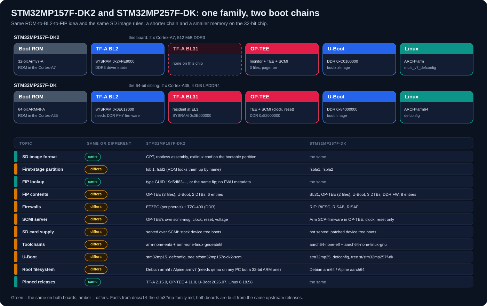

# 14 · The STM32MP family: this board and its 64-bit sibling

ST sells two generations of these microprocessors, and this repository has a board directory for one kit of
each. They are built the same way (one `build.sh`, upstream sources, an SD card image, the same ten
chapters), but they are **not one build with a switch**. This chapter says what is the same, what is not, and
why each has its own directory.

The sibling is [`boards/stm32mp2-dk`](../../stm32mp2-dk/README.md) (STM32MP257F-DK, two 64-bit Cortex-A35); its
[boot flow](../../stm32mp2-dk/docs/01-boot-flow.md) and
[secure-world chapter](../../stm32mp2-dk/docs/11-secure-world-and-scmi.md) are the counterparts of
[01](01-boot-flow.md) and [11](11-secure-world-and-scmi.md) here.

## Why two directories

The board contract ([`docs/board-contract.md`](../../../docs/board-contract.md)) says a board directory is
self-contained: you can copy it out of the repository and it still works. Almost everything below differs
between the two kits, so one directory with `if mp1; then …` in every script would make both harder to read.
The scripts were kept **structurally identical** instead, so that `diff -u` of the two boards shows exactly the
list in this chapter and nothing else.

## What is the same

| Topic | Both boards |
| --- | --- |
| Medium and format | a GPT **SD card image** assembled without root (`fakeroot`, `mke2fs -d`, `sfdisk`) |
| Boot ROM | looks in the GPT for a partition with a fixed *name* and loads the file in it into on-chip SRAM |
| First stage | TF-A **BL2**, built with `RESET_TO_BL2`, wrapped in an STM32 image header |
| Second container | a **FIP** found by type GUID `19d5df83-11b0-457b-be2c-7559c13142a5` (or the name `fip`), made by `fiptool` |
| Trusted OS | **OP-TEE**, which is also the SCMI server for clocks and resets |
| Bootloader | **U-Boot** (BL33), `bootcmd_stm32mp`, distro boot, `extlinux.conf` on the partition with the bootable flag |
| Environment | the `u-boot-env` partition (`u-boot,mmc-env-partition`) |
| Pinned releases | TF-A v2.15.0, OP-TEE 4.11.0, U-Boot v2026.07, Linux 6.18.58, Arm GNU Toolchain 14.3.rel1, Debian trixie, Alpine 3.24.2 |
| Console | `ttySTM0` at 115200 8N1 through the on-board ST-LINK |
| Tooling | explain mode (`--dry-run`), `flash` guard, `deps`, `info`, the same step names (`firmware`, `kernel`, `rootfs`, `image`, `flash`) |

## What differs

| Topic | STM32MP157F-DK2 (this board) | STM32MP257F-DK |
| --- | --- | --- |
| CPU | 2 × Cortex-A7 (Armv7-A, **32-bit**), + Cortex-M4 | 2 × Cortex-A35 (ARMv8-A, **64-bit**), + Cortex-M33 |
| Memory | 512 MiB DDR3 | 4 GiB LPDDR4 |
| DDR bring-up | driver in BL2, no firmware blob | driver in BL2 **plus** ST's DDR PHY training firmware (SLA0044), a `ddr` build step |
| Monitor | **no BL31**: OP-TEE is the monitor (`AARCH32_SP=optee`) | BL31 stays resident at EL3 (`SPD=opteed`) |
| Privilege model | processor modes (SVC, monitor) | exception levels EL0-EL3 |
| Peripheral firewall | ETZPC (per peripheral) and TZC-400 (DDR) | RIF: RIFSC, RISAB, RISAF |
| BL2 location | SYSRAM `0x2FFE9000` | SYSRAM `0x0E017000` |
| OP-TEE location | SYSRAM (pager) and DDR `0xDE000000` | DDR `0x82000000` |
| OP-TEE files in the FIP | 3 (header, pager, pageable; pager is on) | 2 (header, pager) |
| FIP entries | 6 | 8 |
| SCMI server | OP-TEE's own `scmi-msg`; protocols clock `0x14`, reset `0x16`, **voltage `0x17`** | Arm SCP-firmware inside OP-TEE; clock and reset only |
| SD card supply | served over SCMI, so the stock device tree is booted | **not** served: a patched device tree is booted ([that board's chapter 11](../../stm32mp2-dk/docs/11-secure-world-and-scmi.md)) |
| First-stage partition names | `fsbl1`, `fsbl2` | `fsbla1`, `fsbla2` |
| TF-A | `PLAT=stm32mp1 ARCH=aarch32 ARM_ARCH_MAJOR=7 AARCH32_SP=optee` | `PLAT=stm32mp2 STM32MP_LPDDR4_TYPE=1 SPD=opteed` |
| Toolchains | `arm-none-eabi-` (TF-A, OP-TEE) and `arm-none-linux-gnueabihf-` (U-Boot, kernel) | `aarch64-none-elf-` and `aarch64-none-linux-gnu-` |
| U-Boot | `stm32mp15_defconfig`, tree `st/stm32mp157c-dk2-scmi`, starts a `zImage` with `bootz` | `stm32mp25_defconfig`, tree `st/stm32mp257f-dk`, starts an `Image` with `booti` |
| Kernel | `ARCH=arm`, `multi_v7_defconfig`, `zImage`, `arch/arm/boot/dts/st/stm32mp157f-dk2.dtb` | `ARCH=arm64`, `defconfig`, `Image`, `arch/arm64/boot/dts/st/stm32mp257f-dk.dtb` |
| Root filesystem | Debian `armhf`, Alpine `armv7` | Debian `arm64`, Alpine `aarch64` |
| Building the Debian rootfs on an ARM64 PC | needs `qemu-user` (an ARM64 CPU may not run 32-bit code) | runs natively |
| Console UART | UART4 | USART2 |
| Kernel config | the stock `multi_v7_defconfig` passes all 20 boot-path checks | the stock `defconfig` passes its 17 |
| Hardware on the DK | microSD only (no eMMC), DSI panel, Wi-Fi/BT, audio, HDMI | see that board's tour |

## Which to read first

If you are new to the family, read this board first: there is no BL31, no DDR firmware, no SCP-firmware, no
device-tree workaround, so the boot chain is shorter by three boxes and you see only the parts that matter.
Then read the sibling for what a 64-bit chip adds. If you already know one, the table above is the
whole diff.

## Where the two meet in the sources

* TF-A: `plat/st/common/` is shared (the STM32 image header, the GPT/FIP lookup in `bl2_io_storage.c`, the
  console and the board-info printing); `plat/st/stm32mp1/` and `plat/st/stm32mp2/` are the SoC-specific parts.
  The two ST documentation pages are `docs/plat/st/stm32mpus.rst` (common) and `stm32mp1.rst`/`stm32mp2.rst`.
* OP-TEE: `core/arch/arm/plat-stm32mp1/` and `plat-stm32mp2/`, `PLATFORM=stm32mp1` or `stm32mp2`.
* U-Boot: `board/st/stm32mp1/` vs `board/st/stm32mp2/`, `arch/arm/mach-stm32mp/`, the `stm32mp15_*` and
  `stm32mp25_*` configs.
* Linux: `arch/arm/mach-stm32` (a few lines) vs `arch/arm64`; the device trees in `arch/arm/boot/dts/st/` and
  `arch/arm64/boot/dts/st/`.

Next: [15 · First boot checklist](15-first-boot-checklist.md).
