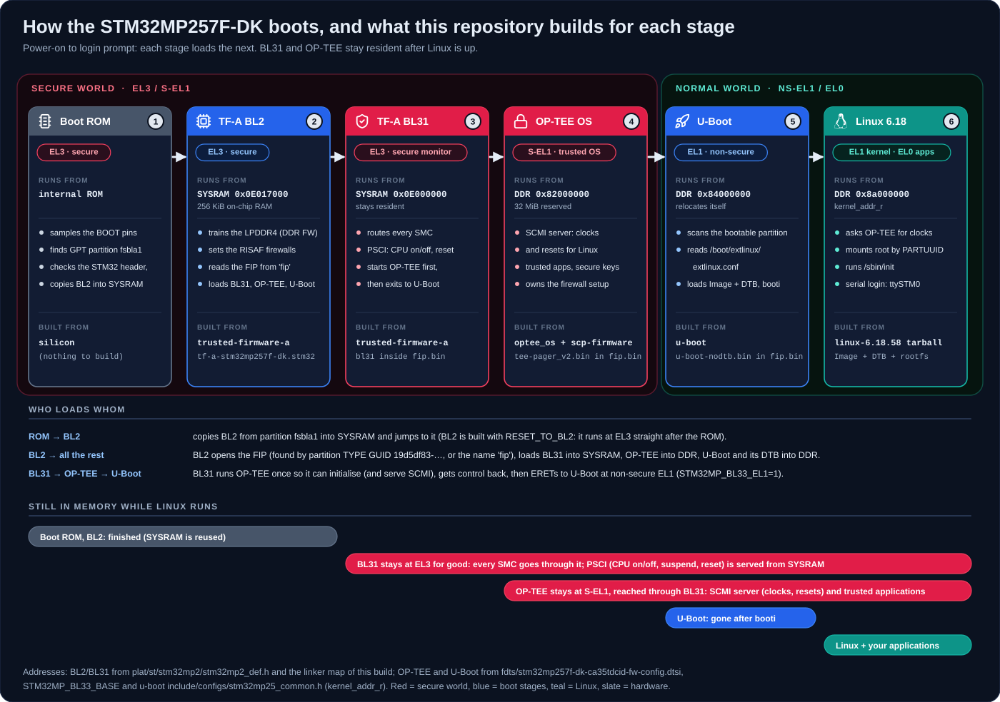
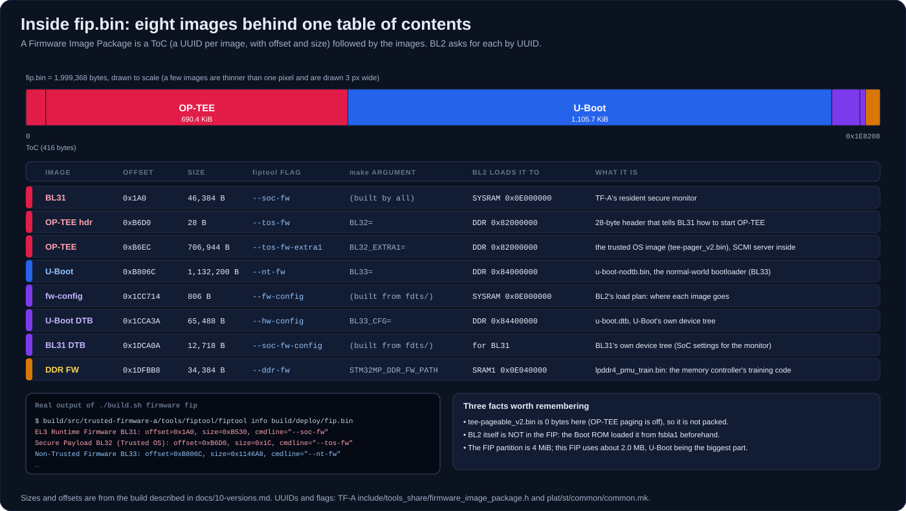
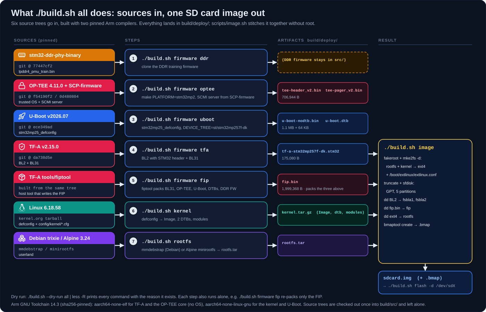
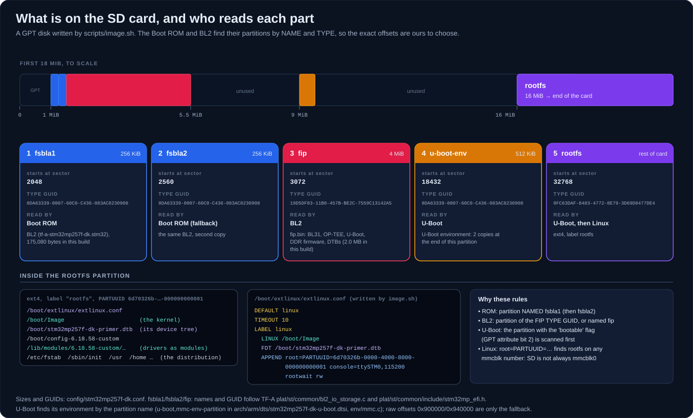
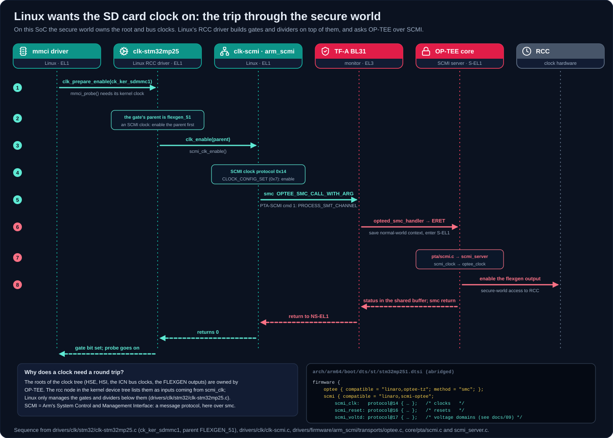
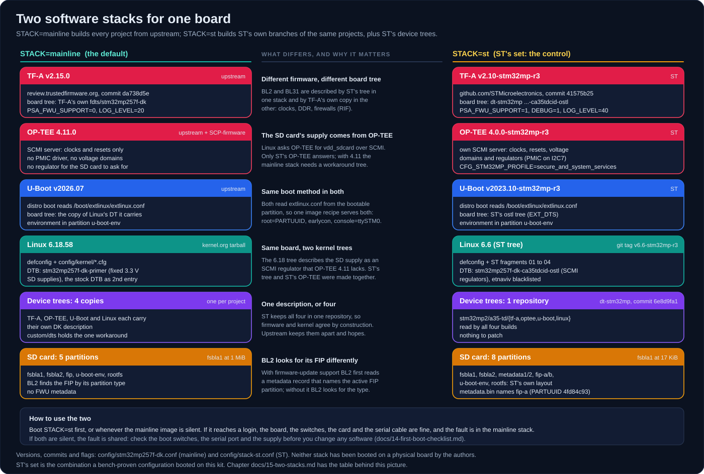

<div align="center">

# STM32MP257F-DK · first steps from source

**Secure firmware, OP-TEE, U-Boot, Linux and a bootable SD card for ST's STM32MP257F Discovery Kit,
built from the upstream projects with one command and no Yocto.**

[](https://github.com/N3b3x/embedded-linux-primer/actions/workflows/ci.yml)


[Quick start](#quick-start) · [Status](#what-has-been-checked) · [How it boots](#1-the-boot-chain) ·
[How the build works](#2-how-the-build-makes-the-sd-card) · [The secure world](#3-the-secure-world-in-one-page) ·
[Two stacks](#4-two-software-stacks-one-board) · [First boot](docs/14-first-boot-checklist.md) ·
[Docs](docs/README.md) · [Acronyms](docs/13-acronyms.md)

</div>



```bash
./build.sh deps --install          # once: host packages
./build.sh -s st all               # FIRST BOOT: ST's own tested stack  → build/deploy-st/sdcard.img
./build.sh all                     # the mainline stack (upstream)      → build/deploy/sdcard.img
./build.sh flash -d /dev/sdX       # write the card (asks first), then boot the board
```

`STACK=st ./build.sh all` is the same as `./build.sh -s st all`. Which one to use first, and why there are two,
is [section 4](#4-two-software-stacks-one-board).

- **All upstream (the default stack):** TF-A, OP-TEE, U-Boot and the Linux kernel at the project's own release tags. No vendor
  fork, no Yocto. Every version is pinned to a commit or a sha256.
- **Or ST's own set (`-s st`):** ST's branches of the same projects (TF-A 2.10, OP-TEE 4.0, U-Boot 2023.10, Linux 6.6)
  and ST's device trees, also built from source without Yocto. It is the combination a bench-proven configuration booted on this kit,
  so it doubles as the control that separates "board, switches or serial problem" from "mainline-stack problem".
- **Explains itself:** every command is printed with *why* it runs, and `--dry-run` turns the whole build
  into a readable recipe.
- **Two compilers, both from Arm:** `aarch64-none-elf` for the bare-metal parts, `aarch64-none-linux-gnu`
  for U-Boot and the kernel; downloaded with their checksum for your PC (x86-64 or ARM64).
- **Rootless:** compiling and image assembly run as your user. `sudo` is needed to install packages, to write
  the card, and only if your system forbids user namespaces for the Debian root filesystem.
- **A real secure world:** the STM32MP25 cannot reach Linux without one. This board is the place to see how
  a secure monitor (BL31), a trusted OS (OP-TEE) and its SCMI server fit together.

---

## What has been checked

Honesty first. The mainline stack was written and exercised in an Ubuntu 24.04 ARM64 container on 24 October 2026,
the ST stack and the boot-safety changes on 25 October 2026 in the same kind of container.
**Neither stack has been booted on a physical STM32MP257F-DK.**

| Capability | `mainline` | `st` | How it was checked |
| --- | --- | --- | --- |
| Scripts are `shellcheck`-clean | **done** | **done** | `shellcheck -x build.sh scripts/*.sh scripts/lib/common.sh scripts/rootfs/*.sh` |
| `--dry-run` of every step and of `all` | **done** | **done** | the whole recipe printed without errors, for both `STACK` values |
| TF-A BL2 + BL31, OP-TEE, U-Boot, FIP | **built in a container** | **built in a container** | `./build.sh firmware`: mainline `fip.bin` 1,999,368 bytes and BL2 175,080 bytes; st `fip.bin` 3,136,774 bytes, BL2 200,744 bytes (a `DEBUG=1` build), 120-byte FWU metadata; `fiptool info` lists the 8 expected images in both. The st firmware was also built from empty source directories |
| Linux (`Image`, DTBs, modules) | **built in a container** | **built in a container** | `./build.sh kernel`: mainline 6.18.58, `Image` 41,421,312 bytes, 1,418 modules, 36 minutes; st 6.6.116-custom (ST tree, four ST fragments), `Image` 25,704,960 bytes, about 25 minutes with 4 jobs. The options the boot path needs (17, 18 for st) are checked at configuration time. The pinned 14.3.rel1 compilers built every part of both stacks |
| Debian trixie / Alpine 3.24 rootfs | **built in a container** | shared | `./build.sh rootfs`, `./build.sh -r alpine rootfs`; both stacks use the same tarball |
| SD image assembly, partition table | **built and inspected in a container** | **built and inspected in a container** | `./build.sh image`: `sfdisk --verify`; BL2, the FIP and (st) the metadata compared byte for byte with their partitions; `extlinux.conf` read back from the ext4. **U-Boot sandbox builds** (v2026.07 and ST's v2023.10) were run on the images: each parses the GPT, `part list -bootable` answers the rootfs partition (5, and 8 for st), and `sysboot` reads `extlinux.conf`, loads `/boot/Image` and the DTB and sets `bootargs=root=PARTUUID=… rootwait rw earlycon … console=ttySTM0,115200` |
| `flash.sh` | **exercised on a loop device** | **exercised on a loop device** | in a container, with the disk-safety guard stubbed (it refuses loop devices): a full write with `bmaptool`, erasing a planted stale environment, `--expand` (checked: `sfdisk -N` keeps PARTUUID and the bootable attribute), `--firmware-only`, and the refusal of a card of the other stack. Not run against a real SD card |
| Builds on an **x86-64** PC | not run | not run | the x86-64 toolchain URLs return 200 and their checksums are pinned; the scripts pick them by `uname -m` |
| **Boots on the DK** | **not tried** | **not tried** | see [14](docs/14-first-boot-checklist.md), [09](docs/09-troubleshooting.md) and the risks below |

**The known risk of the mainline stack.** The upstream device tree of this kit takes the SD card's power from an SCMI
*voltage domain*, which OP-TEE 4.11.0's SCMI server for the STM32MP2 does not offer (it serves clocks and resets
only). Linux would wait for it forever. The default tree here (`custom/dts/stm32mp257f-dk-primer.dts`)
replaces those two supplies with fixed regulators. The reasoning is in
[11](docs/11-secure-world-and-scmi.md#what-this-repository-had-to-work-around); it is **unverified on
hardware** and it is the first place to look if the board stops after U-Boot. The boot menu offers the unmodified tree as a
second entry so the two can be compared on the board. **The ST stack avoids the question**: ST's OP-TEE serves the voltage
domain and ST's device tree names it ([15](docs/15-two-stacks.md)).

**The known risk of the ST stack.** The bench-proven configuration that booted this kit with ST's versions started Linux
through a signed FIT image; this repository starts it the way ST's own SD image does, through U-Boot's `extlinux.conf`, on a
layout built from ST's. The pieces are ST's, the wiring of the last step is ours and has only been run in U-Boot's PC
sandbox.

**What you get when it boots:** a console on the ST-LINK serial port, the microSD card, Ethernet, the heartbeat
LED and the two user buttons. The mainline kernel's device tree for this kit enables nothing else yet
([12](docs/12-board-tour.md)): no display, USB, audio, Wi-Fi or Cortex-M33. ST's device tree describes more,
but this image has no drivers' user space for it.

### If the first boot is silent

Five minutes of checking beats an hour of rebuilding. In this order ([14](docs/14-first-boot-checklist.md) has the details):

1. **Nothing at all on the serial port?** Boot switches on **SD**, the USB cable in the **ST-LINK** connector, a 5 V / 3 A supply,
   115200 8N1 with flow control **off**, the port captured to a file *before* power-on. Seeing ST's own Linux login means the
   board booted its eMMC, i.e. the switches are wrong.
2. **Text, then it stops?** Find the last line in the table of [14](docs/14-first-boot-checklist.md#3-what-each-stage-prints-and-what-its-absence-means): each stage has the line that proves it passed.
3. **Build and boot the other stack** (`./build.sh -s st all` if you used the default): if ST's reaches a login, the board, card
   and cable are fine and the fault is in the mainline stack. If both are silent the fault is shared, so look at step 1 again.
4. **Mainline stops after U-Boot or waits for the root device?** In the boot menu pick the second entry (the stock tree), and
   rebuild BL2 with `TFA_LOG_LEVEL=40` (`config/local.conf`) to see every step it takes.
5. **Send back the whole raw log** plus `./build.sh info`, `sfdisk -d` of the card and, if you reached `STM32MP>`, `printenv` and
   `part list mmc 0`.

---

## Quick start

| Step | Command | What happens |
| --- | --- | --- |
| **1. Host setup** (once) | `git clone https://github.com/N3b3x/embedded-linux-primer && cd embedded-linux-primer/boards/stm32mp2-dk`<br>`./build.sh deps --install` | installs ~35 Ubuntu/Debian packages. The cross-compilers are downloaded later, automatically |
| **2. Build** | `./build.sh -s st all`<br>or `./build.sh all`<br>or `./build.sh -s st -r alpine all` | firmware in minutes, kernel in the long step, Debian (full distro) or Alpine (tiny, no root). Ends with `SD card image: build/deploy-st/…img` (`-s st`) or `build/deploy/…img`. **For a first power-on use `-s st`**: its versions and device trees are the ones a bench-proven configuration booted |
| **3. Flash** | `lsblk -dpo NAME,SIZE,TRAN,MODEL`<br>`./build.sh -s st flash -d /dev/sdX --expand` | refuses system disks, shows the card, asks, writes, **erases the U-Boot environment area** (a reused card would keep old variables), grows the partition to the whole card. Use the same `-s` as for the build |
| **4. Boot** | boot switches → **SD** (see the kit's user manual), then `picocom -b 115200 --logfile boot.log /dev/ttyACM0` | BL2, OP-TEE and U-Boot text, then the kernel, then a login. Silent? See [14](docs/14-first-boot-checklist.md) |
| **5. Log in** | `root` or `dev`, password `stm32mp2` (a bench default: change it) | then read [07](docs/07-flashing-and-booting.md) and [12](docs/12-board-tour.md) |

No board yet? `./build.sh --dry-run all | less -R` prints the entire build as an annotated recipe, and
`./build.sh firmware` is a few minutes of real compiling that shows every moving part of the boot chain.

---

## 1. The boot chain

The diagram at the top is the whole story. Six stages, each loads the next:

| # | Stage | Runs at | Its job | Built from |
| --- | --- | --- | --- | --- |
| 1 | **Boot ROM** | EL3 · secure | finds partition `fsbla1`, copies BL2 into the on-chip SRAM | silicon |
| 2 | **TF-A BL2** | EL3 · secure | trains the LPDDR4, sets the memory firewalls, loads the **FIP** | `trusted-firmware-a` |
| 3 | **TF-A BL31** | EL3 · secure monitor | stays resident: `smc` routing, PSCI; starts OP-TEE, then U-Boot | `trusted-firmware-a` |
| 4 | **OP-TEE** | S-EL1 · trusted OS | trusted apps; **SCMI server** for clocks and resets | `optee_os` + `scp-firmware` |
| 5 | **U-Boot** | EL1 · non-secure | finds `extlinux.conf` on the bootable partition, loads Linux | `u-boot` |
| 6 | **Linux 6.18** | EL1 / EL0 | drivers, root filesystem, login on `ttySTM0` | `linux-6.18.58` + rootfs |

Stages 2 to 5 travel together in the **FIP**, one file written into one partition:



Deep dive: **[01 · Boot flow](docs/01-boot-flow.md)**, with the memory map and exactly which file in which
project does what ([source map](docs/images/source-map.svg)).

---

## 2. How the build makes the SD card



| Step | Command (runs on its own too) | Produces | Why it exists |
| --- | --- | --- | --- |
| ddr | `./build.sh firmware ddr` | `lpddr4_pmu_train.bin` | the DDR PHY must be trained at every power-up |
| optee | `./build.sh firmware optee` | `tee-pager_v2.bin` | the trusted OS and the SCMI server |
| uboot | `./build.sh firmware uboot` | `u-boot-nodtb.bin`, `u-boot.dtb` | the bootloader (BL33) |
| tfa | `./build.sh firmware tfa` | `tf-a-stm32mp257f-dk.stm32` | BL2: the one thing the Boot ROM can load |
| fip | `./build.sh firmware fip` | `fip.bin` | everything BL2 loads, in one container |
| metadata | `./build.sh -s st firmware metadata` | `metadata.bin` | `-s st` only: tells BL2 that `fip-a` is the active firmware |
| kernel | `./build.sh kernel` | `Image`, DTBs, modules | the OS |
| rootfs | `./build.sh rootfs` | `rootfs.tar` | init, shell, libraries |
| image | `./build.sh image` | `sdcard.img` + `.bmap` | lays out the card byte for byte, **without root** |
| flash | `./build.sh flash -d /dev/sdX` | the SD card | guarded `bmaptool`/`dd`, optional `--expand` |

The card is a GPT disk. The ROM and BL2 find their partitions by **name** and **type**, so those are
fixed; the offsets are ours (the mainline stack's five partitions below; ST's eight are in
[the two-stacks section](#4-two-software-stacks-one-board)):



Deep dives: [03 · Firmware and U-Boot](docs/03-firmware-and-uboot.md) ·
[04 · Kernel](docs/04-kernel.md) · [05 · Rootfs](docs/05-rootfs.md) ·
[06 · SD card image](docs/06-sdcard-image.md).

---

## 3. The secure world in one page

On this SoC the root of the clock tree belongs to OP-TEE. Linux's own clock driver builds gates and dividers
on top of it, and asks OP-TEE over **SCMI** (Arm's System Control and Management Interface, here carried in an
`smc`) whenever it needs a root clock or a reset:



So OP-TEE is not an optional extra here: it is the reason the kernel's device tree has a
`firmware { optee … scmi … }` node. [11 · The secure world and SCMI](docs/11-secure-world-and-scmi.md)
explains it step by step, with the files to open.

---

## 4. Two software stacks, one board



| | `STACK=mainline` (default) | `STACK=st` |
| --- | --- | --- |
| What it is | every project from upstream, current releases | ST's own branches of the same projects, as in OpenSTLinux r3 |
| TF-A / OP-TEE / U-Boot / Linux | 2.15.0 / 4.11.0 / 2026.07 / 6.18.58 | 2.10-stm32mp-r3 / 4.0.0-stm32mp-r3 / 2023.10-stm32mp-r3 / 6.6-stm32mp-r3 |
| Device trees | each project's own copy; one workaround tree for the SD supply | ST's `dt-stm32mp` repository, read by all four builds |
| SD card supply | fixed regulators (a workaround, unverified) | SCMI regulators, served by ST's OP-TEE |
| SD layout | 5 partitions, FIP found by type | ST's 8 (FWU metadata, `fip-a`/`fip-b`), `fsbla1` at 17 KiB |
| Boot logging | BL2 at level 20 (set `TFA_LOG_LEVEL=40`) | ST's debug trace: level 40 |
| Output directories | `build/{src,work,deploy,logs}` | `build/{src,work,deploy,logs}-st` |
| Checked | built, image inspected, never booted | built, image inspected, never booted |
| Expected odds of a first boot (an estimate) | moderate: the SD-supply workaround and the upstream-only combination are untested | better: these versions and device trees are the ones that booted, and the one new link is the `extlinux.conf` path |

Use ST's stack **first** on a new kit, because it is the one most likely to boot and because it is the control: if it reaches
a login and the mainline stack does not, the board is fine. The rest of this directory describes the mainline stack; every
place where ST's differs is marked, and [15 · The two stacks](docs/15-two-stacks.md) lists them all. The first-boot
procedure is [14](docs/14-first-boot-checklist.md).

---

**The 32-bit sibling.** [STM32MP157F-DK2](../stm32mp1-dk2/README.md) uses the same tools and image format;
its family chapter compares the two chips.

## Learn the concepts

| Chapter | You learn |
| --- | --- |
| [01 · Boot flow](docs/01-boot-flow.md) | exception levels, the six stages, who loads whom |
| [02 · Host setup](docs/02-host-setup.md) | packages, disk, time, containers |
| [03 · Firmware and U-Boot](docs/03-firmware-and-uboot.md) | DDR training, the FIP, how U-Boot finds Linux |
| [04 · Kernel](docs/04-kernel.md) | defconfig, the device tree of this board, the two DTBs |
| [05 · Root filesystem](docs/05-rootfs.md) | Debian vs Alpine vs yours |
| [06 · SD card image](docs/06-sdcard-image.md) | GPT, partition names and GUIDs, `extlinux.conf` |
| [07 · Flashing and booting](docs/07-flashing-and-booting.md) | writing the card, what to see on the console |
| [08 · Customizing](docs/08-customizing.md) | where every kind of change goes |
| [09 · Troubleshooting](docs/09-troubleshooting.md) | by the last line you saw |
| [10 · Versions](docs/10-versions.md) | the pins, how to move, ST's own set (`-s st`) |
| [11 · Secure world and SCMI](docs/11-secure-world-and-scmi.md) | TrustZone, RIF, SCMI over OP-TEE |
| [12 · Board tour](docs/12-board-tour.md) | the kit and what is enabled |
| [13 · Acronyms](docs/13-acronyms.md) | every three-letter word |
| [14 · First-boot checklist](docs/14-first-boot-checklist.md) | the switches, the log lines that prove each stage, what to send back |
| [15 · The two stacks](docs/15-two-stacks.md) | mainline vs ST: versions, device trees, SCMI, FWU metadata, SD layout |

## Layout of this directory

```text
build.sh                one entry point; ./build.sh help
config/                 versions and board constants (stm32mp257f-dk.conf), ST's stack (stack-st.conf), kernel fragments, local.conf
scripts/                one script per step + lib/common.sh (logging, explain mode, git/fetch/toolchain helpers)
patches/                your patches to TF-A, OP-TEE, U-Boot and the kernel, applied once per checkout (patches/st/ for -s st)
custom/dts/             your device trees (and the DK's SD-supply workaround); custom/dts-st/ for -s st
docs/                   the chapters above, and images/ with the SVG diagrams and their generators
build/                  everything generated (git-ignored): downloads, toolchains, sources, deploy/ (and src-st, deploy-st, ...)
```

## Licences

The scripts and documents of this directory are part of the repository (see the root of the repository for
its licence). The software they download keeps its own: TF-A BSD-3-Clause, OP-TEE BSD-2-Clause, SCP-firmware
BSD-3-Clause, U-Boot GPL-2.0-or-later, Linux GPL-2.0, ST's device trees (`dt-stm32mp`) GPL-2.0-only or BSD-3-Clause,
and the **DDR training firmware under ST's SLA0044** licence (`stm32-ddr-phy-binary/LICENSE.md`): read it before you redistribute an image.
