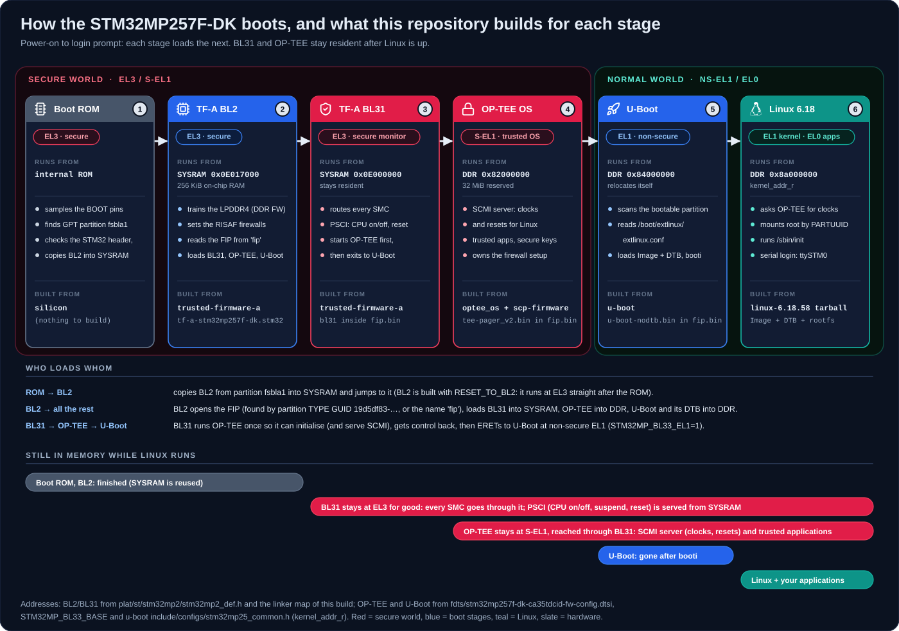
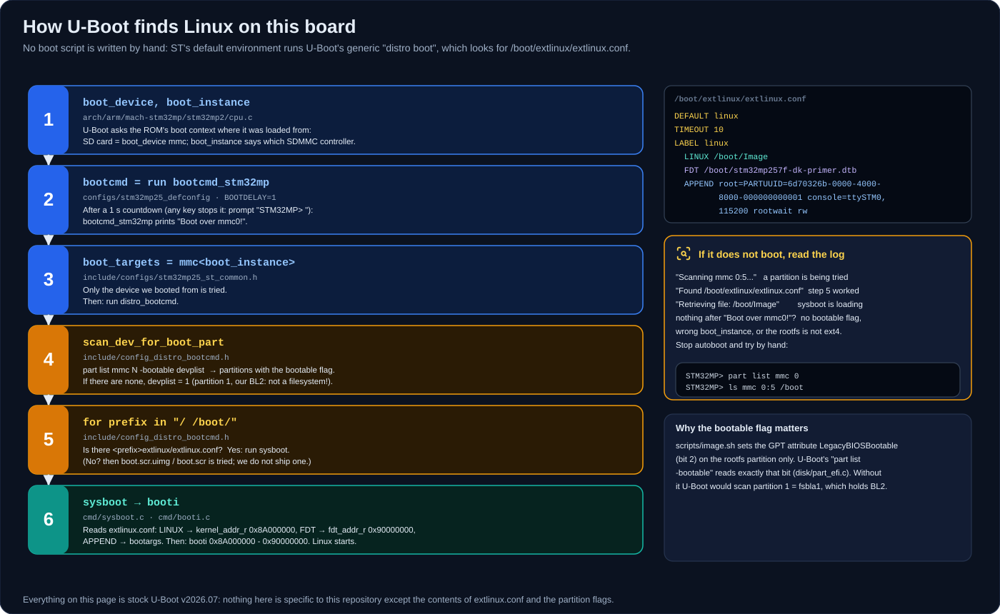
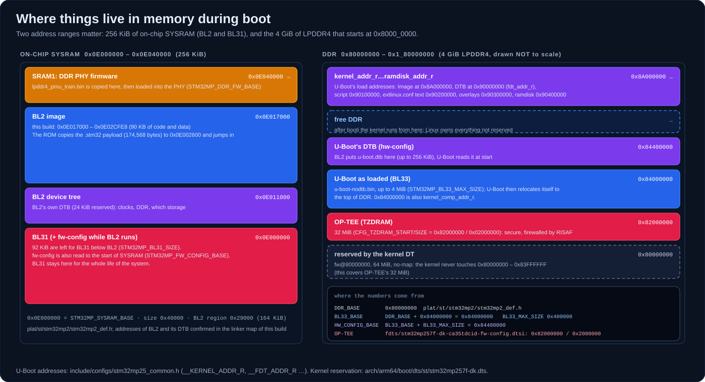

# 01 · Boot flow: from power-on to a login prompt

This chapter explains every box in the picture. If a word is new, [13 · Acronyms](13-acronyms.md) has it.
Every address and file name below was read from the pinned source trees; the file is named so you can
check.

## The big picture in one paragraph

A processor cannot start a big program like Linux straight from power-on: its RAM is not even working yet.
So boot is a **chain**. The first link is code burned into the chip (the **Boot ROM**). It can only do one
small thing: read a tiny program (**BL2**) from the SD card into the chip's on-board RAM (**SYSRAM**) and run
it. BL2's job is to make the big RAM (the **LPDDR4**) work, and then load everything else from the card. The
STM32MP25 then adds something many SoCs of this class do not have by default: a **secure world** that stays
alive next to Linux and owns the clocks and resets (see [11](11-secure-world-and-scmi.md)).

## The six stages

| # | Stage | Runs at | Lives at | What it does | Built from |
| --- | --- | --- | --- | --- | --- |
| 1 | **Boot ROM** | EL3, secure | internal ROM | samples the boot pins, finds GPT partition `fsbla1`, checks the STM32 image header, copies the payload into SYSRAM | silicon |
| 2 | **TF-A BL2** | EL3, secure | SYSRAM `0x0E017000` | logs why it was reset, trains the LPDDR4, sets the RISAF memory firewalls, loads every image from the FIP | `trusted-firmware-a` |
| 3 | **TF-A BL31** | EL3, secure monitor | SYSRAM `0x0E000000` | stays resident; routes every `smc`; PSCI (CPU on/off, reset); starts OP-TEE, then U-Boot | `trusted-firmware-a` |
| 4 | **OP-TEE OS** | S-EL1, secure | DDR `0x82000000`, 32 MiB | trusted OS; **SCMI server** for clocks and resets; trusted applications | `optee_os` + `scp-firmware` |
| 5 | **U-Boot** (BL33) | EL1, non-secure | DDR `0x84000000`, then relocates | scans the card for `extlinux.conf`, loads the kernel and DTB, `booti` | `u-boot` |
| 6 | **Linux** | EL1 kernel, EL0 apps | DDR | drivers, root filesystem, `/sbin/init`, login | `linux-6.18.58` |

Sources: SYSRAM addresses `plat/st/stm32mp2/stm32mp2_def.h` (and the linker map of the build); OP-TEE
`fdts/stm32mp257f-dk-ca35tdcid-fw-config.dtsi` and `core/arch/arm/plat-stm32mp2/conf.mk`; U-Boot
`STM32MP_BL33_BASE` in `stm32mp2_def.h`.

### Exception levels in one minute

An ARM64 CPU runs at one of four **exception levels** (EL), like floors in a building: EL0 (apps), EL1
(an OS kernel), EL2 (a hypervisor), EL3 (the **secure monitor**, the most privileged). A second, orthogonal
switch, the **security state**, splits the machine into a *secure world* and a *normal world*. Boot starts
at the top (EL3, secure) and only ever walks down.

| Level | Who runs there on this board |
| --- | --- |
| EL3 | the Boot ROM, BL2 and BL31 (TF-A) |
| S-EL1 | OP-TEE (secure world's "kernel") |
| EL1 non-secure | U-Boot, then Linux |
| EL2 | unused: TF-A is built with `STM32MP_BL33_EL1=1`, so U-Boot (and Linux) start at EL1 (`plat/st/stm32mp2/platform.mk`, `plat_bl2_mem_params_desc.c`: `BL33_MODE = MODE_EL1`) |

The unused EL2 has one consequence worth knowing: this configuration does not run a hypervisor such as
KVM. Building TF-A with `STM32MP_BL33_EL1=0` starts the normal world at EL2.

## Stage by stage

### 1. The Boot ROM

On power-on or reset the CPU starts in the ROM. It reads the **boot pins** (on the DK, a bank of switches:
see [07](07-flashing-and-booting.md)), which choose the medium: SD card, eMMC, NAND, NOR, or a serial/USB
download mode used for recovery. For an SD card it reads the GPT and looks for the partition **named
`fsbla1`**; if that image is bad, **`fsbla2`**. The file in that partition is `tf-a-stm32mp257f-dk.stm32`:
BL2 with a 512-byte STM32 header that the ROM checks. The ROM copies the payload to SYSRAM
(`0x0E002600` in this build) and jumps into it. Nothing here is configurable, which is why the partition
names in [06](06-sdcard-image.md) are not negotiable.

### 2. TF-A BL2: memory, then everything else

BL2 is TF-A built with `RESET_TO_BL2`: it is the first normal piece of software, and it runs at EL3.
`bl2_platform_setup()` in `plat/st/stm32mp2/bl2_plat_setup.c` calls `stm32mp2_ddr_probe()`
(`drivers/st/ddr/stm32mp2_ram.c`), which brings up the LPDDR4 controller and its PHY. The PHY contains a
small processor (the PMU) that must run **training code** to tune signal timing at each power-up; that code
(`lpddr4_pmu_train.bin`, from ST's `stm32-ddr-phy-binary` repository) is itself inside the FIP and is loaded
into SRAM1 first. Then `stm32mp2_risaf_init()` sets up the RISAF memory firewalls, and BL2 loads the images
named by the `fw-config` device tree: BL31, OP-TEE, U-Boot and U-Boot's DTB.

BL2 finds the FIP by **partition type GUID** `19d5df83-11b0-457b-be2c-7559c13142a5`, or failing that by the
partition name `fip` (`plat/st/common/bl2_io_storage.c`, `STM32MP_FIP_GUID` in
`plat/st/common/include/stm32mp_efi.h`). [03](03-firmware-and-uboot.md) opens the FIP.

### 3. TF-A BL31: the monitor that never leaves

BL2 ends by jumping to BL31 (`bl31/bl31_main.c`, `plat/st/stm32mp2/bl31_plat_setup.c`). BL31 owns EL3
for the rest of the system's life. Its jobs: receive every `smc` instruction from the normal world and
dispatch it; provide **PSCI** (so Linux can bring CPU 1 online, suspend, power off); and, through the
`opteed` dispatcher (`services/spd/opteed/opteed_main.c`), pass messages to OP-TEE. It first runs OP-TEE once
so the trusted OS can initialise, gets control back, then `ERET`s to U-Boot at non-secure EL1.

### 4. OP-TEE: the trusted OS (and the SCMI server)

OP-TEE runs in the 32 MiB at `0x82000000`. On most SoCs it is optional. **On this one it is not**: the
kernel's device tree (`arch/arm64/boot/dts/st/stm32mp251.dtsi`) has a `firmware { optee { … } scmi { … } }`
node, and Linux asks OP-TEE for clocks. If OP-TEE is absent, the kernel cannot enable its bus clocks.
[11 · Secure world and SCMI](11-secure-world-and-scmi.md) tells the whole story.

### 5. U-Boot: find the kernel on the card

U-Boot is the normal-world bootloader. Its default environment runs `bootcmd_stm32mp`, which sets
`boot_targets=mmc<boot_instance>` (the card it was loaded from) and runs U-Boot's **distro boot**. That
scans the *bootable* partition for `/boot/extlinux/extlinux.conf`, loads the kernel and device tree it
names, and starts Linux with `booti`. The decision flow is drawn in

and described in [03](03-firmware-and-uboot.md#how-u-boot-finds-linux).

### 6. Linux: from `Image` to `login:`

`booti` hands the kernel the device tree address in register `x0`. The kernel parses the DTB, creates a
device for every enabled node, and **probes drivers** for them: the serial port (`ttySTM0`), the SD
controller, the Ethernet MAC. It mounts the root filesystem named by `root=PARTUUID=…`, starts
`/sbin/init`, and `init` starts a login on the serial console. [04](04-kernel.md) and [05](05-rootfs.md)
cover each step.

## What stays resident after boot

BL2 and U-Boot are gone once Linux runs (their memory is reused). **BL31 and OP-TEE stay**: if you
`sudo dmesg | grep -i optee` on the board, you are looking at the driver that talks to the second one.

## Where each address came from

| Name | Value | Source |
| --- | --- | --- |
| `STM32MP_SYSRAM_BASE` / size | `0x0E000000` / `0x40000` | `plat/st/stm32mp2/stm32mp2_def.h` |
| BL2 image / its DTB | `0x0E017000` / `0x0E011000` | same file; confirmed in the linker map of this build |
| `STM32MP_DDR_BASE` | `0x80000000` | same file |
| OP-TEE | `0x82000000`, 32 MiB | `fdts/stm32mp257f-dk-ca35tdcid-fw-config.dtsi`; `CFG_TZDRAM_START` in OP-TEE's `plat-stm32mp2/conf.mk` |
| U-Boot as loaded | `0x84000000` (`STM32MP_BL33_BASE`), up to 4 MiB | `stm32mp2_def.h` |
| U-Boot's DTB | `0x84400000` | `STM32MP_HW_CONFIG_BASE` |
| Kernel / DTB load addresses | `0x8A000000` / `0x90000000` | U-Boot `include/configs/stm32mp25_common.h` |

Next: [02 · Host setup](02-host-setup.md).
