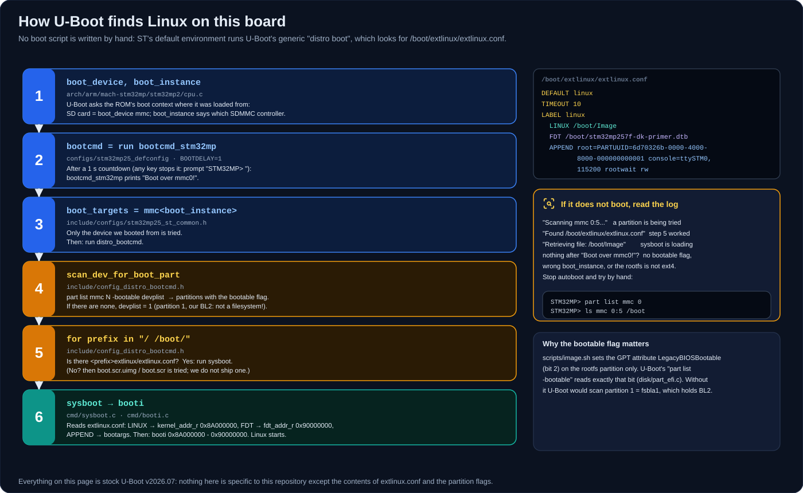
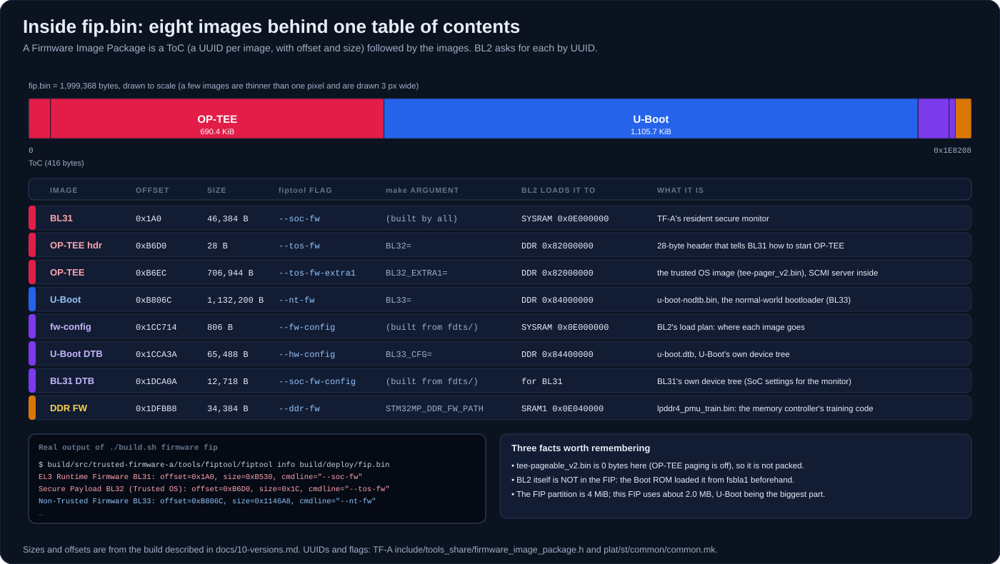

# 03 · Firmware and U-Boot: building the boot chain

Everything before Linux is built by one script, [`scripts/firmware.sh`](../scripts/firmware.sh), called with
`./build.sh firmware [step]`. This chapter walks through each step, shows what it produces, and explains
what is inside.

```bash
./build.sh --dry-run firmware     # read the whole recipe with the reasons, run nothing
./build.sh firmware               # all five steps
./build.sh firmware fip           # just one step
```

| Step | Command | Source | Produces |
| --- | --- | --- | --- |
| 1 | `firmware ddr` | `stm32-ddr-phy-binary` v1.0-stm32mp | `lpddr4_pmu_train.bin` (stays in `build/src`) |
| 2 | `firmware optee` | OP-TEE 4.11.0 + Arm SCP-firmware | `tee-header_v2.bin`, `tee-pager_v2.bin` |
| 3 | `firmware uboot` | U-Boot v2026.07 | `u-boot-nodtb.bin`, `u-boot.dtb` |
| 4 | `firmware tfa` | TF-A v2.15.0 | `tf-a-stm32mp257f-dk.stm32` (BL2) and BL31 |
| 5 | `firmware fip` | TF-A's `fiptool` | `fip.bin` |

Everything lands in `build/deploy/`. The order matters only for `fip`, which needs the outputs of 1-4;
`firmware all` runs them in order. Two compilers are used (see [10](10-versions.md)):
`aarch64-none-elf-` for TF-A and OP-TEE (bare metal) and `aarch64-none-linux-gnu-` for U-Boot.

## The same steps with `-s st`

`./build.sh -s st firmware` runs the same steps on ST's branches (TF-A 2.10, OP-TEE 4.0, U-Boot 2023.10) and
adds a sixth, `metadata`; the output goes to `build/deploy-st/`. The commands are the ones ST's Yocto recipes run,
with ST's device trees from the `dt-stm32mp` repository (`$EXTDT`) instead of the ones in each project:

```bash
# 3. TF-A: BL2, BL31 and the device-tree blobs; firmware-update support on, ST's "debug trace" build
make -C tfa PLAT=stm32mp2 ARCH=aarch64 ARM_ARCH_MAJOR=8 CROSS_COMPILE=aarch64-none-elf- DEBUG=1 LOG_LEVEL=40 \
  SPD=opteed STM32MP_SDMMC=1 STM32MP_LPDDR4_TYPE=1 PSA_FWU_SUPPORT=1 \
  TFA_EXTERNAL_DT=$EXTDT/stm32mp2/a35-td/tf-a DTB_FILE_NAME=stm32mp257f-dk-ca35tdcid-ostl.dtb all
# 2. OP-TEE 4.0 (its own SCMI server; the build needs python3-pil for a font)
make -C optee_os PLATFORM=stm32mp2 ARCH=arm CFG_ARM64_core=y CROSS_COMPILE_core=aarch64-none-elf- \
  CROSS_COMPILE_ta_arm64=aarch64-none-elf- NOWERROR=1 CFG_EXT_DTS=$EXTDT/stm32mp2/a35-td/optee \
  CFG_STM32MP_PROFILE=secure_and_system_services CFG_TEE_CORE_DEBUG=y \
  CFG_EMBED_DTB_SOURCE_FILE=stm32mp257f-dk-ca35tdcid-ostl.dts CFG_TEE_CORE_LOG_LEVEL=2 all
# 4. U-Boot 2023.10: ST's tree is selected with EXT_DTS and DEVICE_TREE_EXT
make -C u-boot ARCH=arm CROSS_COMPILE=aarch64-none-linux-gnu- EXT_DTS=$EXTDT/stm32mp2/a35-td/u-boot \
  DEVICE_TREE=stm32mp257f-dk-ca35tdcid-ostl DEVICE_TREE_EXT=stm32mp257f-dk-ca35tdcid-ostl.dtb all
# 5. the FIP: ST's TF-A has no "make fip" for this chip, so fiptool is called directly
make -C tfa PLAT_FIPTOOL_HELPER_MK=plat_fiptool/st/stm32mp2/plat_fiptool.mk PLAT_DIR=../../plat/st/stm32mp2 fiptool
fiptool create --fw-config … --soc-fw bl31.bin --soc-fw-config … --ddr-fw lpddr4_pmu_train.bin \
  --tos-fw tee-header_v2.bin --tos-fw-extra1 tee-pager_v2.bin --tos-fw-extra2 tee-pageable_v2.bin \
  --nt-fw u-boot-nodtb.bin --hw-config u-boot.dtb fip.bin
# 6. the FWU metadata that makes BL2 load partition fip-a (mkfwumdata is built from U-Boot's tools)
mkfwumdata -g -i 1 -b 2 -v 2 <metadata GUID>,<FIP type GUID>,<fip-a PARTUUID>,<fip-b PARTUUID> metadata.bin
```

The result: `fip.bin` of 3,136,774 bytes (U-Boot 2023.10 and a debug OP-TEE are larger than the mainline pair),
BL2 of 200,744 bytes, `metadata.bin` of 120 bytes. [15](15-two-stacks.md) says why each flag is there.

## Step 1: the DDR training firmware

The LPDDR4 chip needs its signal timing tuned every time it powers up. The memory controller's PHY has a
tiny helper processor that runs *training code* for this; the code is a binary blob supplied by ST
(Synopsys IP). The script just checks out ST's repository at a pinned commit:

```text
https://github.com/STMicroelectronics/stm32-ddr-phy-binary   (stm32mp2/lpddr4_pmu_train.bin, version A2022.11)
```

The repository also has `ddr3_pmu_train.bin` and `ddr4_pmu_train.bin`; the DK has LPDDR4 (the DK's TF-A
device tree includes `stm32mp25-lpddr4-1x32Gbits-1x32bits-1200MHz.dtsi`), so `STM32MP_LPDDR4_TYPE=1` and
the LPDDR4 file are used. TF-A refuses to build unless exactly one DDR type is selected
(`plat/st/stm32mp2/platform.mk`, `check_ddr_type`).

> **Licence note.** This blob is under ST's SLA0044 licence (`LICENSE.md` in that repository), not the
> BSD licence of TF-A. Read it before you redistribute images that contain it.

## Step 2: OP-TEE and its SCMI server

```bash
make -C build/src/optee_os O=build/work/optee \
     CROSS_COMPILE64=aarch64-none-elf- ARCH=arm PLATFORM=stm32mp2 \
     CFG_EMBED_DTB_SOURCE_FILE=stm32mp257f-dk.dts \
     CFG_SCP_FIRMWARE=build/src/scp-firmware all
```

* `PLATFORM=stm32mp2` selects `core/arch/arm/plat-stm32mp2/`. Its `conf.mk` forces `CFG_ARM64_core=y`,
  puts the secure memory at `CFG_TZDRAM_START=0x82000000` (size `0x02000000`, 32 MiB) and asks for the
  SCMI server: `CFG_SCMI_SCPFW_PRODUCT=stm32mp2`.
* `CFG_EMBED_DTB_SOURCE_FILE=stm32mp257f-dk.dts` embeds the **board's device tree as the secure world sees
  it** (`core/arch/arm/dts/stm32mp257f-dk.dts`): which peripherals are secure, the clock tree OP-TEE
  manages, which agent may use which SCMI channel.
* `CFG_SCP_FIRMWARE` must point at Arm's SCP-firmware sources. OP-TEE embeds that project's SCMI protocol
  stack as its server and refuses to build without it
  (`mk/config.mk`: *"CFG_SCMI_SCPFW=y requires CFG_SCP_FIRMWARE configuration"*). Only its sources and a
  CMake configure step are needed (that is why `cmake` is a host dependency). The script uses the revision
  that OP-TEE's own CI builds this platform against, `0d480804` of the SCP-firmware repository.
* `supported-ta-targets ?= ta_arm64` for this platform, so no 32-bit compiler is needed. (TF-A's own
  STM32MP2 instructions also pass `CROSS_COMPILE32=arm-none-eabi-`; it only matters when 32-bit trusted
  applications are built.)

Outputs, from `build/work/optee/core/`:

| File | Size in this build | What it is |
| --- | --- | --- |
| `tee-header_v2.bin` | 28 bytes | header that tells BL31 where and how to start OP-TEE |
| `tee-pager_v2.bin` | 706,944 bytes | the OP-TEE image |
| `tee-pageable_v2.bin` | 0 bytes | the pageable part; empty because paging is off, so it is not packed |

## Step 3: U-Boot

```bash
make -C build/src/u-boot O=build/work/u-boot ARCH=arm CROSS_COMPILE=aarch64-none-linux-gnu- stm32mp25_defconfig
make -C build/src/u-boot O=build/work/u-boot ARCH=arm CROSS_COMPILE=aarch64-none-linux-gnu- \
     DEVICE_TREE=st/stm32mp257f-dk all
```

* `ARCH=arm`, even though this is a 64-bit CPU: U-Boot names the whole ARM family `arm` and selects 64-bit
  with `CONFIG_ARM64`. Passing `ARCH=arm64` (what the kernel wants) fails with
  `fatal error: asm/arch/stm32.h: No such file or directory`.
* `DEVICE_TREE=st/stm32mp257f-dk`: recent U-Boot versions build their board trees from a copy of the *Linux*
  device trees (`OF_UPSTREAM`, `dts/upstream/src/arm64/`), so the name includes the vendor directory. Without
  `st/` the build stops with *"Device Tree Source … is not correctly specified"*.
* `stm32mp25_defconfig` is shared by all STM32MP25 boards; the board-specific bits are
  `arch/arm/dts/stm32mp257f-dk-u-boot.dtsi`.

Outputs: `u-boot-nodtb.bin` (1,132,200 bytes in this build, the program itself) and `u-boot.dtb` (65,488
bytes, U-Boot's own device tree). TF-A takes both: the program as BL33, the DTB as `BL33_CFG` (the
"hardware config"). U-Boot does not need to know where it is loaded: BL2 puts it at `0x84000000` and it
relocates itself.

### How U-Boot finds Linux



The three things in the environment that matter are, in order (all from stock U-Boot, none written here):

1. `bootcmd=run bootcmd_stm32mp` (`CONFIG_BOOTCOMMAND` in `configs/stm32mp25_defconfig`).
2. `bootcmd_stm32mp` (`include/configs/stm32mp25_st_common.h`) prints `Boot over mmc0!`, runs `env_check`,
   sets `boot_targets` to `mmc<boot_instance>` and runs `distro_bootcmd`.
3. `distro_bootcmd` (`include/config_distro_bootcmd.h`) calls `scan_dev_for_boot_part`, which lists the
   partitions with the **bootable flag** (`part list mmc N -bootable devplist`), or partition **1** if none
   has it. For every candidate it tries the prefixes `/` and `/boot/` for `extlinux/extlinux.conf`, then for
   `boot.scr.uimg` / `boot.scr`.

This is why [`scripts/image.sh`](../scripts/image.sh) sets the `LegacyBIOSBootable` attribute on the
root partition: without it U-Boot would try partition 1, which is `fsbla1` (BL2, not a filesystem), find
nothing and drop to its prompt. `sysboot` (`cmd/sysboot.c`) then parses `extlinux.conf`, loads the kernel to
`kernel_addr_r` (`0x8A000000`) and the device tree to `fdt_addr_r` (`0x90000000`), and `booti` starts it.

### Where U-Boot keeps its environment

U-Boot's device tree for this board sets `u-boot,mmc-env-partition = "u-boot-env"`
(`arch/arm/dts/stm32mp257f-dk-u-boot.dtsi`). `env/mmc.c` (`mmc_offset_try_partition()`) then stores the
environment **in the GPT partition of that name, two copies at its end**. Only if the partition does not
exist does it use the raw offsets `0x900000` and `0x940000` from `configs/stm32mp25_defconfig`. Hence the
512 KiB partition `u-boot-env` in the SD layout ([06](06-sdcard-image.md)): it is where `saveenv` writes.

## Step 4: TF-A BL2 and BL31

```bash
make -C build/src/trusted-firmware-a PLAT=stm32mp2 CROSS_COMPILE=aarch64-none-elf- \
     DTB_FILE_NAME=stm32mp257f-dk.dtb STM32MP_LPDDR4_TYPE=1 STM32MP_SDMMC=1 SPD=opteed \
     LOG_LEVEL=20 BUILD_BASE=build/work/tf-a \
     STM32MP_DDR_FW_PATH=build/src/stm32-ddr-phy-binary/stm32mp2 all
```

| Argument | Meaning |
| --- | --- |
| `PLAT=stm32mp2` | `plat/st/stm32mp2/` (and the shared `plat/st/common/`) |
| `DTB_FILE_NAME=stm32mp257f-dk.dtb` | which board tree to use from TF-A's own `fdts/`: clock settings, DDR parameters, `fw-config`. It also names the output file. |
| `STM32MP_LPDDR4_TYPE=1` | compile the LPDDR4 driver |
| `STM32MP_SDMMC=1` | BL2 reads the FIP from SD/eMMC. Other media have other flags (`STM32MP_RAW_NAND`, `STM32MP_SPI_NOR`, …) |
| `SPD=opteed` | the **secure payload dispatcher** for OP-TEE: BL31 forwards the right `smc` calls to it |
| `LOG_LEVEL=20` | NOTICE: 10 error, 20 notice, 30 warning, 40 info, 50 verbose. Set it to 40 to watch BL2 work |
| `BUILD_BASE=…` | build out of the source tree |

The result is `build/work/tf-a/stm32mp2/release/`: `bl2.bin`, `bl31.bin` and
**`tf-a-stm32mp257f-dk.stm32`**, which is `bl2.bin` plus the BL2 device tree plus a 512-byte STM32 header
(a magic number, the payload size, checksum and entry point that the **Boot ROM** validates). It is 175,080
bytes here and goes into the two 256 KiB `fsbla` partitions.

## Step 5: the FIP

```bash
make -C build/src/trusted-firmware-a <same arguments as step 4> \
     BL33=build/deploy/u-boot-nodtb.bin BL33_CFG=build/deploy/u-boot.dtb \
     BL32=build/deploy/tee-header_v2.bin BL32_EXTRA1=build/deploy/tee-pager_v2.bin fip
```

A **FIP** (Firmware Image Package) is TF-A's container format: a table of contents (a UUID, an offset and
a size per entry) followed by the images. `fiptool` (built from `tools/fiptool/` in the same tree) writes it.



`./build.sh firmware fip` finishes by running `fiptool info` on the result:

```text
EL3 Runtime Firmware BL31: offset=0x1A0,    size=0xB530,   cmdline="--soc-fw"
Secure Payload BL32 (Trusted OS): offset=0xB6D0,  size=0x1C,     cmdline="--tos-fw"
Secure Payload BL32 Extra1 (Trusted OS Extra1): offset=0xB6EC, size=0xAC980, cmdline="--tos-fw-extra1"
Non-Trusted Firmware BL33: offset=0xB806C, size=0x1146A8, cmdline="--nt-fw"
FW_CONFIG: offset=0x1CC714, size=0x326,    cmdline="--fw-config"
HW_CONFIG: offset=0x1CCA3A, size=0xFFD0,   cmdline="--hw-config"
SOC_FW_CONFIG: offset=0x1DCA0A, size=0x31AE, cmdline="--soc-fw-config"
DDR_FW: offset=0x1DFBB8, size=0x8650,      cmdline="--ddr-fw"
```

(Real output of this build; the whole file is 1,999,368 bytes and has to fit the 4 MiB `fip` partition.)
Three device trees travel inside it: **FW_CONFIG** is BL2's load plan (where each image goes), **HW_CONFIG**
is U-Boot's DTB, and **SOC_FW_CONFIG** is BL31's own. The DDR firmware travels too (`--ddr-fw`): the Boot
ROM never sees it, BL2 reads it from the FIP and copies it to SRAM1 before it trains the memory.

The build does not sign anything. A **closed** device (secure-boot fuses blown) makes the ROM reject an
unsigned BL2; these first steps assume a development kit that has not been closed. Signing is TF-A's
`TRUSTED_BOARD_BOOT`, which needs `mbedtls` and keys, and is out of scope here.

## Licences

TF-A (BSD-3-Clause, `docs/license.rst` in the tree) and OP-TEE (BSD-2-Clause) are permissive; U-Boot and
Linux are GPL-2.0-or-later / GPL-2.0; the Arm SCP-firmware is BSD-3-Clause; the DDR PHY firmware is under
ST's SLA0044. A product that ships these must keep the notices and, for GPL parts, offer the source.

## Menuconfig

```bash
./build.sh uboot-menuconfig      # opens U-Boot's menu on build/work/u-boot/.config
```

Make a change permanent by adding a patch under `patches/u-boot/` (they are applied once, in name order,
after checkout) or by editing the defconfig in a patch ([08](08-customizing.md)).

Next: [04 · The kernel](04-kernel.md).
