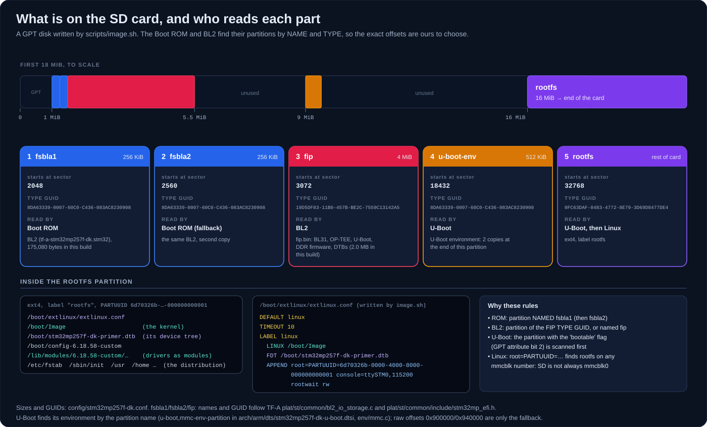
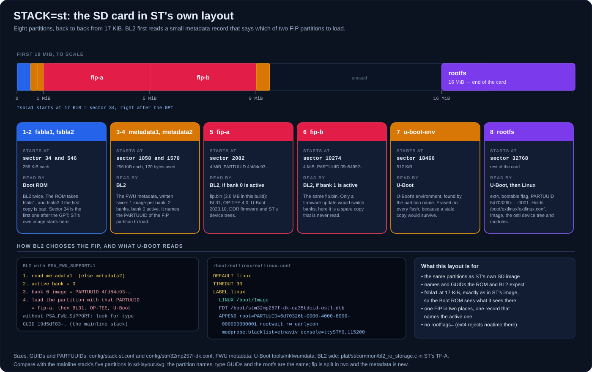

# 06 · The SD card image, byte for byte

```bash
./build.sh image          # needs the outputs of firmware, kernel and rootfs
```

[`scripts/image.sh`](../scripts/image.sh) assembles `build/deploy/sdcard.img` **without root**: the ext4
filesystem is made from a directory with `mke2fs -d` inside a `fakeroot` session, and the partition table is
written to an ordinary file with `sfdisk`.



This chapter describes the mainline stack's card. `./build.sh -s st image` writes ST's own layout instead: eight
partitions, drawn in [the ST section below](#the-st-stacks-card-eight-partitions).

## The partition table

A GPT disk with five partitions. Real output from the build (`sfdisk -d`, device name shortened):

```text
label: gpt
label-id: 6D703200-0000-4000-8000-000000000000
unit: sectors
first-lba: 2048
sector-size: 512

IMG1 : start=  2048, size=   512, type=8DA63339-0007-60C0-C436-083AC8230908, name="fsbla1"
IMG2 : start=  2560, size=   512, type=8DA63339-0007-60C0-C436-083AC8230908, name="fsbla2"
IMG3 : start=  3072, size=  8192, type=19D5DF83-11B0-457B-BE2C-7559C13142A5, name="fip"
IMG4 : start= 18432, size=  1024, type=8DA63339-0007-60C0-C436-083AC8230908, name="u-boot-env"
IMG5 : start= 32768, size=<rest>, type=0FC63DAF-8483-4772-8E79-3D69D8477DE4, name="rootfs",
       uuid=6D70326B-0000-4000-8000-000000000001, attrs="LegacyBIOSBootable"
```

(Each partition also has a random unique GUID, left out; sizes are in 512-byte sectors; the last one is the rest
of the image. `sgdisk -i 5` shows the attribute flags as `0000000000000004`: bit 2, "legacy BIOS bootable".)

| # | Name | Start | Size | Content | Who needs the layout to be this way |
| --- | --- | --- | --- | --- | --- |
| 1 | `fsbla1` | 1 MiB | 256 KiB | `tf-a-stm32mp257f-dk.stm32` (BL2, 175,080 bytes) | **Boot ROM**: looks for this *name* |
| 2 | `fsbla2` | 1.25 MiB | 256 KiB | the same BL2, a second copy | **Boot ROM**: the fallback if copy 1 is bad |
| 3 | `fip` | 1.5 MiB | 4 MiB | `fip.bin` (1,999,368 bytes) | **BL2**: finds it by *type GUID* `19d5df83-…`, or by the name `fip` |
| 4 | `u-boot-env` | 9 MiB | 512 KiB | empty until U-Boot runs `saveenv` | **U-Boot**: `u-boot,mmc-env-partition = "u-boot-env"` |
| 5 | `rootfs` | 16 MiB | rest of the card | ext4, label `rootfs`, **bootable flag** | **U-Boot** scans bootable partitions; **Linux** `root=PARTUUID=` |

### What each rule comes from

* **`fsbla1`/`fsbla2`**: the Boot ROM looks for these *names* (`fsbl` + `a`: the first-stage loader of the
  Cortex-A; `plat/st/stm32mp2/platform.mk` also budgets for `fsbl-m` partitions for the Cortex-M33). ST's own
  layouts give them the type GUID `8DA63339-0007-60C0-C436-083AC8230908` (the generic "Linux reserved"
  type) and this repository does the same; nothing in the TF-A tree says whether the ROM also checks the
  type, so follow ST rather than experiment. TF-A's documentation says *"The SD-card has to be formatted
  with GPT. It should contain at least those partitions: fsbl … and fip (GUID 19d5df83-…)"*
  (`docs/plat/st/stm32mpus.rst`).
* **`fip`**: `plat/st/common/bl2_io_storage.c` calls `get_partition_entry_by_type(&fip_guid)` first and
  `get_partition_entry("fip")` as the fallback. TF-A is built without its optional A/B firmware-update
  feature (`PSA_FWU_SUPPORT=0`), so the extra `metadata1`/`metadata2` partitions and the `fip-a`/`fip-b`
  pair that feature uses are *not* needed. (ST's own image does use them; that is the other layout, below.)
* **`u-boot-env`**: [03](03-firmware-and-uboot.md#where-u-boot-keeps-its-environment). Two copies at the end
  of the partition, so the whole 512 KiB is reserved and nothing else may live there. The raw offsets in
  the defconfig (`0x900000`, `0x940000`, i.e. 9 MiB: where this partition is) are only the fallback.
  The partition is empty in the image, and a flash tool skips blocks of zeros, so **`./build.sh flash` erases
  it after writing**: a card that held another image would otherwise bring that image's saved variables
  into the first boot. If you write the card another way, do the same
  (`sudo dd if=/dev/zero of=/dev/sdX bs=512 seek=18432 count=1024`; the numbers are the `start` and `size` of
  `u-boot-env` in `sfdisk -d`).
* **The bootable flag on `rootfs`**: [03](03-firmware-and-uboot.md#how-u-boot-finds-linux). Without it
  U-Boot scans partition 1.
* **`rootfs` by PARTUUID**: the kernel command line says `root=PARTUUID=6d70326b-0000-4000-8000-000000000001`,
  the `uuid=` in the sfdisk script. It does not matter whether Linux enumerates the SD card as `mmcblk0` or
  `mmcblk1` (the eMMC and the card share numbers in probe order), nor which name udev gives the partition.

### Why these offsets

* The GPT itself takes sectors 0 to 33; the first aligned MiB is left alone (`first-lba: 2048`).
* BL2 is 175,080 bytes; 256 KiB leaves room for a build with more log strings. `image.sh` stops if it
  grows past `FSBL_SIZE_KB`.
* The FIP is 1,999,368 bytes; 4 MiB is the size ST's own layouts use for it. `image.sh` stops if it
  outgrows `FIP_SIZE_KB`, or if the partition would reach the environment at 9 MiB.
* The rootfs starts at 16 MiB (`ROOTFS_PART_START_MB`): a round number past everything above, and
  aligned for flash.

All of these are variables in the config file ([08](08-customizing.md)); the names and GUIDs are not.

## Inside the rootfs partition

```text
/boot/extlinux/extlinux.conf       written by image.sh (below)
/boot/Image                        the kernel
/boot/stm32mp257f-dk-primer.dtb    the device tree extlinux.conf names
/boot/stm32mp257f-dk.dtb           the unmodified DK tree, as a fallback
/boot/config-6.18.58-custom        the .config the kernel was built from
/lib/modules/6.18.58-custom/…      the modules
…                                  the distribution (/etc, /usr, /sbin/init, …)
```

`/boot/extlinux/extlinux.conf` (this is the real file the script wrote, read back from the image):

```text
# U-Boot distro boot ("sysboot") reads this file: /boot/extlinux/extlinux.conf.
# Paths are relative to the root of this partition.
DEFAULT linux
TIMEOUT 30
MENU TITLE Boot menu

LABEL linux
  MENU LABEL Linux with stm32mp257f-dk-primer.dtb (default)
  LINUX /boot/Image
  FDT /boot/stm32mp257f-dk-primer.dtb
  APPEND root=PARTUUID=6d70326b-0000-4000-8000-000000000001 rootwait rw earlycon console=ttySTM0,115200

LABEL linux-stm32mp257f-dk
  MENU LABEL Linux with stm32mp257f-dk.dtb
  LINUX /boot/Image
  FDT /boot/stm32mp257f-dk.dtb
  APPEND root=PARTUUID=6d70326b-0000-4000-8000-000000000001 rootwait rw earlycon console=ttySTM0,115200
```

* `TIMEOUT 30` is in tenths of a second: the menu is shown for three seconds and then the `DEFAULT` entry is
  booted. One `LABEL` per device tree in `KERNEL_DTBS`; the second entry is the unmodified upstream tree,
  there so that a first boot can compare the two without rebuilding.
* `LINUX`/`FDT` paths are relative to the root of the partition that holds the file.
* `APPEND` is the kernel command line: the root, `KERNEL_CMDLINE_EXTRA` (`rootwait`: wait for the SD card to
  appear; `rw`: mount read-write; `earlycon`: kernel messages before the real serial driver) and the console
  (`TARGET_CONSOLE`, `CONSOLE_BAUD`). There is **no `rootflags=`**: see
  [09](09-troubleshooting.md#kernel-panic-with-an-ext4-unknown-parameter-message).

## How the file is assembled

1. In one `fakeroot` session: unpack the rootfs tarball, unpack the kernel overlay over it (with
   `--keep-directory-symlink`: on Debian `/lib` is a link to `/usr/lib`), write `extlinux.conf`, measure the
   content, and `mke2fs -t ext4 -L rootfs -d <dir> rootfs.ext4` with *content + 512 MiB (`IMAGE_EXTRA_MB`) +
   10 % + 64 MiB*. `fakeroot` makes every file look root-owned although no one is root.
2. `truncate` creates a sparse image file: 16 MiB + the filesystem + 1 MiB (the GPT keeps a backup copy of
   its table at the very end of the disk).
3. `sfdisk` writes the table above from a small script, with `label-id` fixed so that the image does not
   differ between builds for that reason.
4. `dd conv=notrunc` writes BL2 twice and the FIP at their sectors (and, with `-s st`, the metadata twice and the
   FIP twice); `dd conv=notrunc,sparse` writes the ext4 image into the last partition and skips blocks of zeros.
5. `bmaptool create` writes `sdcard.img.bmap`, which lists the blocks that contain data: flashing a mostly
   empty 4 GB image then writes a few hundred MB.

The checks that were run on the result, so you can repeat them on your own:

```bash
IMG=build/deploy/sdcard.img
sfdisk --verify $IMG                       # "No errors detected."
sfdisk -d $IMG                             # the table above
sgdisk -i 5 $IMG | grep -E 'unique|Attribute'
# BL2 and the FIP are in their partitions, byte for byte:
dd if=$IMG bs=512 skip=2048 count=342 status=none | head -c $(stat -c %s build/deploy/tf-a-stm32mp257f-dk.stm32) | cmp - build/deploy/tf-a-stm32mp257f-dk.stm32
dd if=$IMG bs=512 skip=3072 count=3907 status=none | head -c $(stat -c %s build/deploy/fip.bin) | cmp - build/deploy/fip.bin
# the filesystem and its boot file:
dd if=$IMG of=/tmp/root.ext4 bs=512 skip=32768 status=none
debugfs -R 'cat /boot/extlinux/extlinux.conf' /tmp/root.ext4
```

### Asking real U-Boot about the image

U-Boot can be built to run on your PC (the *sandbox*), with the same partition-table and `sysboot` code as
on the board. This is how the image was checked against U-Boot without a board:

```bash
cd build/src/u-boot && make O=/tmp/sbx sandbox64_defconfig && make O=/tmp/sbx NO_SDL=1 -j4 u-boot dts/dt.dtb
/tmp/sbx/u-boot -T -d /tmp/sbx/arch/sandbox/dts/test.dtb -c \
  "host bind 0 $PWD/../../deploy/sdcard.img; part list host 0 -bootable devplist; echo devplist=[\$devplist]; ls host 0:5 /boot/extlinux"
# → devplist=[5]    and    extlinux.conf listed
```

`devplist=[5]` is the whole point of the bootable flag. Booting itself is not supported by the sandbox
(`Booting is not supported on the sandbox`), but `sysboot` runs up to that point: it retrieves
`/boot/extlinux/extlinux.conf`, `/boot/Image` and the DTB, and sets `bootargs`. The same check was run with
the sandbox built from **ST's U-Boot 2023.10** on the `-s st` image (below): `devplist=[8]`, the menu, the
`Image`, the `ostl` tree and the same `bootargs` plus `modprobe.blacklist=etnaviv`.

## The ST stack's card: eight partitions



ST's own SD image has these partitions, in this order, with these names and type GUIDs, and `-s st` writes the
same table (`sfdisk -d` of the real image, device name shortened):

```text
label: gpt
label-id: 6D703200-0000-4000-8000-000000000000
unit: sectors
first-lba: 34

IMG1 : start=    34, size=   512, type=8DA63339-0007-60C0-C436-083AC8230908, name="fsbla1"
IMG2 : start=   546, size=   512, type=8DA63339-0007-60C0-C436-083AC8230908, name="fsbla2"
IMG3 : start=  1058, size=   512, type=8DA63339-0007-60C0-C436-083AC8230908, name="metadata1"
IMG4 : start=  1570, size=   512, type=8DA63339-0007-60C0-C436-083AC8230908, name="metadata2"
IMG5 : start=  2082, size=  8192, type=19D5DF83-11B0-457B-BE2C-7559C13142A5, uuid=4FD84C93-54EF-463F-A7EF-AE25FF887087, name="fip-a"
IMG6 : start= 10274, size=  8192, type=19D5DF83-11B0-457B-BE2C-7559C13142A5, uuid=09C54952-D5BF-45AF-ACEE-335303766FB3, name="fip-b"
IMG7 : start= 18466, size=  1024, type=8DA63339-0007-60C0-C436-083AC8230908, name="u-boot-env"
IMG8 : start= 32768, size=<rest>, type=0FC63DAF-8483-4772-8E79-3D69D8477DE4, name="rootfs",
       uuid=6D70326B-0000-4000-8000-000000000001, attrs="LegacyBIOSBootable"
```

| What differs from the five-partition card | Why |
| --- | --- |
| `fsbla1` at sector 34 (17 KiB), everything else back to back | ST's image starts there; the ROM finds BL2 by name, so the offset should not matter, but it costs nothing to copy a layout that is known to boot |
| `metadata1`, `metadata2`: the same 120 bytes, written by `mkfwumdata` | with `PSA_FWU_SUPPORT=1` BL2 reads this record first: one image per bank, two banks, bank 0 active, both banks "accepted". The metadata partitions are looked up by type and PARTUUID and, failing that, by *name* (`plat/st/common/bl2_io_storage.c`, `get_metadata_partition_entry`); ST's image gives them the same type as `fsbla1`, so the name lookup is what is used |
| `fip-a`, `fip-b`: the same `fip.bin` in both, with **fixed PARTUUIDs** | the metadata names bank 0's image by the PARTUUID `4fd84c93-…`; BL2 then loads exactly that partition (`get_partition_entry_by_guid`) |
| `u-boot-env` directly after `fip-b` | nothing needs it at 9 MiB: U-Boot finds it by name |

Everything else (rootfs, the bootable flag, `root=PARTUUID`, the erase of `u-boot-env` at flash time) is as above. The
`extlinux.conf` has one entry:

```text
LABEL linux
  MENU LABEL Linux with stm32mp257f-dk-ca35tdcid-ostl.dtb (default)
  LINUX /boot/Image
  FDT /boot/stm32mp257f-dk-ca35tdcid-ostl.dtb
  APPEND root=PARTUUID=6d70326b-0000-4000-8000-000000000001 rootwait rw earlycon modprobe.blacklist=etnaviv console=ttySTM0,115200
```

The checks used on it (same method as above, sectors from the table): `sfdisk --verify` clean; BL2 identical
in sectors 34 and 546; `metadata.bin` identical in 1058 and 1570; `fip.bin` identical in 2082 and 10274;
`u-boot-env` all zero; `fiptool info` on the contents of `fip-a` lists the eight images. U-Boot 2023.10 built
for the PC (`sandbox64_defconfig`, with `CONFIG_TOOLS_MKFWUMDATA` switched off because the sandbox's own FWU
setting does not match ST's tool) parses the table and `part list host 0 -bootable devplist` answers `8`.

Next: [07 · Flashing and booting](07-flashing-and-booting.md).
