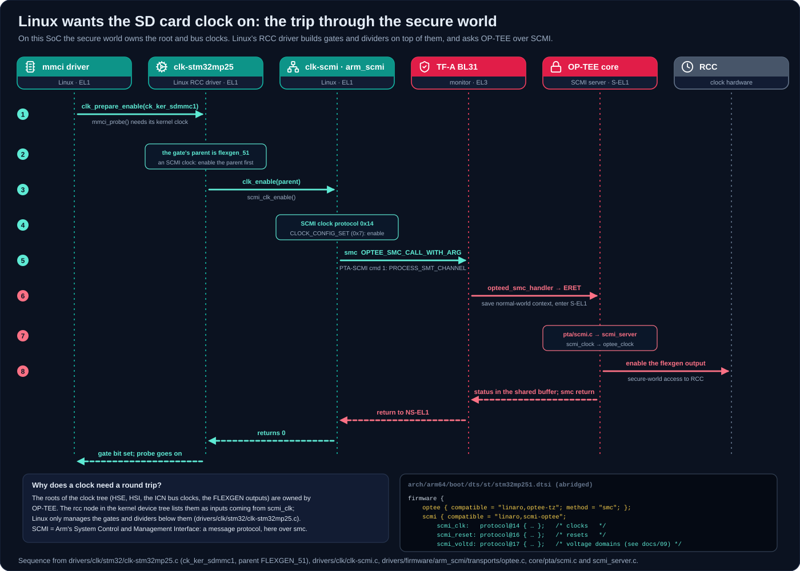

# 11 · The secure world and SCMI: why Linux asks for its clocks

On many SoCs "the secure world" is an optional extra for people who want secure boot or a keystore. On the
STM32MP25 it is part of how the machine is *organised*: you cannot boot a useful Linux without it. This
chapter explains why, how the two worlds talk, and the one place where this repository had to improvise.

## Two worlds, one CPU

The Cortex-A35 cores run in one of two **security states**: *secure* or *non-secure* (normal). The state
is carried on every memory access, and the hardware **firewalls** between the cores and everything else
(memory, peripherals) allow or deny each access based on it. `smc` ("secure monitor call") is the only
instruction that moves between the worlds, and it traps to EL3, where **BL31** decides what to do.

| Where | World | Runs |
| --- | --- | --- |
| EL3 | secure | BL2 (until it jumps), BL31 (forever) |
| S-EL1 | secure | **OP-TEE OS**, the trusted operating system, plus its trusted applications (TAs) |
| EL1 / EL0 | normal | U-Boot, then **Linux** and your applications |

The STM32MP2 adds a finer layer on top of the two-state model, the **RIF** (Resource Isolation Framework):
instead of "secure or not", each peripheral and memory region is assigned to a *compartment*, and a
controller per bus checks who is asking:

| RIF block | Checks | Where you can see it |
| --- | --- | --- |
| RIFSC | access to each peripheral (a numbered slot) | every peripheral in `stm32mp251.dtsi` has `access-controllers = <&rifsc N>`, e.g. `sdmmc1` is `<&rifsc 76>`; Linux's `drivers/bus/stm32_rifsc.c` asks it before it probes a driver |
| RISAF | access to memory regions | TF-A BL2 calls `stm32mp2_risaf_init()` before anything is loaded to DDR; OP-TEE sets up its 32 MiB behind it |
| RISAB | access to on-chip SRAM | |

So Linux is not only *asked* to leave some things alone; it is *prevented* from touching them.

## What is on the secure side on this board

* **The clock tree and resets.** The oscillators (HSE, HSI, MSI, LSE, LSI), the interconnect ("ICN") bus
  clocks and the **FLEXGEN** clock generators are owned by OP-TEE. The kernel's device tree says so: the
  `rcc` node of `arch/arm64/boot/dts/st/stm32mp251.dtsi` takes some forty of its input clocks from
  `<&scmi_clk CK_SCMI_…>`: `CK_SCMI_HSE`, `CK_SCMI_ICN_SDMMC`, `CK_SCMI_FLEXGEN_07` … `FLEXGEN_xx`.
  Linux's own RCC driver (`drivers/clk/stm32/clk-stm32mp25.c`) builds the gates and dividers **below** these
  roots: for the SD card, `ck_icn_m_sdmmc1` (parent `ICN_SDMMC`) and `ck_ker_sdmmc1` (parent
  `FLEXGEN_51`, a gate guarded by RIFSC slot 76).
* **The DDR and its firewall.** BL2 sets the memory up; no one in the normal world can reconfigure it.
* **OP-TEE's own 32 MiB** and the firmware region reserved in the kernel's tree
  (`fw@80000000`, 64 MiB, `no-map`).

## SCMI in two paragraphs

**SCMI** is Arm's *System Control and Management Interface*: a standard message protocol between an *agent*
that wants a service (here: Linux, and also U-Boot) and a *platform* that provides it (here: OP-TEE). A
message names a **protocol** (clock `0x14`, reset `0x16`, voltage `0x17`, power `0x11`, performance `0x13`,
sensor `0x15` …), a **message id** (for a clock: `CLOCK_CONFIG_SET` is `0x7`, the one that enables or
disables a clock) and parameters (which clock). The reply carries a status.

A **transport** says how the bytes move. The usual one is shared memory plus a doorbell (a mailbox or an
`smc`). Here the doorbell is a call into OP-TEE: the device tree says
`scmi { compatible = "linaro,scmi-optee"; linaro,optee-channel-id = <0>; … }`, and the kernel driver
(`drivers/firmware/arm_scmi/transports/optee.c`) opens a session to OP-TEE's **PTA-SCMI** pseudo
trusted application and calls its command `PTA_SCMI_CMD_PROCESS_SMT_CHANNEL` (value `1`) with the message in a
shared-memory buffer. OP-TEE-side, `core/pta/scmi.c` hands it to `scmi_server_smt_process_thread()`
(`core/lib/scmi-server/scmi_server.c`), where Arm's **SCP-firmware** protocol stack (compiled into the
OP-TEE core; that is why `CFG_SCP_FIRMWARE` is needed at build time) decodes it and runs the clock or reset
code.



### The same chain, annotated for the SD card

1. `mmci_probe()` (`drivers/mmc/host/mmci.c`) calls `clk_prepare_enable()` on `ck_ker_sdmmc1`.
2. The clock framework prepares **parents first**: `ck_ker_sdmmc1`'s parent is `FLEXGEN_51`, which is an SCMI
   clock (`drivers/clk/clk-scmi.c`). `scmi_clk_enable()` builds a `CLOCK_CONFIG_SET` message for it.
3. The `optee` transport turns the message into a call into OP-TEE (an `smc` with
   `OPTEE_SMC_CALL_WITH_ARG` that BL31's `opteed_smc_handler()` forwards to S-EL1).
4. OP-TEE's SCMI server enables the generator with the secure-world RCC access it has; the status goes back.
5. Only now does Linux set its **own** gate bit for `ck_ker_sdmmc1` in RCC, which RIFSC allows because slot 76
   is assigned to the normal world.

Steps 2 to 4 cost one trip into the secure world per SCMI message. They are paid when a driver enables or
disables a clock, not for every data transfer.

## What this means for you

* **OP-TEE is not optional.** Without it, `scmi { … }` has no server and Linux cannot get its root and
  bus clocks.
* **U-Boot is a client too.** `drivers/firmware/scmi/optee_agent.c` and the `scmi` node in
  `arch/arm/dts/stm32mp25-u-boot.dtsi` let U-Boot use clocks that belong to the secure world.
* **Debugging is easier from the secure side.** OP-TEE has its own trace on the console
  (`CFG_TEE_CORE_LOG_LEVEL`, set to `2` by `scripts/firmware.sh`); raising it, and `TFA_LOG_LEVEL`, shows the
  secure world's half of a hang that looks like "Linux stopped".
* **On a running board** (nothing here needs special tools):

  ```bash
  sudo dmesg | grep -iE 'optee|scmi'                 # driver and protocol versions
  sudo cat /sys/kernel/debug/clk/clk_summary | less  # the clock tree; SCMI clocks are named by the server
  ls /sys/class/regulator/                           # only what a regulator driver registered
  ```

## What this repository had to work around

The mainline device tree of the DK describes the SD card's two supplies as SCMI **voltage domains**:

```dts
&scmi_regu {
        scmi_vddio1: regulator@0 { … regulator-min-microvolt = <1800000>; regulator-max-microvolt = <3300000>; };
        scmi_vdd_sdcard: regulator@23 { reg = <VOLTD_SCMI_STPMIC2_LDO7>; regulator-name = "vdd_sdcard"; };
};
&sdmmc1 { vmmc-supply = <&scmi_vdd_sdcard>; vqmmc-supply = <&scmi_vddio1>; … };
```

(`arch/arm64/boot/dts/st/stm32mp257f-dk.dts`.) That presumes a server that implements the **voltage domain**
protocol (`0x17`) and talks to the board's STPMIC2 power chip. ST's own OP-TEE builds do. **OP-TEE 4.11.0's
`stm32mp2` SCMI server does not**: it builds exactly the clock and reset modules
(`core/lib/scmi-server/conf-optee-stm32mp2.mk`: `CFG_SCPFW_MOD_SCMI_CLOCK`, `CFG_SCPFW_MOD_SCMI_RESET_DOMAIN`,
no voltage domain; the STM32MP1 file next to it does enable voltage domains) and its DK configuration
(`core/arch/arm/dts/stm32mp25-st-scmi-cfg.dtsi`) defines protocols `0x14` and `0x16` only.

If that is the whole story, Linux would wait forever for a regulator that cannot appear, and with it the
SD controller and the root filesystem. The default device tree here, `stm32mp257f-dk-primer.dts`
([`custom/dts/`](../custom/dts/stm32mp257f-dk-primer.dts)), therefore swaps the two supplies for
`regulator-fixed` nodes that merely describe a card that is already powered (BL2 and U-Boot have been
reading it).

**This has not been run on a board.** It is the reasoning of someone reading the sources, and it could be
incomplete in either direction: another consumer of an SCMI regulator might block something else, or the
SD supply might turn out not to be needed at all. When the board is first booted this is the place to look.
If you have ST's matching OP-TEE, set `KERNEL_DTBS` so that `st/stm32mp257f-dk.dtb` comes first.

**`./build.sh -s st all` builds exactly that matching pair**: ST's OP-TEE 4.0 (which adds the SCMI voltage-domain and
regulator protocols and owns the STPMIC2 on I2C7 itself) and ST's Linux 6.6 device tree, where `&sdmmc1`'s supplies
are SCMI regulators that exist. The workaround tree is then not needed ([15](15-two-stacks.md)). On the mainline
stack, the boot menu lets you boot the stock tree as the second entry to see what happens.

Next: [12 · Board tour](12-board-tour.md).
