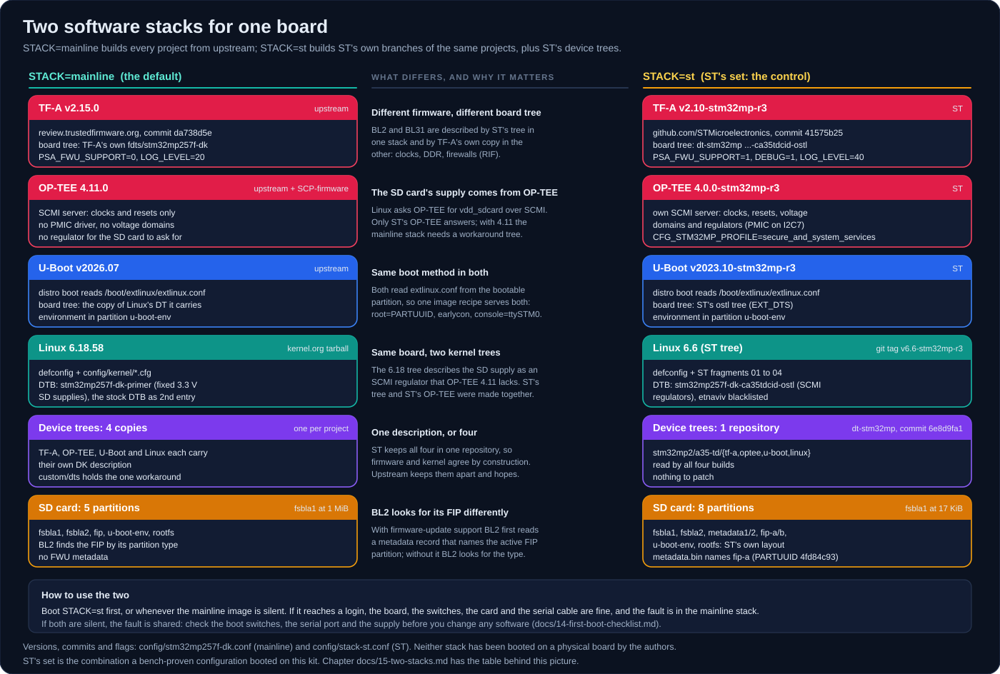
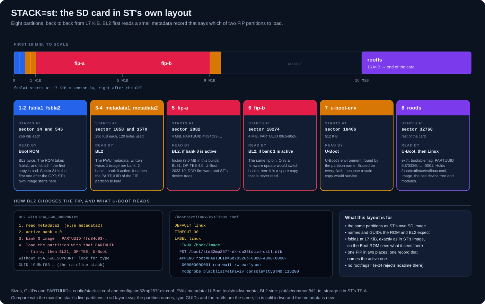

# 15 · The two software stacks

This board builds two complete software sets for the same kit, selected by one switch:

```bash
./build.sh all                 # STACK=mainline (the default): every project from upstream
./build.sh -s st all           # STACK=st: ST's own tested set (or: STACK=st ./build.sh all)
```



The reason there are two is practical. The mainline stack is what this repository is *for*: current upstream
releases, no vendor fork, each project's own documentation applies. But those four projects were never
tested together on this kit by anyone, and the one thing on this board that depends on how they fit
together (the SD card's supply voltage, [11](11-secure-world-and-scmi.md)) is unverified. The ST stack is a
combination that **a bench-proven configuration booted on this very kit**, to a login on the ST-LINK console.
When a first boot fails, booting the second stack tells you which half of "board, switches, card and cable"
versus "software" you are looking at.

Neither stack has been booted on a physical board by the authors of this repository. What *has* been done is
described in the [README](../README.md#what-has-been-checked).

## What is in the ST stack

ST's *OpenSTLinux* distribution is built with Yocto from a layer called `meta-st-stm32mp`. This stack takes
the releases that layer pins (tag `wrynose_v26.02.18`, "r3") and builds them from source **without Yocto**,
with the `make` commands the layer's recipes run. Every pin is in
[`config/stack-st.conf`](../config/stack-st.conf), with the reason next to it.

| Part | Mainline stack | ST stack |
| --- | --- | --- |
| TF-A | v2.15.0 (`review.trustedfirmware.org`, `da738d5e…`) | `v2.10-stm32mp-r3` (`github.com/STMicroelectronics/arm-trusted-firmware`, `41575b25…`) |
| OP-TEE | 4.11.0 (`f54190f2…`) plus Arm SCP-firmware | `4.0.0-stm32mp-r3` (`afdfcb01…`), carries its own SCMI server |
| U-Boot | v2026.07 (`ece349ad…`) | `v2023.10-stm32mp-r3` (`7fbc677b…`) |
| Linux | 6.18.58 (kernel.org tarball) | `v6.6-stm32mp-r3` (`80d29586…`), kernel.org 6.6.116 plus ST's patches |
| Device trees | each project's own copy of the DK tree | ST's `dt-stm32mp` repository (`6e8d9fa1…`), directory `stm32mp2/a35-td`, tree `stm32mp257f-dk-ca35tdcid-ostl` |
| DDR PHY firmware | `stm32-ddr-phy-binary` v1.0-stm32mp (`77447cf2…`) | the same |
| Kernel configuration | arm64 `defconfig` + `config/kernel/*.cfg` | arm64 `defconfig` + ST's four fragments + `config/kernel/*.cfg` |
| Compilers | Arm GNU Toolchain 14.3.rel1 | the same (see below) |
| Root filesystem | Debian trixie, Alpine, or yours | the same tarball |

Every commit was checked against its tag (`git ls-remote <repo> 'refs/tags/<tag>^{}'`). ST's Linux and
U-Boot are shipped by ST as a tarball of the upstream release plus one large patch; the git tag is the same
tree in a single download.

## Where they differ, and why it matters

### The secure world: who serves the SD card's power

This is the difference that motivated the second stack. On the STM32MP2 the SD card's supply (`vdd_sdcard`)
is a rail of the power-management chip, which OP-TEE (not Linux) controls. Linux asks for it with a
SCMI *voltage-domain* request ([11](11-secure-world-and-scmi.md)).

* **ST's OP-TEE 4.0** adds the SCMI voltage-domain and regulator protocols and owns the PMIC on I2C7. ST's
  device tree for Linux names those regulators for the SD controller, and they exist. Nothing to work around.
* **OP-TEE 4.11.0** serves clocks and resets only. The mainline stack therefore boots a device tree
  (`stm32mp257f-dk-primer.dtb`) in which the two supplies are fixed regulators: on the assumption that BL2
  has already switched the card's power on, which it has. That assumption is *not verified on hardware*.

### Device trees: one description, or four

Mainline keeps a copy of the board's device tree in each of TF-A, OP-TEE, U-Boot and Linux. They describe
the same silicon and nothing checks that they agree. ST keeps all four in one repository and every build
reads from it (`TFA_EXTERNAL_DT`, `CFG_EXT_DTS`, `EXT_DTS`, `KBUILD_EXTDTS`). The two trees also differ in what
they enable: ST's configures stricter firewall (RIF) ownership of the peripherals, enables the GPU, the
display pipeline, USB and the coprocessors; the mainline tree enables the console, the SD card, Ethernet,
LEDs and buttons.

One consequence of ST's tree has to be handled: it enables the GPU, and loading the open-source GPU driver
`etnaviv` makes it request the GPU's PLL over SCMI, which panicked OP-TEE 4.0 on the bench. The ST stack
therefore passes `modprobe.blacklist=etnaviv` on the kernel command line and sets
`# CONFIG_DRM_ETNAVIV is not set` (the second is now in `config/kernel/00-base.cfg`, so it applies to both
stacks, where it is harmless).

### Firmware update metadata and the FIP partitions

ST turns on TF-A's PSA firmware-update support (`PSA_FWU_SUPPORT=1`). With it BL2 no longer looks for "the
FIP partition": it reads a small record, the **FWU metadata**, from the partition `metadata1` (or
`metadata2`), takes the active bank and loads the partition whose PARTUUID that bank names: `fip-a` or `fip-b`.
The record is written by U-Boot's `mkfwumdata`:

```text
mkfwumdata -g -i 1 -b 2 -v 2 <metadata type GUID>,<FIP type GUID>,<fip-a PARTUUID>,<fip-b PARTUUID> metadata.bin
           (1 image, 2 banks, version 2; both banks "accepted", bank 0 active)
```

120 bytes, written into both metadata partitions. The mainline stack builds TF-A without the feature and
needs none of this.

### The SD card layout

| | Mainline | ST |
| --- | --- | --- |
| Partitions | `fsbla1 fsbla2 fip u-boot-env rootfs` (5) | `fsbla1 fsbla2 metadata1 metadata2 fip-a fip-b u-boot-env rootfs` (8) |
| `fsbla1` at | 1 MiB (sector 2048) | 17 KiB (sector 34), as in ST's own image |
| Layout rule | aligned, `u-boot-env` at 9 MiB | back to back, `u-boot-env` right after `fip-b` |
| FIP found by | its type GUID, or the name `fip` | the metadata, by PARTUUID |
| rootfs | 16 MiB, bootable flag, PARTUUID `6d70326b-…-0001` | the same |



Names and type GUIDs are the same in both, so the Boot ROM and BL2 see what they would see on a card from ST.
The details are in [06](06-sdcard-image.md).

### What is the same

* **How Linux is started.** ST's U-Boot, like upstream's, runs distro boot: it reads
  `/boot/extlinux/extlinux.conf` from the partition with the GPT *bootable* flag and starts `/boot/Image`
  with the device tree named there. (ST's own OpenSTLinux card keeps `/boot` on a separate small partition;
  this image keeps it in the root filesystem. The bench configuration used a different, signed boot
  policy, so *this* path has not been run on the DK with ST's stack either.)
* **The kernel command line**: `root=PARTUUID=… rootwait rw earlycon console=ttySTM0,115200`, plus
  `modprobe.blacklist=etnaviv` on the ST stack. Never `rootflags=…`: ST's 6.6 kernel hands it to ext4 as
  filesystem parameters and `noatime` is rejected there (`ext4: Unknown parameter 'noatime'`, found on the
  bench).
* **The root filesystem** and the whole image-assembly script.

### Logging

ST ships its images with its *debug trace* setting on, and so does this stack: TF-A is built with `DEBUG=1`
and `LOG_LEVEL=40` (BL2 prints the partition it booted from and every image it loads), OP-TEE with its debug
level, and U-Boot and the kernel are not silenced. The mainline stack builds TF-A at ST's *release* level 20
by default; `TFA_LOG_LEVEL=40` in `config/local.conf` makes it as talkative
([14](14-first-boot-checklist.md)).

## Using them side by side

Everything the ST stack generates goes to its own directories next to the mainline ones:

```text
build/src       build/work       build/deploy       build/logs        mainline
build/src-st    build/work-st    build/deploy-st    build/logs-st     STACK=st
build/downloads build/toolchain  build/deploy/rootfs.tar              shared
```

so building one never disturbs the other, and the root filesystem is built once. Your own additions are kept
apart too: `patches/st/<component>/` for patches to ST's trees, `custom/dts-st/` for your own device trees
(the mainline `custom/dts/` workaround is written for the upstream tree and cannot be used with ST's).
`config/kernel/*.cfg` applies to both.

| Task | Command |
| --- | --- |
| Build ST's stack | `./build.sh -s st all` |
| Only ST's firmware | `./build.sh -s st firmware` (steps `ddr optee uboot tfa fip metadata`) |
| Show what it will use | `./build.sh -s st info` |
| Flash it | `./build.sh -s st flash -d /dev/sdX --expand` |
| Make it the default | `echo 'STACK=st' >> config/local.conf` |

`./build.sh flash` writes the image of the stack you selected. The image file names say which it is
(`stm32mp257f-dk-st-…img` for ST's).

## Host requirements of the ST stack

The same packages as the mainline stack plus `python3-pil` and `python3-cryptography` (`./build.sh -s st deps
--install`): OP-TEE 4.0 renders a font into its user-space libraries.

Two things to know if the build fails on a very new host:

* **U-Boot's host tools** use SWIG and Python. ST's Yocto layer carries two small patches for SWIG 4.3 or newer
  and Python 3.13 or newer (`0002-Fixup-SWIG-4.3-API-changed.patch`,
  `0003-BINMAN-use-importlib.resources-instead-of-pkg_resour.patch` in `meta-st-stm32mp`,
  `recipes-bsp/u-boot/u-boot-stm32mp/`). Ubuntu 24.04 (SWIG 4.2, Python 3.12) needs neither. If yours does,
  put them in `patches/st/u-boot/`; they are applied once per checkout.
* **Compilers.** The pinned Arm GNU Toolchain 14.3.rel1 builds all four projects of this stack
  ([the check](#what-was-checked-for-the-st-stack)); ST's own SDK uses an older GCC 13, so an unexpected
  `-Werror` failure on another compiler is solved with `NOWERROR=1` (already set for OP-TEE) or an older
  Arm toolchain via `ARM_TOOLCHAIN_VERSION` and the four `ARM_TC_SHA256_*` values.

## What was checked for the ST stack

In a Ubuntu 24.04 ARM64 container on 25 October 2026, from empty source directories:

* TF-A (`bl2`, `bl31`, the `.stm32` BL2 image), OP-TEE, U-Boot, the FIP and the FWU metadata build with
  `./build.sh -s st firmware`; `fiptool info` lists the eight images BL2 expects.
* The ST kernel builds with `./build.sh -s st kernel` with the four fragments and the 18 boot-path options
  checked built in; the `ostl` device tree is compiled from ST's repository.
* `./build.sh -s st image` assembles the card; `sfdisk --verify` is clean, BL2, the FIP (twice) and the
  metadata (twice) are byte-identical to their partitions, and `extlinux.conf` reads back from the ext4.

What was **not** done: boot it. In particular nothing here proves that ST's U-Boot finds `extlinux.conf` on the
root partition the way the mainline sandbox test showed for upstream's; the logic is the same distro boot,
but it is untested on the board.

## Which one first

For a **first power-on of a new kit**, build and boot the ST stack first. It is the combination with the best
odds (versions and device trees a bench-proven configuration booted), and it gives you a clean control. If it
reaches a login you know the board, switches, serial cable and card reader are fine. Then build the mainline
stack, which is the point of this repository, and compare: a difference is then a *mainline-stack* difference,
and [09](09-troubleshooting.md) and [14](14-first-boot-checklist.md) say where to look.

Next: [10 · Versions](10-versions.md#plan-b-sts-own-tested-set-implemented-as-stackst).
