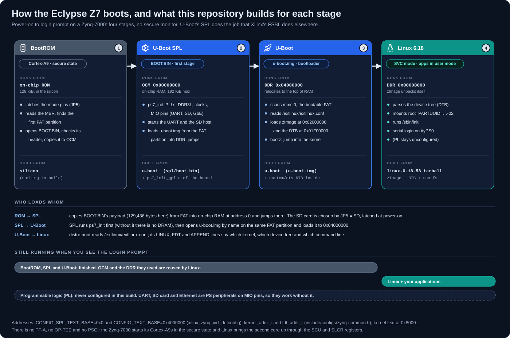
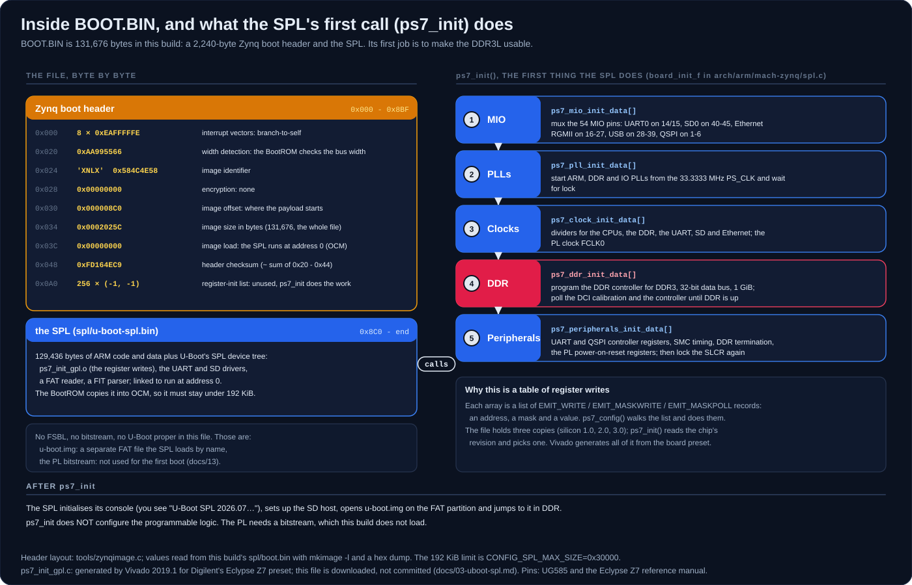
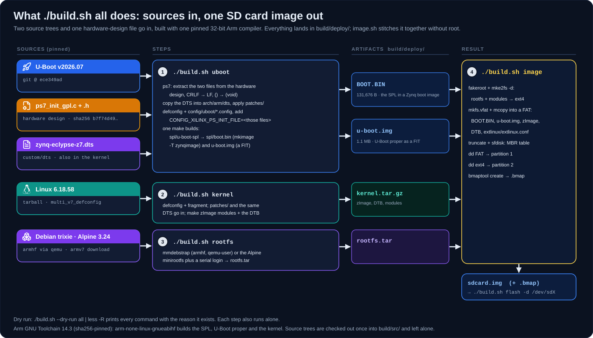
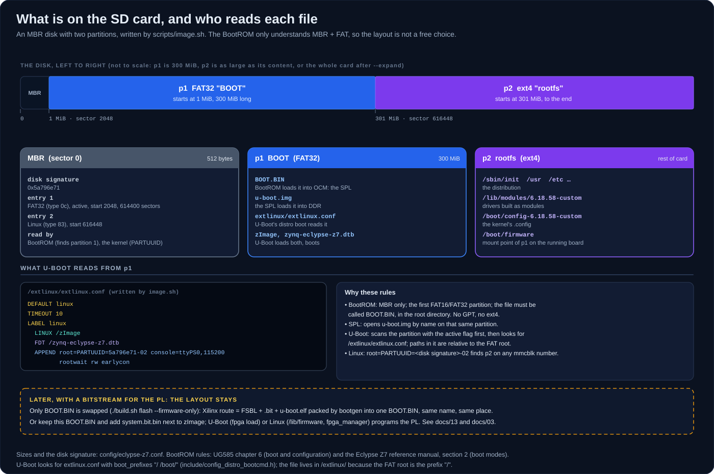
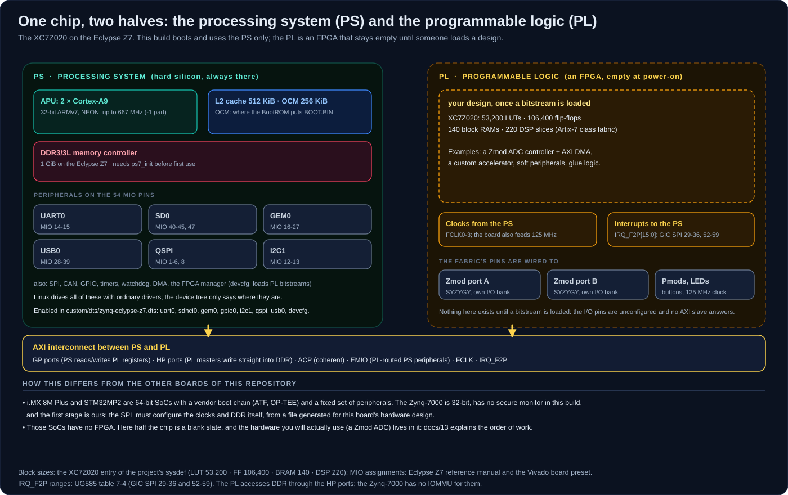
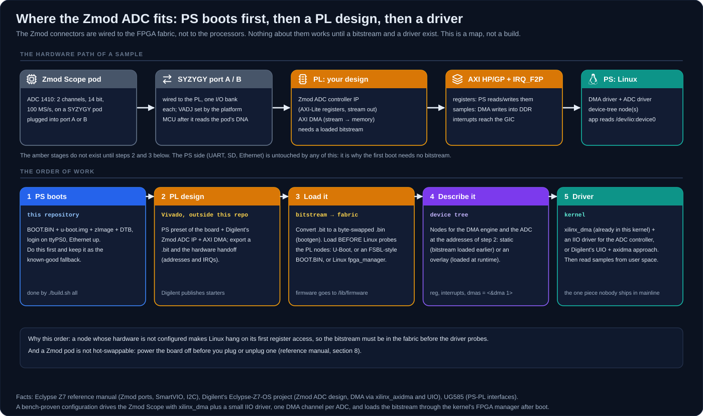

<div align="center">

# Digilent Eclypse Z7 · first steps from source

**U-Boot's SPL as the first stage, U-Boot, Linux and a bootable SD card for the Zynq-7000 XC7Z020, built
from the upstream projects with one command: no Yocto, no Vivado, no Vitis on your PC.**

[](https://github.com/N3b3x/embedded-linux-primer/actions/workflows/ci.yml)


[Quick start](#quick-start) · [Status](#what-has-been-checked) · [How it boots](#1-the-boot-chain) ·
[How the build works](#2-how-the-build-makes-the-sd-card) · [PS and PL](#3-the-chip-has-two-halves) ·
[First boot checklist](docs/14-first-boot-checklist.md) · [Docs](docs/README.md)

</div>



```bash
./build.sh deps --install          # once: host packages
./build.sh all                     # U-Boot + kernel + rootfs → build/deploy/sdcard.img
./build.sh flash -d /dev/sdX       # write the card (asks first); JP5 on SD; picocom -b 115200 /dev/ttyUSB1
```

- **No Xilinx tools.** `BOOT.BIN` is U-Boot's own SPL wrapped by `mkimage -T zynqimage`. The one file that comes
  from the board's *hardware design*, the PS7 initialisation (clocks, DDR, pins), is downloaded by hash or supplied by
  you: [03](docs/03-uboot-spl.md) says where it comes from and why it is not committed here.
- **All upstream:** U-Boot v2026.07 and the Linux kernel at the projects' own release points. Every version is
  pinned to a commit or a sha256.
- **Explains itself:** every command is printed with *why* it runs, and `--dry-run` turns the whole build into a
  readable recipe.
- **One 32-bit compiler** from Arm builds everything; downloaded with its checksum for your PC (x86-64 or ARM64).
- **Rootless:** compiling and image assembly run as your user (`fakeroot`, `mke2fs -d`, `mkfs.vfat` + mtools).
  `sudo` is for installing packages and writing the card.
- **PS-only first boot.** The FPGA half of the chip stays unconfigured. The Zmod ADC modules this board is meant
  for need a PL design and a driver; [13](docs/13-zmod-adc.md) is the map, not a build.

---

## What has been checked

Honesty first. This board was written and exercised in an Ubuntu 24.04 ARM64 container on 25 October 2026.
**It has not yet been booted on a physical Eclypse Z7.** The first-boot procedure, with what to capture, is
[docs/14](docs/14-first-boot-checklist.md).

| Capability | State | How it was checked |
| --- | --- | --- |
| Scripts are `shellcheck`-clean | **done** | `shellcheck -x build.sh scripts/*.sh scripts/lib/common.sh scripts/rootfs/*.sh` with the repository's `.shellcheckrc` |
| `--dry-run` of every step and of `all` | **done** | the whole recipe printed without errors |
| U-Boot SPL + proper, `BOOT.BIN`, `u-boot.img` | **built in a container** | `./build.sh uboot` from an empty build directory (about 3 min with the toolchain download, 4 jobs): `BOOT.BIN` 131,676 bytes, `u-boot.img` 1,100,664 bytes; `mkimage -l BOOT.BIN`: *Xilinx Zynq Boot Image*, offset `0x8c0`, load `0x0`; header words `aa995566` and `XNLX` checked in a hex dump; the SPL is below the 192 KiB limit |
| `ps7_init` from the pinned hardware design | **done** | downloaded, sha256 `b7f74d49…` verified, prepared, compiled into the SPL (`ps_init_gpl.o`) |
| SPL behaviour | **partly**: ran in QEMU | QEMU's `xilinx-zynq-a9` ran the SPL through `ps7_init`, the UART and the SD host set-up; QEMU does not model the UART clock, so **no SPL console text was seen**. The SPL's real output is unverified |
| Linux 6.18.58 (`zImage`, DTB, modules) | **built in a container** | `./build.sh kernel`: `zImage` 11,915,776 bytes, `zynq-eclypse-z7.dtb` 11,430 bytes, 889 modules (33 MB); 18 minutes with 4 jobs on a shared machine; the 14 options the boot path needs are checked at configuration time |
| Debian trixie `armhf` rootfs | **built in a container** | `./build.sh rootfs`, 266 MiB tar, about 6 minutes, with `--privileged`, a mounted `binfmt_misc` and qemu-user (an ARM64 host cannot run 32-bit code natively) |
| Alpine 3.24 `armv7` rootfs | **built in a container** | `./build.sh -r alpine rootfs` (5.5 MiB tar) |
| SD image assembly, partition table | **built and inspected in a container** | `./build.sh image`: `sfdisk -d` (MBR, signature `5a796e71`, p1 `c` active, p2 `83`), `fsck.vfat` (FAT32, 4 KiB clusters), `mdir` listing, `BOOT.BIN`, `u-boot.img`, `zImage` and the DTB compared byte for byte with the build outputs, `e2fsck` of the ext4, `/etc/fstab` and `extlinux.conf` read back |
| Kernel + Debian rootfs boot | **run in QEMU** | `qemu-system-arm -M xilinx-zynq-a9`: the kernel with our DTB found `root=PARTUUID=5a796e71-02`, mounted ext4, ran systemd and reached `eclypse-z7 login:`; logged in as `root`: `systemctl --failed` empty, p1 mounted at `/boot/firmware`, `lsblk` shows `BOOT` (vfat) and `rootfs` (ext4), `modprobe zynq-fpga` loads and the manager reports `unknown` (QEMU models one CPU and no PHY) |
| U-Boot proper distro boot | **run in QEMU** | the same image: U-Boot (`u-boot.bin`) found `/extlinux/extlinux.conf` on partition 1 and loaded `zImage` and the DTB, then started the kernel. In QEMU (no `ps7_init`, CPU clock unlisted in the OPP table) the kernel hits a `cpufreq` BUG unless `cpufreq.off=1` is added; on the board the clock is the listed 666.667 MHz ([14](docs/14-first-boot-checklist.md)) |
| `flash.sh` | **run against a loop device** (privileged container) | the guards refuse a partition and (without `--force`) a loop device; the whole-image write with `bmaptool` and `--expand` (`sfdisk`, `e2fsck`, `resize2fs`), then `--firmware-only` and `--kernel-only` (`mcopy` on the device, `mount` + `tar`); the result passes `fsck.vfat` and `e2fsck`. **Not run against a real SD card** (no udev, no removable-media checks exercised) |
| Builds on an **x86-64** PC | not run | the x86-64 toolchain URL returns 200 and its sha256 is pinned; the scripts pick it by `uname -m` |
| **Boots on the Eclypse Z7** | **not tried** | see [14](docs/14-first-boot-checklist.md) and the risks below |
| **PL, bitstream, Zmod ADC** | **out of scope of the first boot** | nothing is loaded or driven; [13](docs/13-zmod-adc.md) is a map for the next phase |

**The risks, in order.** (1) *The SPL is untested on the board's silicon here.* A bench-proven configuration on this exact
board uses the same idea and the same PS7 file, but a different U-Boot version and kernel. (2) *`ps7_init` must match
the board:* it comes from Digilent's design for it, not from your hardware. (3) *The card:* some cards are fussy in the
SPL's SD driver; try a second one. (4) *Ethernet:* the PHY reset line and RGMII delays follow the manual; unverified on the
board. (5) The kernel's `cpufreq` aborts if the CPU clock is not an operating point (see above).

**What you get when it boots:** a console on the USB-UART connector, the microSD card, Ethernet, USB host, both
cores. Not enabled: the push-buttons, LEDs, Pmods and Zmod ports, which belong to the FPGA ([12](docs/12-board-tour.md)).

---

## Quick start

| Step | Command | What happens |
| --- | --- | --- |
| **1. Host setup** (once) | `git clone https://github.com/N3b3x/embedded-linux-primer && cd embedded-linux-primer/boards/zynq7000-eclypse-z7`<br>`./build.sh deps --install` | installs ~35 Ubuntu/Debian packages. The cross-compiler is downloaded later, automatically |
| **2. Build** | `./build.sh all`<br>or `./build.sh -r alpine all` | `BOOT.BIN` in minutes, kernel in the long step (~20 min), Debian (full distro, needs qemu-user) or Alpine (tiny, no emulation). Ends with `SD card image: build/deploy/…img` |
| **3. Flash** | `lsblk -dpo NAME,SIZE,TRAN,MODEL`<br>`./build.sh flash -d /dev/sdX --expand` | refuses system disks, shows the card, asks, writes, grows the root partition to the whole card |
| **4. Set the board** | **JP5 → SD** (jumper on the two pins labelled "SD"), card in J4, micro-USB from J6, 12 V in J11 | the mode pins are read only at power-on: power-cycle after any change |
| **5. Boot** | `picocom -b 115200 --logfile boot.log /dev/ttyUSB1` (the **second** FTDI channel), then the power switch | SPL, U-Boot, kernel text, then a login |
| **6. Log in** | `root` or `dev`, password `zynq7000` (a bench default: change it) | then read [14](docs/14-first-boot-checklist.md) and [12](docs/12-board-tour.md) |

No board yet? `./build.sh --dry-run all | less -R` prints the entire build as an annotated recipe, and
`./build.sh uboot` is a few minutes of real compiling that makes the first-stage `BOOT.BIN`.

---

## 1. The boot chain

The diagram at the top is the whole story. Four stages, each loads the next:

| # | Stage | Runs in | Its job | Built from |
| --- | --- | --- | --- | --- |
| 1 | **BootROM** | secure state | reads JP5, finds `BOOT.BIN` in the first FAT partition of the MBR card, copies it to on-chip RAM | silicon |
| 2 | **U-Boot SPL** (`BOOT.BIN`) | on-chip RAM | `ps7_init`: pins, PLLs, clocks, **DDR3L**; starts UART and SD; loads `u-boot.img` | `u-boot` + `ps7_init_gpl.c` |
| 3 | **U-Boot** (`u-boot.img`) | DDR | reads `/extlinux/extlinux.conf`, loads `zImage` and the DTB, `bootz` | `u-boot` |
| 4 | **Linux 6.18** | SVC mode / user mode | drivers, root filesystem, login on `ttyPS0` | `linux-6.18.58` |

There is no TF-A, no OP-TEE and no PSCI on this SoC family's Linux: the Cortex-A9s start in the secure state and
stay there. The SPL does the work that Xilinx's FSBL does in vendor flows:



Deep dive: **[01 · Boot flow](docs/01-boot-flow.md)**, **[03 · The first stage and the bootloader](docs/03-uboot-spl.md)**
(with a table of *SPL route vs Xilinx FSBL + bootgen route*, and where `ps7_init` comes from), and exactly which file
does what ([source map](docs/images/source-map.svg)).

---

## 2. How the build makes the SD card



| Step | Command (runs on its own too) | Produces | Why it exists |
| --- | --- | --- | --- |
| ps7 | `./build.sh uboot ps7` | `ps7_init_gpl.c/.h` prepared | the board's clock, DDR and pin set-up |
| uboot | `./build.sh uboot` | `BOOT.BIN`, `u-boot.img` | first stage and bootloader from one build |
| kernel | `./build.sh kernel` | `zImage`, DTB, modules | the OS |
| rootfs | `./build.sh rootfs` | `rootfs.tar` | init, shell, libraries (32-bit) |
| image | `./build.sh image` | `sdcard.img` + `.bmap` | lays out the card byte for byte, **without root** |
| flash | `./build.sh flash -d /dev/sdX` | the SD card | guarded `bmaptool`/`dd`, optional `--expand`, `--firmware-only`, `--kernel-only` |

The card is an **MBR** disk with a FAT32 partition the BootROM reads and an ext4 root partition:



Deep dives: [04 · Kernel](docs/04-kernel.md) · [05 · Rootfs](docs/05-rootfs.md) ·
[06 · SD card image](docs/06-sdcard-image.md) · [07 · Flashing and booting](docs/07-flashing-and-booting.md).

---

## 3. The chip has two halves

The Zynq-7000 is a dual Cortex-A9 **processing system (PS)** and an Artix-7-class **FPGA (the PL)** in one package.
This repository boots the PS and leaves the PL empty; the Zmod ADC modules that this board is made for live in the
PL.



[11 · PS and PL](docs/11-ps-and-pl.md) explains the two halves and how this SoC differs from the other boards;
[13 · Where the Zmod ADC fits](docs/13-zmod-adc.md) says what must exist before an ADC works (a bitstream, a device-tree
node, a driver) and in which order:



---

## Learn the concepts

| Chapter | You learn |
| --- | --- |
| [01 · Boot flow](docs/01-boot-flow.md) | the four stages, modes instead of exception levels, who loads whom |
| [02 · Host setup](docs/02-host-setup.md) | packages, disk, qemu for armhf, containers |
| [03 · First stage and bootloader](docs/03-uboot-spl.md) | SPL vs FSBL, `BOOT.BIN`, `ps7_init`, provenance and licence |
| [04 · Kernel](docs/04-kernel.md) | multi_v7_defconfig, the device tree of this board |
| [05 · Root filesystem](docs/05-rootfs.md) | Debian armhf vs Alpine armv7 vs yours |
| [06 · SD card image](docs/06-sdcard-image.md) | MBR, FAT, partition flags, `extlinux.conf` |
| [07 · Flashing and booting](docs/07-flashing-and-booting.md) | writing the card, JP5, the serial port, what to look for |
| [08 · Customizing](docs/08-customizing.md) | where every kind of change goes |
| [09 · Troubleshooting](docs/09-troubleshooting.md) | by the last line you saw |
| [10 · Versions](docs/10-versions.md) | the pins, how to move, a vendor image as plan B |
| [11 · PS and PL](docs/11-ps-and-pl.md) | what the two halves are; how this differs from the other boards |
| [12 · Board tour](docs/12-board-tour.md) | the board and what is enabled |
| [13 · Where the Zmod ADC fits](docs/13-zmod-adc.md) | bitstream, device tree, driver, in order |
| [14 · First-boot checklist](docs/14-first-boot-checklist.md) | the day you power it: what to see, capture, and failures by first log line |
| [15 · Acronyms](docs/15-acronyms.md) | every three-letter word |

## Layout of this directory

```text
build.sh                one entry point; ./build.sh help
config/                 versions and board constants (eclypse-z7.conf), uboot/ and kernel/ fragments, local.conf
scripts/                one script per step + lib/common.sh (logging, explain mode, git/fetch/toolchain helpers) + lib/ps7_prepare.py
patches/                your patches to U-Boot and the kernel, applied once per checkout (two one-line ones ship)
custom/dts/             the board's device tree: one file for U-Boot and Linux
docs/                   the chapters above, and images/ with the SVG diagrams, their generators and walkthroughs
build/                  everything generated (git-ignored): downloads, toolchain, sources, deploy/
```

## Licences

The scripts and documents of this directory are part of the repository (see the root of the repository for its
licence). The software they download keeps its own: U-Boot GPL-2.0-or-later, Linux GPL-2.0, Debian and Alpine their
packages' licences. The PS7 initialisation file `ps7_init_gpl.c` is generated by Xilinx's tools and carries a
**GPL-2.0-or-later** header; it is downloaded, not redistributed here ([03](docs/03-uboot-spl.md#ps7_init_gplc-where-the-boards-ps-configuration-comes-from)).
