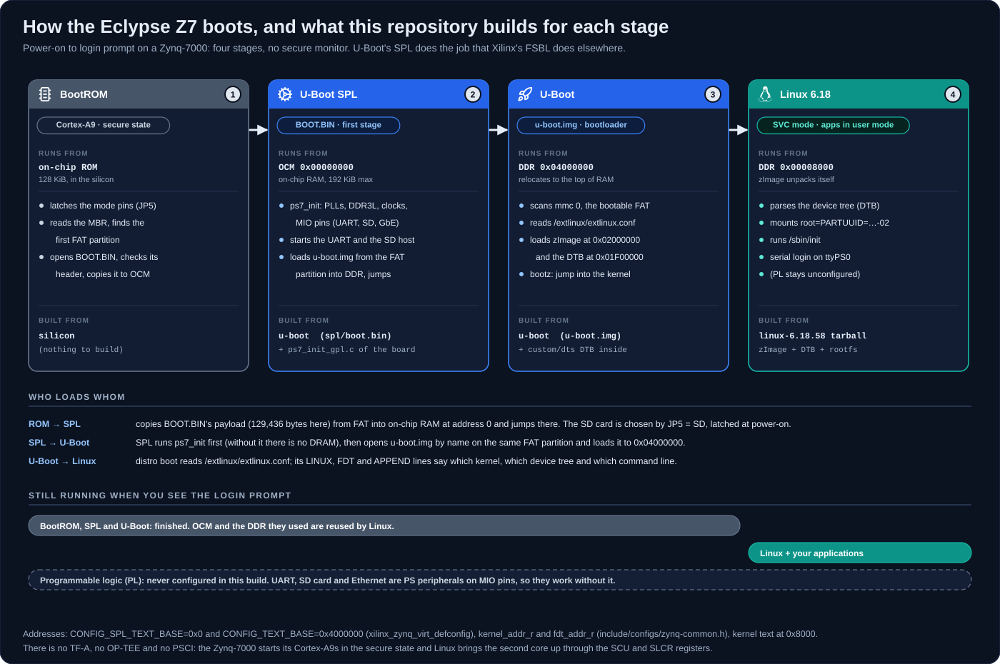
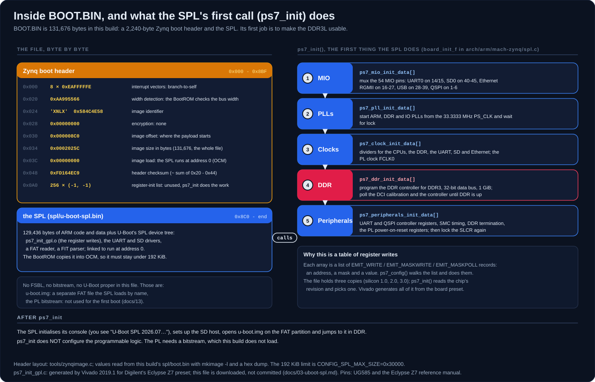

# 01 · Boot flow: from power-on to a login prompt

This chapter explains every box in the picture. If a word is new, [15 · Acronyms](15-acronyms.md) has it.
Every address and file name below was read from the pinned source trees, the Zynq-7000 technical reference
manual (UG585) or the Eclypse Z7 reference manual; the file is named so you can check.

## The big picture in one paragraph

A processor cannot start a big program like Linux straight from power-on: its DRAM is not even working yet. So
boot is a **chain**. The first link is code burned into the chip (the **BootROM**). It can only do one small
thing: read a small program (`BOOT.BIN`) from the SD card into the chip's 256 KiB of on-chip RAM (**OCM**) and
run it. On most Zynq boards that program is Xilinx's **FSBL**, built with Vivado and Vitis. Here it is U-Boot's
own **SPL**, built from the same source tree as the bootloader. Its job is to make the big RAM work (the
**PS7 initialisation**, chapter [03](03-uboot-spl.md)) and to load U-Boot proper, which loads Linux.

The Zynq-7000 is also different from the other boards of this repository in what is *absent*: no TF-A, no
OP-TEE, no secure monitor, no 64-bit exception levels. And it has something they do not have: an FPGA next to
the processors (chapter [11](11-ps-and-pl.md)). The FPGA stays empty in this build.

## The four stages

| # | Stage | Runs in | Lives at | What it does | Built from |
| --- | --- | --- | --- | --- | --- |
| 1 | **BootROM** | secure state, ARM mode | internal ROM | latches the mode pins (jumper JP5), reads the MBR, finds the first FAT partition, opens `BOOT.BIN`, checks its header, copies the payload to OCM address 0, jumps | silicon |
| 2 | **U-Boot SPL** (`BOOT.BIN`) | secure state | OCM `0x00000000` | `ps7_init()`: MIO pins, PLLs, clocks, DDR3L; then starts the UART and SD host and loads `u-boot.img` | `u-boot`, `spl/boot.bin` |
| 3 | **U-Boot** (`u-boot.img`) | secure state | DDR `0x04000000`, then relocates | scans the SD card, reads `/extlinux/extlinux.conf`, loads `zImage` and the device tree, `bootz` | `u-boot`, `u-boot.img` |
| 4 | **Linux** | SVC mode (kernel), user mode (apps) | DDR | drivers, root filesystem, `/sbin/init`, login on `ttyPS0` | `linux-6.18.58` |

Sources: `CONFIG_SPL_TEXT_BASE=0x0` and `CONFIG_TEXT_BASE=0x4000000` in `configs/xilinx_zynq_virt_defconfig`;
`kernel_addr_r=0x2000000`, `fdt_addr_r=0x1f00000` in `include/configs/zynq-common.h`; the kernel's text starts
at `0x8000` of DDR.

### "Secure state" without a secure world

A Cortex-A9 has the ARM *TrustZone* security extension: a **secure** and a **non-secure** state, switched by a
tiny monitor. The Zynq-7000 starts its cores in the secure state, and in this build nothing ever leaves it: U-Boot
and Linux run there, with no monitor. That is the normal arrangement for Zynq-7000 Linux. Two consequences:

* there is no PSCI firmware: the kernel starts the second core itself through the SCU and SLCR registers
  (`arch/arm/mach-zynq/platsmp.c`);
* there is no OP-TEE: a trusted OS would have to be added as a monitor, which this repository does not do.

The other boards of this repository (i.MX 8M Plus, STM32MP2) are 64-bit and have exception levels EL0 to EL3.
A 32-bit ARMv7 core has *modes* instead (user, SVC, IRQ…); the kernel runs in SVC mode, applications in user mode.

## Stage by stage

### 1. The BootROM

On power-on the CPU starts in the ROM (128 KiB, in the silicon). If, and only if, the chip was just powered on
(not on a warm reset) it latches the **mode pins** into a register. On the Eclypse Z7 the pins are wired to the
three-position jumper **JP5**: `JTAG`, `QSPI`, `SD`. Changing the jumper therefore needs a power cycle (reference
manual, section 2).

In SD mode the ROM reads the card's **MBR**, looks for the first **FAT16 or FAT32** partition and opens the
file `BOOT.BIN` in its root directory. This is why the card is not GPT-partitioned like the cards of the other
boards, and why the file name is not negotiable (chapter [06](06-sdcard-image.md)).

`BOOT.BIN` starts with a 2,240-byte header (`tools/zynqimage.c` documents it): a width-detection word
`0xAA995566`, the identifier `XNLX`, the payload offset (`0x8C0`), the size, a load address (0 here) and a
checksum. The ROM verifies it and copies the payload to the on-chip RAM. If the header is wrong, the jumper is
wrong, or there is no readable FAT partition, **nothing at all is printed**: the UART has not been started yet.
The header, field by field, is in the [BOOT.BIN diagram](images/bootbin-anatomy.svg) of chapter 03.

### 2. The U-Boot SPL

The *secondary program loader* is a stripped-down U-Boot, built from the same source and configuration as the
real one, small enough for the on-chip RAM (at most 192 KiB; it is about 129 KB here). Its entry point is
`board_init_f()` in `arch/arm/mach-zynq/spl.c`, whose first call is `ps7_init()`:

`ps7_init()` is the code Vivado generates for a hardware design: five tables of register writes that mux the 54
MIO pins, start the PLLs, set the clock dividers, program the DDR3L controller and enable a few peripherals.
Only after it returns does the DRAM exist. Then the SPL starts the UART (you get the first line of output:
`U-Boot SPL 2026.07…`), initialises the SD host, and calls `spl_mmc_load()`, which mounts the FAT partition and
reads the file named by `CONFIG_SPL_FS_LOAD_PAYLOAD_NAME`: `u-boot.img`. That file is a FIT image holding U-Boot
proper and its device tree; the SPL puts it at `0x04000000` and jumps.

### 3. U-Boot proper

The full bootloader: a shell, drivers, a FAT and ext4 reader, and **distro boot**. It relocates itself to the
top of the 1 GiB of DRAM, finds the boot device from the boot-mode register (SD → `mmc0` first,
`board_late_init()` in `board/xilinx/zynq/board.c`), loads its environment from `uboot.env` on the FAT partition
if that file exists, and runs `bootcmd`. Distro boot scans each partition (the *active* one first) with the
prefixes `/` and `/boot/`, and on finding `extlinux/extlinux.conf` runs `sysboot`: it loads the kernel to
`kernel_addr_r`, the device tree to `fdt_addr_r`, sets `bootargs` from the `APPEND` line, and runs `bootz`.

Between the last SPL line and the kernel you see U-Boot's banner, `Hit any key to stop autoboot`, and the
distro-boot messages (`Scanning mmc 0:1…`, `Found /extlinux/extlinux.conf`). The `jtag`, `pxe` and `dhcp`
boot targets that Xilinx's configuration lists first fail quickly on an SD boot; they are not used.

### 4. Linux

`zImage` is a self-extracting kernel: it unpacks itself, then starts at DDR `0x8000`. The device tree
(`zynq-eclypse-z7.dtb`) tells the kernel where the UART, the SD controller and the Ethernet MAC are. The root
filesystem is named on the command line by `root=PARTUUID=<disk signature>-02`; the kernel waits for the SD card
(`rootwait`), mounts the ext4 partition, and runs `/sbin/init`. For Debian that is systemd, which starts a login
on the serial console it finds in `console=ttyPS0,115200`.

## What stays running

Nothing of the first three stages is left when you see the login prompt. They have done their jobs and
their memory is reused. What *is* running is Linux on both Cortex-A9 cores. The programmable logic has never
been touched.

## Where to go next

* Build it: [02 · Host setup](02-host-setup.md), then [03 · U-Boot SPL](03-uboot-spl.md).
* What is in `BOOT.BIN`, and where `ps7_init` comes from (this is the chapter to read if you ask "can I trust
  this file"): [03](03-uboot-spl.md).
* The board in the picture of the chip: [11 · PS and PL](11-ps-and-pl.md).
