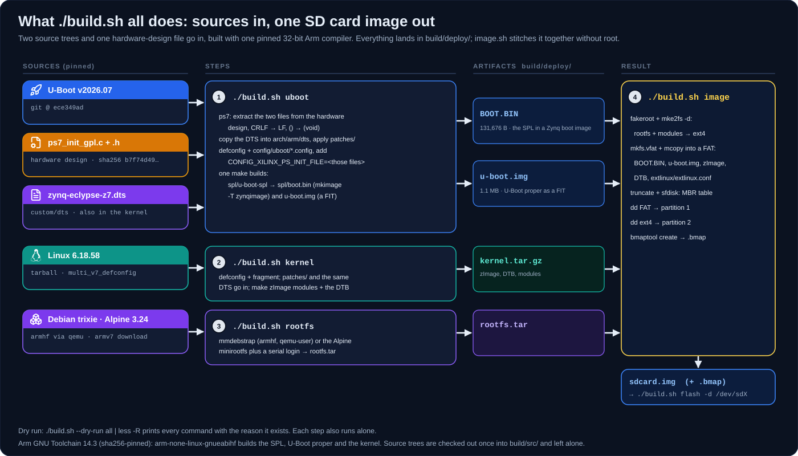
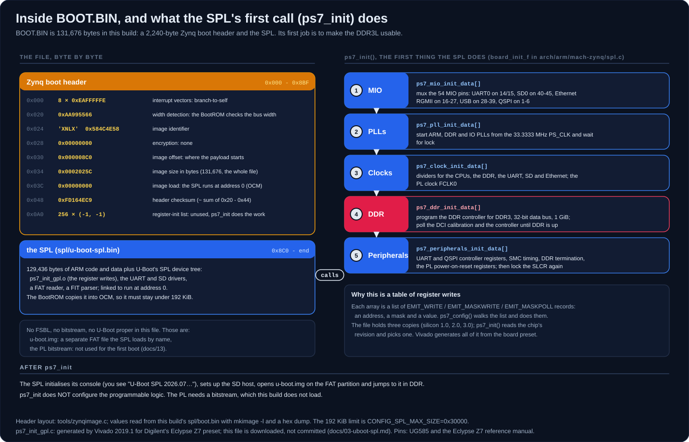

# 03 · The first stage and the bootloader: U-Boot SPL, `BOOT.BIN`, `u-boot.img`



This is the chapter to read if you ask *"what runs before Linux, where did it come from, and why should I trust
it?"* The short answer: one U-Boot build produces both programs; the only input that is not a software project is
a generated file with the board's clock, DDR and pin settings.

## Two ways to make `BOOT.BIN`

The BootROM needs a **boot image** (`BOOT.BIN`) whose first partition is a small program it can run from the
256 KiB on-chip RAM. Something has to turn on the DDR before anything bigger can run. Two well-known ways:

| | **A. U-Boot SPL** (this repository) | **B. Xilinx FSBL + bootgen** (vendor route) |
| --- | --- | --- |
| First-stage program | U-Boot's own SPL, built from the U-Boot tree | Xilinx's FSBL, built with Vitis from the `embeddedsw` sources |
| Where the DDR/clock/MIO setup comes from | `ps7_init_gpl.c` compiled into the SPL | `ps7_init.c` compiled into the FSBL |
| `BOOT.BIN` is made by | `mkimage -T zynqimage` (part of U-Boot, runs inside `make`) | `bootgen` and a `.bif` description (Xilinx's tool) |
| What `BOOT.BIN` holds | the SPL only; U-Boot proper is a second file, `u-boot.img` | FSBL, optionally a bitstream, and U-Boot (`u-boot.elf`) as partitions |
| Needs Vivado/Vitis on your PC | **no** | yes (or a prebuilt FSBL from someone else) |
| PL bitstream before U-Boot | not in this build (U-Boot or Linux can load one later, [13](13-zmod-adc.md)) | the FSBL configures the PL from the bitstream partition |
| Licence of the first stage | GPL-2.0-or-later (U-Boot) + the generated GPL init file | Xilinx licence (the FSBL is under their terms) |
| Secure boot (RSA/AES partitions) | not supported by the SPL | supported by `bootgen` + FSBL |
| Use it when | you want a source-built, open, Vivado-free first boot, or you are learning | you need a bitstream at power-on, secure boot, or Xilinx support for the boot path |

This board does **A**, because it is the simplest path that is fully built from source and needs no vendor tool
on your PC. A bench-proven configuration on this exact board uses the same idea (an SPL as the only content of
`BOOT.BIN`, with the PS initialisation taken from the board's hardware design) and boots it. Route **B** is
documented here only as a pointer: [Appendix](#appendix-the-vendor-route-fsbl-and-bootgen).

## What `./build.sh uboot` does

```text
./build.sh uboot ps7   extract ps7_init_gpl.c/.h from the hardware design, make them compile
./build.sh uboot       the same, then configure and build U-Boot, deploy BOOT.BIN and u-boot.img
```

In detail (`scripts/uboot.sh`, every command is printed with its reason by `--dry-run`):

1. **Check out U-Boot** at the pinned commit (`v2026.07`), apply `patches/u-boot/*.patch` (one line: the
   Makefile now builds `zynq-eclypse-z7.dtb`) and copy `custom/dts/zynq-eclypse-z7.dts` into
   `arch/arm/dts/`.
2. **Prepare the PS7 files** (next section).
3. **Configure** with `xilinx_zynq_virt_defconfig`: mainline's generic Zynq-7000 configuration, with SPL
   enabled, distro boot and FIT. Merge `config/uboot/eclypse-z7.config` (device tree name) and one generated
   line, `CONFIG_XILINX_PS_INIT_FILE="…/ps7_init_gpl.c"`.
4. **One `make`** produces `spl/u-boot-spl` (the first stage), `spl/boot.bin` (the SPL wrapped by
   `mkimage -T zynqimage`) and `u-boot.img` (U-Boot proper plus its device tree, a FIT image).
5. **Deploy** `spl/boot.bin` as `build/deploy/BOOT.BIN` and `u-boot.img`. The script refuses an SPL larger than
   192 KiB, the most the BootROM can load.

Why no board `defconfig` for the Eclypse Z7: mainline U-Boot has a **single** Zynq-7000 defconfig now
(`xilinx_zynq_virt_defconfig`; the per-board `zynq_zybo_defconfig` and friends are gone) and selects the board with
`DEVICE_TREE=<name>`. The in-tree device trees include `zynq-zybo-z7`, `zynq-zed`, `zynq-microzed`,
`zynq-zc702` and others but **no Eclypse Z7**; mainline Linux 6.18 has none either. So this repository carries
the device tree (below).

### The device tree: one file for both projects

`custom/dts/zynq-eclypse-z7.dts` `#include`s `zynq-7000.dtsi` and switches on what the board wires to the PS:
UART0 (MIO 14/15), SD0 (MIO 40-45), the Gigabit Ethernet PHY on GEM0 (RGMII, MDIO address 1, reset on MIO 9), USB0
(reset MIO 46), I2C1, the QSPI flash, and the 33.3333 MHz PS clock; 1 GiB of memory at 0. The same file is copied
into the U-Boot tree and into the kernel tree. Nodes the SPL needs (UART, SD, QSPI) carry `bootph-all`, a
property Linux ignores. See [04](04-kernel.md#the-device-tree) and [08](08-customizing.md).

## `ps7_init_gpl.c`: where the board's PS configuration comes from

The processing system cannot use its DDR until PLLs, clock dividers, the DDR controller and the MIO pin muxes
are configured. The values depend on the **hardware design** (which peripherals sit on which MIO pins, which
DDR chips, which clocks). Xilinx's tools write them as `ps7_init.c` and `ps7_init_gpl.c`; the second is the
variant meant for GPL programs such as U-Boot. U-Boot contains these files for a few boards under
`board/xilinx/zynq/<device-tree-name>/ps7_init_gpl.c`, each regenerated by hand (the one for the Digilent Zybo Z7 is
a Vivado export with manual edits for the style checker). It does not contain one for the Eclypse Z7.

| | |
| --- | --- |
| What the build uses by default | `system.hdf` from Digilent's **Eclypse-Z7-OS** project at commit `8d74b26e…` (Vivado 2019.1, board preset `digilentinc.com:eclypse-z7:1.0`, part `xc7z020clg484-1`), downloaded from `raw.githubusercontent.com`, **sha256 `b7f74d49bf9456cef08f9bf2a7b75df93691ea573c8ed4e25ab4aea1854ae937`** |
| What is taken out of it | `ps7_init_gpl.c` and `ps7_init_gpl.h` only (the `.hdf` is a zip; it also holds a bitstream and block-design files, which are ignored) |
| What the script changes | CRLF line endings → LF, and old-style empty parameter lists (`int ps7_init()`) → `(void)`, because U-Boot compiles with `-Werror=strict-prototypes`. The 687 register-write records are untouched. The script prints the sha256 of both results |
| Checked at run time | the download's sha256, and that the file really writes the SLCR unlock key to `0xF8000008` |
| Is it committed here? | **No.** It is downloaded into `build/downloads/` and prepared in `build/work/ps7-init/` |

**Provenance and licence, honestly.** The file's own header says *GNU General Public License, version 2 or
later*, Copyright Xilinx, "automatically generated". That is why U-Boot may build it. The project that hosts it
(Digilent's Eclypse-Z7-OS) has no licence file at its top level at the pinned commit (a request for
`LICENSE` returns *404*), so this repository does **not** redistribute the file: it fetches it from its public
location and checks the hash, as it does for every other external input. If you redistribute images built from
it, the file is part of the GPL-covered SPL: ship its source with the image, as you would for U-Boot itself.
A bench-proven configuration on this board uses exactly this file, from the same commit, for the same purpose.

**Providing your own.** If your PS configuration differs (another DDR chip, other MIO pins, a different clock) or
you do not want to depend on that download, give the script a file:

```bash
PS7_INIT_SRC=/path/to/ps7_init_gpl.c        ./build.sh uboot    # a file (ps7_init_gpl.h beside it)
PS7_INIT_SRC=/path/to/dir                   ./build.sh uboot    # a directory containing both
PS7_INIT_SRC=/path/to/design.xsa            ./build.sh uboot    # a Vivado/Vitis hardware handoff (.hdf/.xsa)
```

To make one in Vivado: create a project with the **Eclypse Z7** board files (Digilent's `vivado-boards`
repository), add a block design with the **ZYNQ7 Processing System** and run *Block Automation* with *Apply Board
Preset* (this is what puts the right DDR, MIO and clock settings in), validate, generate the output products,
and *Export Hardware*. Vivado 2018 to 2019.1 put `ps7_init_gpl.c/.h` into the `.hdf`; newer versions put them into
the `.xsa` and the Vitis platform's `hw` folder (check with `unzip -l design.xsa | grep ps7_init`). Never hand-edit
the register values.

## What is in `BOOT.BIN`



`spl/boot.bin` is 131,676 bytes in this build: **2,240 bytes of header** and **129,436 bytes of SPL**. Inspect it
with U-Boot's own tool:

```text
$ build/work/u-boot/tools/mkimage -l build/deploy/BOOT.BIN
Image Type   : Xilinx Zynq Boot Image support
Image Offset : 0x000008c0
Image Size   : 131676 bytes (131676 bytes packed)
Image Load   : 0x00000000
User Field   : 0x00000000
Checksum     : 0xfd164ec9
```

(The line `Truncated file` that `mkimage -l` also prints is a quirk of that tool: it expects a longer file than a
bare boot image.) `xxd -l 96 build/deploy/BOOT.BIN` shows the fixed words: `aa995566` at `0x20` and the ASCII
`XNLX` at `0x24`.

The header's register-initialisation list (`0xA0` to `0x89F`, 256 address/value pairs the BootROM can apply
before it starts the SPL) is unused: it holds only `0xFFFFFFFF` terminators. All initialisation is done by
`ps7_init()` in software.

## What is in `u-boot.img`

A **FIT image** (flattened image tree, `mkimage -f auto`): U-Boot proper (1,069,928 bytes, load address
`0x04000000`) and the board's device tree, with CRC32 hashes. The SPL loads it with `spl_load_simple_fit()`
(`common/spl/spl_fit.c`). Print it with `mkimage -l build/deploy/u-boot.img`.

## What U-Boot proper does on this board

* **Boot target.** `board_late_init()` reads the boot-mode register; in SD mode `mmc0` goes first in
  `boot_targets`. The generic Zynq configuration lists `jtag`, `pxe` and `dhcp` targets too; on a card boot they
  fail fast and `mmc0` wins. (Run `printenv boot_targets` at the U-Boot prompt.)
* **Distro boot.** For each partition, active first, and each prefix in `boot_prefixes` (`/`, `/boot/`), it looks
  for `boot.scr`, then `extlinux/extlinux.conf`. This board uses the latter: [06](06-sdcard-image.md).
* **Memory map.** `kernel_addr_r=0x2000000`, `fdt_addr_r=0x1f00000` (`include/configs/zynq-common.h`).
* **Environment.** `saveenv` writes `uboot.env` into the FAT partition (`CONFIG_ENV_IS_IN_FAT`, selected at run
  time by the boot mode). Nothing is stored in the QSPI flash by this build.
* **Console.** `serial0` = UART0 at 115200 8N1 (the `stdout-path` of the device tree).

To change the U-Boot configuration: `./build.sh uboot-menuconfig`, then put the changed lines in a
`config/uboot/*.config` fragment ([08](08-customizing.md)).

## What this build does with the PL

Nothing. `ps7_init()` powers the PL's reset registers but configures no bitstream; the SPL does not load one;
U-Boot's `fpga` commands are compiled in (`CONFIG_FPGA_ZYNQPL`) but not used by the boot script. Adding a
bitstream is chapter [13](13-zmod-adc.md).

## Appendix: the vendor route (FSBL and bootgen)

Not built here; for reference when you need a bitstream at power-on or secure boot:

1. In Vivado, create the block design (PS, plus your PL logic) and *Export Hardware* including the bitstream.
2. In Vitis, create a platform from the exported `.xsa` and build the **FSBL** application (Xilinx's
   `embeddedsw`).
3. Build U-Boot as an ELF with the same defconfig (`make xilinx_zynq_virt_defconfig && make`, giving `u-boot`
   or `u-boot.elf`).
4. Describe the image in a `.bif` and run `bootgen`:

   ```text
   the_ROM_image:
   {
     [bootloader] fsbl.elf
     design.bit
     u-boot.elf
   }
   ```

   `bootgen -arch zynq -image boot.bif -w on -o BOOT.BIN`
5. Copy that `BOOT.BIN` onto the FAT partition instead of this build's file. The `u-boot.img` file is then
   not needed. The rest of the card is unchanged: `./build.sh flash --firmware-only` replaces `BOOT.BIN`
   (and writes `u-boot.img` too, harmlessly).

A vendor FSBL taken from a prebuilt vendor image works the same way; it is only valid for the hardware design
it was built for. Digilent's own Eclypse Z7 images use this route.

Next: [04 · The kernel](04-kernel.md).
