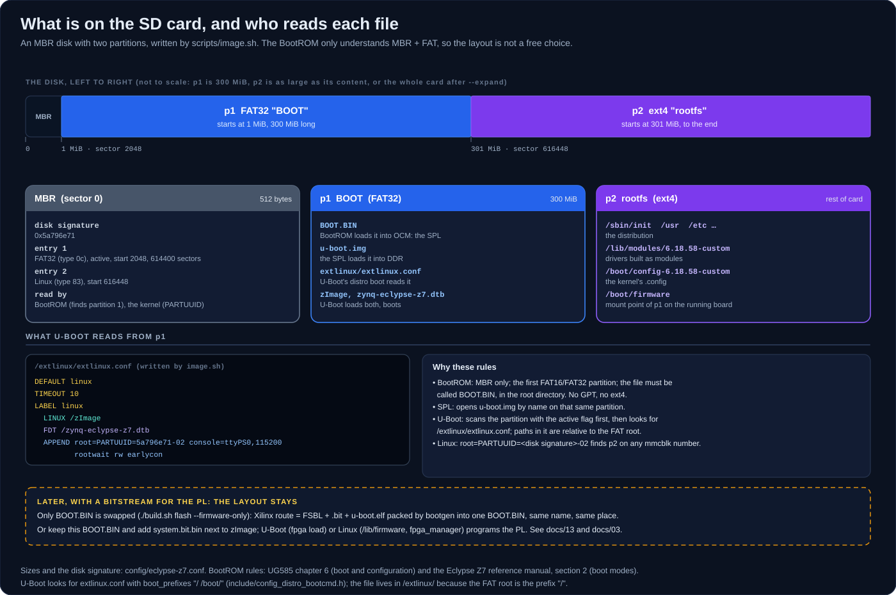

# 06 · The SD card image, byte for byte



`./build.sh image` (`scripts/image.sh`) writes `build/deploy/eclypse-z7-<rootfs>-<date>.img` and a
`sdcard.img` link to the newest one, plus a `.bmap` block map for fast flashing. It needs no root rights.

## Why MBR and FAT

The Zynq-7000 BootROM does not read GPT. In SD mode it reads an **MBR**, looks for the first **FAT16 or FAT32**
partition and opens the file `BOOT.BIN` in its root directory (UG585, *SD card boot*; the Eclypse Z7 reference
manual says: *format the card FAT32 and copy the boot image renamed `BOOT.bin`*). The i.MX and STM32 boards of
this repository use GPT because *their* ROMs need it. The SoC decides the partition table, not fashion.

A bench-proven configuration for this exact board uses the same arrangement: an MBR card whose first partition is
FAT with `BOOT.BIN` in its root.

## The partition table

```text
$ sfdisk -d build/deploy/sdcard.img
label: dos
label-id: 0x5a796e71
unit: sectors
sector-size: 512

sdcard.img1 : start=        2048, size=      614400, type=c, bootable
sdcard.img2 : start=      616448, size=     1902592, type=83
```

| # | Start | Size | Type | Content |
| --- | --- | --- | --- | --- |
| – | sector 0 | 512 B | MBR | boot-code area (zeros), the disk signature `0x5a796e71`, the table |
| 1 | sector 2048 (1 MiB) | 300 MiB | `0c` FAT32 (LBA), **active** | `BOOT.BIN`, `u-boot.img`, `zImage`, `zynq-eclypse-z7.dtb`, `extlinux/extlinux.conf` |
| 2 | sector 616448 (301 MiB) | the rest | `83` Linux, ext4, label `rootfs` | the root filesystem and the modules |

Choices worth knowing:

* **p1 starts at 1 MiB**: aligned for any flash erase block, clear of the MBR.
* **p1 is 300 MiB** so that `mkfs.vfat` makes ordinary **4 KiB clusters**. (A 64 MiB FAT32 volume would get 512-byte
  clusters: legal, but unusual, and not the geometry the BootROM is usually tested with. The script passes `-s 8`
  explicitly.) The space also holds a second kernel or a bitstream later.
* **The active flag** on p1 is what U-Boot's distro boot scans first (`part list mmc 0 -bootable`).
* **The disk signature** `5a796e71` (`DISK_SIGNATURE`) makes `PARTUUID=5a796e71-02` the root partition: the same name
  works whether Linux calls the SD card `mmcblk0` or `mmcblk1`.
* **Partition 2 stops at the content size** plus `IMAGE_EXTRA_MB` (512). `flash --expand` grows it to the whole
  card; or do it on the board with `sfdisk` + `resize2fs`.

## The FAT partition

```text
$ mdir -i <p1 image> ::
BOOT     BIN    131676   the Zynq boot image: U-Boot SPL      (BootROM loads it)
u-boot   img   1100664   U-Boot proper as a FIT image          (the SPL loads it)
ZIMAGE        11915776   zImage                                (U-Boot loads it)
ZYNQ-E~1 DTB     11430   zynq-eclypse-z7.dtb                   (U-Boot loads it)
extlinux     <DIR>       extlinux/extlinux.conf, 295 bytes     (U-Boot's distro boot reads it)
```

`extlinux.conf` (written by `image.sh`, edit it on the card to experiment):

```text
DEFAULT linux
TIMEOUT 10
MENU TITLE Boot menu

LABEL linux
  MENU LABEL Linux
  LINUX /zImage
  FDT /zynq-eclypse-z7.dtb
  APPEND root=PARTUUID=5a796e71-02 console=ttyPS0,115200 rootwait rw earlycon
```

Paths are relative to the FAT root: U-Boot's distro boot tries the prefixes `/` and `/boot/`
(`boot_prefixes`), and finds the file at `/extlinux/extlinux.conf`. `TIMEOUT 10` is in tenths of a second.

## How the image is made (rootless)

1. `fakeroot` + `tar` + `mke2fs -t ext4 -d`: the rootfs tarball and the kernel's `rootfs/` half become an ext4 image
   owned by root without being root.
2. `mkfs.vfat -F 32 -s 8` on a file, then `mcopy`/`mmd` (mtools) put the five files in it.
3. `truncate` makes an empty image file; `sfdisk` writes the MBR on it (the script is printed by `--dry-run`).
4. `dd conv=notrunc,sparse` places both filesystems at their sectors; `bmaptool create` records which blocks hold data.

Inspect an image without mounting anything:

```bash
IMG=build/deploy/sdcard.img
sfdisk -d $IMG
dd if=$IMG of=/tmp/p1.fat bs=512 skip=2048 count=614400 status=none
mdir -i /tmp/p1.fat ::
mcopy -i /tmp/p1.fat ::extlinux/extlinux.conf -                  # print it
fsck.vfat -n /tmp/p1.fat
dd if=$IMG of=/tmp/p2.ext4 bs=512 skip=616448 status=none
e2fsck -fn /tmp/p2.ext4 && debugfs -R 'ls -l /boot' /tmp/p2.ext4
```

## Later: a `BOOT.BIN` that carries a bitstream

Nothing in the layout has to change. `BOOT.BIN` is one file in the FAT root; a vendor-style one (FSBL + `.bit` +
U-Boot, made with `bootgen`, [03](03-uboot-spl.md#appendix-the-vendor-route-fsbl-and-bootgen)) replaces it with
`./build.sh flash -d /dev/sdX --firmware-only`, or by copying one file on a PC. If you keep the SPL `BOOT.BIN`
and want the bitstream loaded later instead, put the converted file next to `zImage`; see
[13](13-zmod-adc.md#where-the-bitstream-can-be-loaded-from).

Next: [07 · Flashing and booting](07-flashing-and-booting.md).
