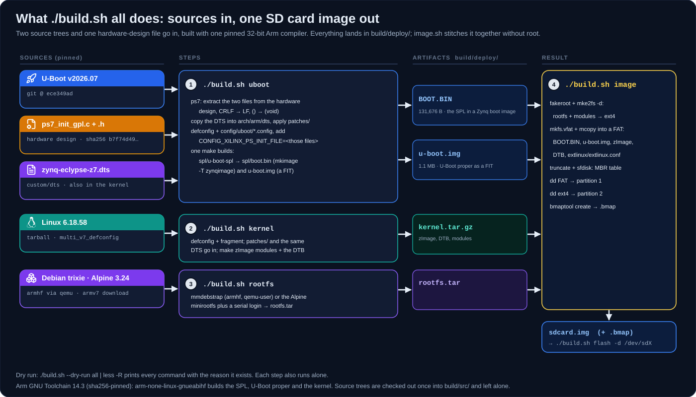

# 08 · Customizing: where each kind of change goes

The build never edits the upstream sources by hand and never edits `config/eclypse-z7.conf` for you. Your
changes live in a few small places that are meant to be committed to git, so the whole board stays reproducible.



| I want to … | Put it in | Rebuild with |
| --- | --- | --- |
| change a version, URL, hostname, password, console, partition size | `config/local.conf` (git-ignored) **or** an environment variable for one run | the affected step |
| use my own PS configuration (other DDR, MIO pins, clocks) | `PS7_INIT_SRC=/path/…` (a `ps7_init_gpl.c`, a directory, or an `.hdf`/`.xsa`) | `./build.sh uboot` |
| change U-Boot's configuration | `config/uboot/*.config` fragments, or `./build.sh uboot-menuconfig` to experiment | `./build.sh uboot` |
| patch U-Boot | `patches/u-boot/*.patch` | `./build.sh uboot` |
| change the kernel configuration | `config/kernel/*.cfg` | `FORCE_CONFIG=1 ./build.sh kernel` |
| patch the kernel | `patches/kernel/*.patch` | `./build.sh kernel` |
| change or add a device tree | `custom/dts/*.dts` (this one file serves U-Boot **and** Linux) | `./build.sh uboot` and `./build.sh kernel` |
| change the kernel command line | `KERNEL_CMDLINE_EXTRA` in `config/local.conf`, or edit `extlinux.conf` on the card | `./build.sh image` |
| add packages / change the Debian system | `DEBIAN_PACKAGES`, `scripts/rootfs/debian-customize.sh` | `./build.sh rootfs image` |
| add my application | into your rootfs (a tarball, or the customize hook) | `./build.sh rootfs image` |
| change the partition sizes | `BOOT_PART_SIZE_MB`, `IMAGE_EXTRA_MB` in `config/local.conf` | `./build.sh image` |

## Overriding configuration

Every setting in [`config/eclypse-z7.conf`](../config/eclypse-z7.conf) has the form `: "${NAME:=default}"`,
meaning *"keep NAME if the environment already sets it"*. So for one run:

```bash
KERNEL_CMDLINE_EXTRA="rootwait rw" ./build.sh image          # drop earlycon
TARGET_HOSTNAME=bench-07 ./build.sh -r alpine rootfs
```

and for good, in `config/local.conf` (sourced first, git-ignored):

```bash
TARGET_PASSWORD='something-else'
KERNEL_CMDLINE_EXTRA="rootwait rw"
JOBS=8
```

## The device tree

`custom/dts/zynq-eclypse-z7.dts` is the one tree both U-Boot and Linux build. Edit it, then rebuild both
(`./build.sh uboot && ./build.sh kernel`): U-Boot embeds its own copy in `u-boot.img`, Linux reads
`zynq-eclypse-z7.dtb` from the FAT partition. To use a different tree for the kernel only, add another `.dts` to
`custom/dts/` (every `.dts` there is built) and put its `.dtb` **first** in `KERNEL_DTBS`; `image.sh` writes the first
entry into `extlinux.conf`.

Faster iteration with no rebuild: edit the device tree *source* on your PC, compile with
`dtc -I dts -O dtb`, and copy the `.dtb` over the one on the card's FAT partition. (The file needs the kernel's
`#include`s resolved; the simplest way is `./build.sh kernel build`.)

## Fragments

* **Kernel**: one `CONFIG_FOO=y` per line in `config/kernel/NN-name.cfg`, merged on top of `multi_v7_defconfig`,
  then `olddefconfig`. The boot-path check ([04](04-kernel.md)) refuses a fragment that turns one off.
* **U-Boot**: the same format in `config/uboot/*.config`, merged on top of `xilinx_zynq_virt_defconfig`.
  Example: `CONFIG_BOOTDELAY=5`.

A comment that starts with an option name (`# CONFIG_FOO is not set`) is how an option is switched **off**;
`merge_config.sh` reads it as a setting.

## Patches

`patches/<component>/*.patch` are applied in name order, once per checkout (a list of applied names is kept
inside the checkout). The two that ship here do only one thing each: add `zynq-eclypse-z7.dtb` to the Makefile of
the device-tree directory. Make yours with `git diff` (U-Boot) or `diff -u a/… b/…` (the kernel tree is not a git
repository), with `a/` and `b/` prefixes so that `git apply` accepts them. `./build.sh --update` refuses to move a
checkout with uncommitted changes: turn them into patches first.

## Adding a bitstream

Chapter [13](13-zmod-adc.md) lists the options and the order of work.

Next: [09 · Troubleshooting](09-troubleshooting.md).
