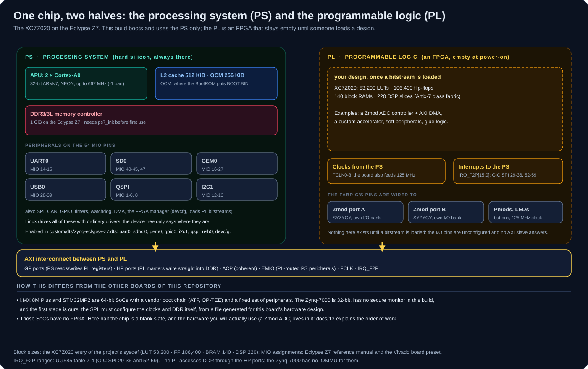

# 11 · The processing system (PS) and the programmable logic (PL)

The XC7Z020 is **two chips in one package**. Everything the other boards of this repository teach about booting
Linux applies to the left half, the **processing system (PS)**. The right half, the **programmable logic (PL)**,
is an FPGA, which is why this SoC exists and why this chapter does.

## The PS: a hard 32-bit computer

| Block | On this chip | Matters for |
| --- | --- | --- |
| APU | 2 × ARM Cortex-A9, ARMv7, NEON, up to 667 MHz (speed grade -1) | Linux SMP; a 32-bit kernel and userland |
| Caches | 32 KiB L1 I + D per core, 512 KiB shared L2 | |
| OCM | 256 KiB on-chip RAM | the BootROM puts `BOOT.BIN` here |
| DDR controller | DDR3/DDR3L, 32-bit, here 1 GiB | needs `ps7_init` ([03](03-uboot-spl.md)) |
| MIO | 54 multiplexed pins | UART0, SD0, GEM0, USB0, QSPI, I2C1 on this board |
| Peripherals | 2 UART, 2 SD, 2 GEM, 2 USB, 2 I2C, 2 SPI, 2 CAN, GPIO, timers, watchdog, DMA, QSPI/NAND/NOR | all with ordinary Linux drivers |
| Clocks and reset | the **SLCR** (system-level control registers), 3 PLLs | the SPL programs them; Linux's `zynq_clock_init` reads the result |

The device tree's job is to say which of these the board uses and where they are, exactly as on any other ARM
board. **None of this needs the PL**: the PS peripherals are routed to pins by the MIO mux, not by the fabric.
That is why this repository boots with no bitstream.

## The PL: an FPGA that the PS configures

| Block | On this chip | |
| --- | --- | --- |
| Logic | 53,200 LUTs, 106,400 flip-flops | Artix-7 class, 28 nm |
| Memory / DSP | 140 block RAMs (36 Kb), 220 DSP slices | |
| Clocks into the PL | `FCLK0-3` from the PS (and a 125 MHz clock from the board's Ethernet PHY) | |
| Pins | the board wires Zmod ports A and B, the Pmods, buttons and LEDs to it | |

The PL is empty at power-on: it has no configuration, and **configuration is a file** (a *bitstream*) written into
it by something that runs on the PS: the FSBL, U-Boot, or Linux. It also forgets it at every power cycle. Between
the two halves are the **AXI** interconnect ports (General-Purpose ports so the CPUs reach registers in the
fabric; High-Performance ports so fabric masters write into DDR; the ACP), the `FCLK` clocks, 16 interrupts into
the GIC (`IRQ_F2P`, GIC SPI 29-36 and 52-59) and *EMIO*, which can route PS peripherals out through the fabric's pins.

## How this differs from the other boards of this repository

| | i.MX 8M Plus (Variscite) | STM32MP257F-DK | **Zynq-7000 (Eclypse Z7)** |
| --- | --- | --- | --- |
| CPU | 4 × Cortex-A53, 64-bit | 2 × Cortex-A35, 64-bit | **2 × Cortex-A9, 32-bit** |
| Exception levels / secure monitor | EL3 TF-A BL31, OP-TEE | EL3 TF-A BL31, OP-TEE (SCMI server) | **none: Linux in the secure state, no PSCI** |
| First stage | BootROM → SPL (in `imx-boot`) | BootROM → TF-A BL2 | **BootROM → U-Boot SPL (our `BOOT.BIN`)** |
| Who makes the DDR work | `imx-boot` with vendor DDR training firmware | TF-A BL2 + DDR PHY firmware (ST) | **the SPL, from `ps7_init` generated for this board's design** |
| Partition table the ROM reads | raw offset on the card (no table) | GPT, partitions *named* | **MBR + FAT, a file named `BOOT.BIN`** |
| Programmable logic | none | none | **an FPGA, empty in this build** |
| Device-tree upstream status | yes | yes | **no tree for this board in U-Boot or Linux: carried here** |
| Toolchain | AArch64 (two) | AArch64 (two) | **one 32-bit hard-float compiler** |

Three practical consequences:

1. **Hardware design is a build input.** On the other SoCs the memory and clock set-up is code in the vendor firmware.
   On a Zynq it is *generated from the hardware design* (a Vivado block design with the board preset). Change the
   board's DDR or MIO map, and you regenerate `ps7_init`.
2. **You can configure the chip two ways** and they do not interfere: software (U-Boot, Linux: this repository)
   and logic (the PL: a Vivado project and Digilent's IP). Nothing in this build knows about the second.
3. **Boot problems look different.** There is no firmware log between the ROM and the SPL, so a card that does not
   work is silent. [14](14-first-boot-checklist.md) is built around that.

## Where the Zmod ADC fits

A Zmod ADC plugs into one of the SYZYGY ports, which are wired to the PL only. See [13](13-zmod-adc.md).

Next: [12 · Board tour](12-board-tour.md).
