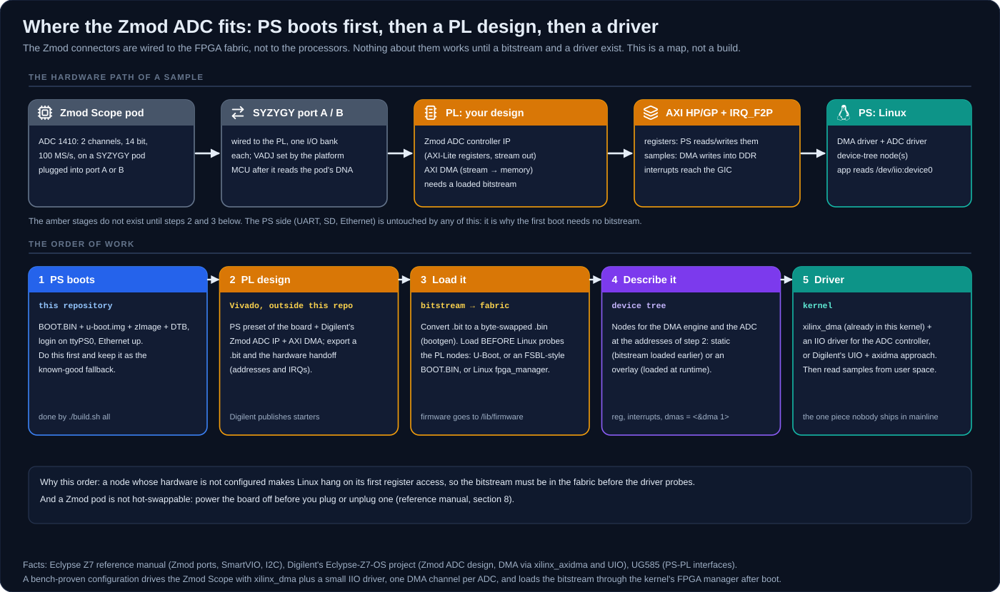

# 13 · Where the Zmod ADC fits



> **Scope.** This chapter is a **map**, not a build. Nothing in `./build.sh` loads a bitstream or touches the
> Zmod ports, and the first boot ([07](07-flashing-and-booting.md), [14](14-first-boot-checklist.md)) must not depend
> on it. Everything below is grounded in Digilent's reference manual, Digilent's Eclypse-Z7-OS project, the
> kernel's FPGA documentation, and a bench-proven configuration of this board that drives a Zmod Scope ADC.

## What the Zmod connectors are wired to

The Eclypse Z7 has two **Zmod ports** that follow the **SYZYGY** standard (version 1.1). Each carries 16 single-ended
I/O, 8 differential pairs (or 16 more single-ended), a dedicated differential input and output clock, and power.
All of that goes to **pins of the Zynq's programmable logic**: *each port has an I/O bank of the Zynq dedicated to
it, powered by a variable supply* (reference manual, section 8). They are **not** connected to any PS peripheral.

Power is managed by a small **platform microcontroller** (PMCU). At power-on it reads each pod's identity (its
"DNA") over I2C and sets the port's supply (`VADJ_A`, `VADJ_B`) accordingly, then hands the I2C bus to the Zynq
(MIO 12/13). Two LEDs (LD2 and LD3) show when a port's supply is on. A pod is **not hot-swappable**: power the board
off before plugging or unplugging one.

So, for a Zmod ADC, the signal path is:

```text
analog input → Zmod Scope pod (ADC 1410: 2 channels, 14 bit, 100 MS/s)
            → SYZYGY port A or B → PL pins
            → a PL design: ADC controller IP  →  AXI DMA  →  AXI port to DDR
            → Linux driver (DMA engine + ADC)  →  your application
```

## Why a bitstream, a device-tree node and a driver are all needed

| Piece | Why |
| --- | --- |
| **A bitstream** | the PL is empty at power-on. Something in the fabric must implement the ADC's digital interface (the controller IP that talks to the pod's converter) and a DMA engine that writes samples to memory. Without a configuration, the pins do nothing and no AXI slave answers |
| **A device-tree node (or nodes)** | the kernel cannot discover memory-mapped devices. It needs the register addresses, the interrupt numbers and, for DMA, which engine serves which device. These come from the design (Vivado's address editor and its hardware handoff), not from the board |
| **A driver** | the kernel needs code that knows the controller's registers. The DMA engine has one in mainline (`xilinx_dma`, enabled in this kernel); the ADC controller does not. Digilent's route is a user-space library over UIO; a bench-proven route is a small kernel driver that exposes an IIO device |

A **warning that explains the order of work.** A node for hardware that is not configured makes the CPU wait on a bus
access that nothing answers, and Linux hangs at probe. The bitstream must be in the fabric **before** the driver
for it probes.

## The order of work

1. **PS boots first** (this repository). If the board boots to a login with Ethernet, the processing system is
   healthy. Keep that card as your known-good fallback.
2. **A PL design** (Vivado, outside this repository). Start from the board preset used for the PS configuration
   and Digilent's published Zmod design, or build your own: ZYNQ7 PS + the Zmod ADC controller IP + an **AXI DMA** (a
   stream-to-memory channel, S2MM). Digilent's *Eclypse-Z7-OS* project contains such a design for a Zmod
   ADC 1410 on **port A** (Vivado 2019.1). Note what the starter design connects: in the bench-proven one every pin of
   the design is on port A, so a module in port B is not driven. Export the bitstream and the hardware handoff:
   the handoff lists every register address and interrupt line, which is what step 4 needs.
3. **Load the bitstream** (next section).
4. **Describe the hardware** in the device tree, at the addresses and interrupt numbers from step 2.
5. **A driver**, then user space.

The file `build/downloads/system.hdf` that `./build.sh uboot` downloads (Digilent's hardware handoff for this board,
see [03](03-uboot-spl.md)) is itself a zip that holds, next to the PS7 files, `design_1_wrapper.bit`: the bitstream of
that Zmod ADC design, and `design_1.hwh`, its address map. You can read it (`unzip -l build/downloads/system.hdf`) as
a worked example of what step 2 produces. This repository does not use or install it.

## Where the bitstream can be loaded from

The Zynq configures its PL through the **device-configuration interface** (`devcfg`), driven by software on the PS.

| Option | How | Notes for this board |
| --- | --- | --- |
| **A. Before U-Boot, in `BOOT.BIN`** | build `BOOT.BIN` with `bootgen` from an FSBL, the `.bit` and U-Boot ([03](03-uboot-spl.md#appendix-the-vendor-route-fsbl-and-bootgen)). The FSBL configures the PL before U-Boot starts | simplest for "the PL is always loaded"; replaces this build's `BOOT.BIN` (same file name, same place on the card), needs Xilinx tools. The device-tree nodes can then be static |
| **B. In U-Boot** | put the converted bitstream on the FAT partition and load it with U-Boot's `fpga` command before `bootz` (the commands are compiled in: see `help fpga`) | keeps this build's `BOOT.BIN`; needs a boot script or `extlinux` `APPEND` change; static nodes |
| **C. In Linux, from user space** | the kernel's **FPGA manager** (`CONFIG_FPGA_MGR_ZYNQ_FPGA`, built as a module `zynq-fpga` here). Copy the bitstream to `/lib/firmware/`, write its name to `/sys/class/fpga_manager/fpga0/firmware` | the manager takes a **byte-swapped `.bin`** (a raw `.bit` is refused: "could not find a sync word"). `bootgen -arch zynq -image design.bif -process_bitstream bin` makes it. After loading, `state` reads `operating`. A bench-proven run did exactly this on this board |
| **D. In Linux, with a device-tree overlay** | an **FPGA region** with `firmware-name` programs the fabric and adds the design's nodes when the overlay is applied (`CONFIG_OF_OVERLAY`, `CONFIG_FPGA_REGION`, `CONFIG_OF_FPGA_REGION`, `CONFIG_FPGA_BRIDGE`) | `zynq-7000.dtsi` already has the region (`fpga_full`) and `devcfg`. **Mainline has no user-space interface to apply an overlay** (the configfs one, `CONFIG_OF_CONFIGFS`, is in Xilinx's tree); in mainline, overlays are applied by kernel code. The bench-proven setup ran Xilinx's kernel for this reason |

None of the four is built here. Start with **C** to prove the design (`fpga0/state` goes to `operating`; nothing
crashes while no driver touches it); move to **A** or **B** when the nodes are static and the PL must be ready at
boot.

## What the device-tree nodes look like

From the bench-proven design of a Zmod ADC 1410 on port A (the addresses are the Vivado defaults; **take yours from
your design's handoff**):

```dts
/* in the PL region of zynq-7000.dtsi: &fpga_full, or a static node when A/B loaded the bitstream first */
dma_a: dma@40400000 {
        compatible = "xlnx,axi-dma-1.00.a";           /* driver: xilinx_dma (in this kernel) */
        reg = <0x40400000 0x10000>;
        #dma-cells = <1>;
        clocks = <&clkc 15>;                          /* FCLK0 */
        clock-names = "s_axi_lite_aclk";
        xlnx,addrwidth = <0x20>;
        xlnx,sg-length-width = <0x1a>;
        dma-channel@40400030 {                        /* S2MM: stream -> memory */
                compatible = "xlnx,axi-dma-s2mm-channel";
                interrupt-parent = <&intc>;
                interrupts = <0 30 4>;                /* IRQ_F2P[1] = GIC SPI 30 */
                xlnx,datawidth = <0x20>;
        };
};
adc_a: adc@43c00000 {
        compatible = "digilent,zmod-adc1410";         /* driver: yours */
        reg = <0x43c00000 0x10000>;
        interrupt-parent = <&intc>;
        interrupts = <0 29 4>;                        /* IRQ_F2P[0] = GIC SPI 29 */
        dmas = <&dma_a 1>;  dma-names = "rx";
};
```

`IRQ_F2P[7:0]` are GIC SPI 29-36 and `[15:8]` are SPI 52-59 on the Zynq-7000 (UG585).

## The driver, and what the data looks like

* The ADC controller streams 32-bit words: channel 0 in bits 31:18 and channel 1 in bits 15:2, each 14-bit two's
  complement (Digilent's `zmodlib` register map, MIT-licensed, is the reference).
* The kernel-side pattern that worked on the bench: `xilinx_dma` owns the AXI DMA and an **IIO** driver uses the IIO
  *dmaengine buffer*, so an application reads samples from `/dev/iio:deviceN` and never touches a DMA engine that
  could write anywhere in memory (the Zynq-7000 has **no IOMMU**: a PL bus master can read or write any physical
  address). This needs `CONFIG_IIO_BUFFER_DMAENGINE` (not enabled in `multi_v7_defconfig`; add it to a fragment).
* Digilent's own route (the *Eclypse-Z7-OS* README): the PetaLinux kernel, `xilinx_axidma` and UIO, with the DMA buffer
  reserved in the device tree. Quicker to start, but the DMA engine is then reachable from user space.

## What would change in this repository

| Change | Where |
| --- | --- |
| kernel options for the FPGA region/overlay route, `IIO_BUFFER_DMAENGINE`, `UIO_PDRV_GENIRQ` | `config/kernel/*.cfg` |
| the nodes | `custom/dts/zynq-eclypse-z7.dts` (static) or a `.dtso` loaded at run time |
| the bitstream | a file on the FAT partition (option B), in `/lib/firmware` (C, D), or inside `BOOT.BIN` (A) |
| an out-of-tree driver | the rootfs hook, or a `patches/kernel/` patch |
| `BOOT.BIN` with an FSBL and the bitstream | replace `build/deploy/BOOT.BIN`; `./build.sh flash --firmware-only` writes it |
| reserved memory for a DMA buffer (UIO route only) | `reserved-memory` node in the device tree |

The partition table and everything else on the card stay as they are ([06](06-sdcard-image.md#later-a-bootbin-that-carries-a-bitstream)).

## Sources

* Digilent, *Eclypse Z7 Reference Manual*: sections *Zmod Ports*, *Power Supplies*, *Platform MCU*.
* Digilent, **Eclypse-Z7-OS** (GitHub): the PetaLinux project with a Zmod ADC 1410 on connector A and the `.hdf` this
  build downloads.
* Linux kernel documentation: `Documentation/driver-api/fpga/` (FPGA manager, region, bridge) and
  `drivers/fpga/zynq-fpga.c`; `drivers/dma/xilinx/xilinx_dma.c`.
* Xilinx UG585, *Zynq-7000 Technical Reference Manual*: PS-PL interfaces, interrupts, `devcfg`.

Next: [14 · First-boot checklist](14-first-boot-checklist.md).
