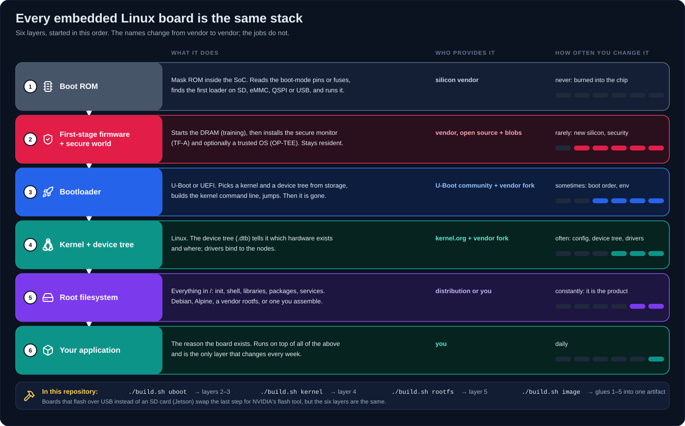
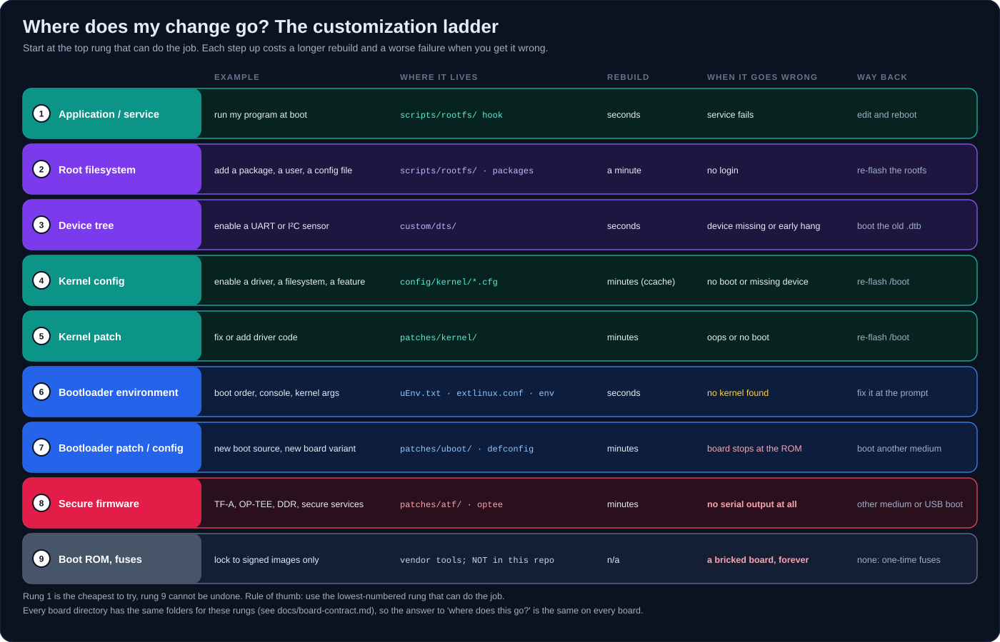

# 01 · What an embedded Linux board really is

You bought a board, or a module on a carrier, and the vendor says "it runs Linux". This chapter
explains what that sentence hides: the layers of software between the power button and your
program, who owns each one, and which ones you will actually touch. Everything in the board
directories makes sense once you can see these layers.

## The idea in one paragraph

A desktop PC hides all of this behind a BIOS and an installer. An embedded board does not. Its
processor wakes up with a tiny program burned into the chip (the **Boot ROM**), which loads a first
loader, which sets up the memory and the **secure world**, which loads a **bootloader**, which loads
the **kernel** together with a **device tree**, which mounts a **root filesystem**, which starts
your application. Six layers, always in that order. Every vendor names them differently and ships
them differently, but if you know the six you can find your way around any board.

## The six layers

### 1. Boot ROM: the part you can never change

A few kilobytes of code inside the SoC, written by the silicon vendor and fixed at the factory. It
runs first, because the processor's reset vector points at it. It reads the **boot-mode pins** or
fuses (a switch on the board), looks for the next stage on SD, eMMC, QSPI flash, USB or serial, checks
that it has the right header (and its signature, if the chip is "closed"), loads it into on-chip
RAM and jumps to it.

What you need to know: it decides **where on the storage your first loader must be** (a byte offset,
or a named partition) and in **what container format**. That requirement is the reason each board's
image looks different, and it is why `image.sh` exists in every board directory.

### 2. First-stage firmware and the secure world

DRAM does not work at power-on; its interface has to be trained or configured first, and the code
that does it must run from on-chip RAM. So the first loader (U-Boot's SPL on i.MX, TF-A's BL2 on
STM32MP2, NVIDIA's MB1 and MB2 on Jetson) initialises the memory and loads the rest.

The same layer installs the **secure monitor**, almost always **Arm Trusted Firmware (TF-A)**, which
runs at the highest privilege level (EL3) and stays resident after boot. It answers two kinds of
calls from Linux: **PSCI** ("start CPU 1", "suspend") and vendor services. Optionally it also starts
a **trusted OS** (**OP-TEE**) in the secure world, for keys and secure services.

What you need to know: this layer is mostly **vendor code plus a few binary blobs**, you rarely
change it, and when it is wrong the board prints nothing at all. Chapter 03 of every board explains
exactly which pieces it contains.

### 3. Bootloader

**U-Boot** (or UEFI on some systems) is the first piece that has a prompt, a filesystem driver and
a scripting language. It reads a kernel image and a **device tree** from storage, builds the
**kernel command line** (`console=…`, `root=…`), jumps to the kernel and is gone.

What you need to know: its behaviour is controlled by **environment variables** and by a boot
script or `extlinux.conf`; you change those far more often than you change U-Boot itself, and they
can be fixed from its serial prompt without re-flashing anything.

### 4. Kernel and device tree

**Linux** itself, plus a **device tree blob** (`.dtb`). On a PC the kernel discovers hardware by
asking buses (PCI, ACPI). On an SoC most peripherals cannot be discovered: a UART is just a block of
registers at a fixed address. The device tree is the data file that says, for example, "there is a UART at
`0x40010000`, here is its interrupt and its clock", and drivers bind to those nodes.

What you need to know: most customisation of a board is *a change to its device tree and kernel
configuration*. The tree lives in the kernel sources, is compiled with `dtc`, and the bootloader
hands the result to the kernel.

### 5. Root filesystem

Everything in `/`: `systemd` or BusyBox as **init** (PID 1), a shell, libraries, `ssh`, package
manager, your services. It can be a full distribution (Debian), a tiny one (Alpine), a vendor image
or something assembled by Yocto or Buildroot. The kernel mounts it using the `root=` argument.

What you need to know: this is the layer that is "just Linux", and everything you already know about
Linux administration applies. That is why each board offers more than one choice.

### 6. Your application

The reason the board exists. It sits on top of the other five and changes every week. Everything
below it should change as rarely as possible, which is why the rest of this primer is about getting
the bottom five layers *reproducible*.

## What a "BSP" is

A **Board Support Package (BSP)** is the vendor's bundle of layers 2 to 4 (and often 5) that is known
to work on their hardware: the boot firmware, a U-Boot with the board's configuration, a kernel
with the board's drivers and device tree, and sometimes a rootfs. Vendors ship BSPs as Yocto layers,
as tarballs of prebuilt binaries, or as git branches of forks of U-Boot and Linux.

This primer does the same job by hand: each board directory is a small, readable, scripted BSP,
built from pinned sources. Reading it is the cheapest way to learn what a Yocto BSP is doing on
your behalf.

## Which layers will you touch?

Almost nobody changes layers 1 and 2. The next picture ranks every kind of change by how cheap it is
to try and how bad it is when it goes wrong. Pick the lowest rung that can do the job.

## Where each layer lives on the board

The layers are not all on the same chip. A typical module has:

| Storage | What usually lives there | Why |
| --- | --- | --- |
| **On-chip ROM** | Boot ROM | silicon |
| **On-chip RAM (OCRAM/SRAM)** | first-stage loader while it runs | DRAM is not up yet |
| **SD card** | everything, in the development setup | removable, so you cannot brick the board |
| **eMMC** | everything, in the product | soldered, reliable, fast |
| **QSPI / NOR flash** | boot firmware (and sometimes only that) | small, execute-in-place-friendly, signed as a unit |
| **NVMe / USB disk** | root filesystem on bigger boards | capacity |

The two ways of getting software into these storages is the subject of
[chapter 03](03-two-build-models.md).

## Check yourself

**1. Which layer reads the boot-mode switch?**

Show the answer

The Boot ROM.

**2. A board prints nothing on the serial console, not even a banner. Which layers are suspects, and which are not?**

Show the answer

Layers 1 and 2 could be. The kernel and the root filesystem cannot, because nothing has loaded them yet.

**3. You want to enable an I²C sensor. Which rung of the ladder is that, and what do you re-flash?**

Show the answer

Rung 3, the device tree. Usually just the `.dtb` on the boot partition.

**4. Why is the first loader so small?**

Show the answer

It runs from on-chip RAM, because the DRAM is not trained yet.

Next: [02 · The boot chains compared](02-boot-chains-compared.md).
