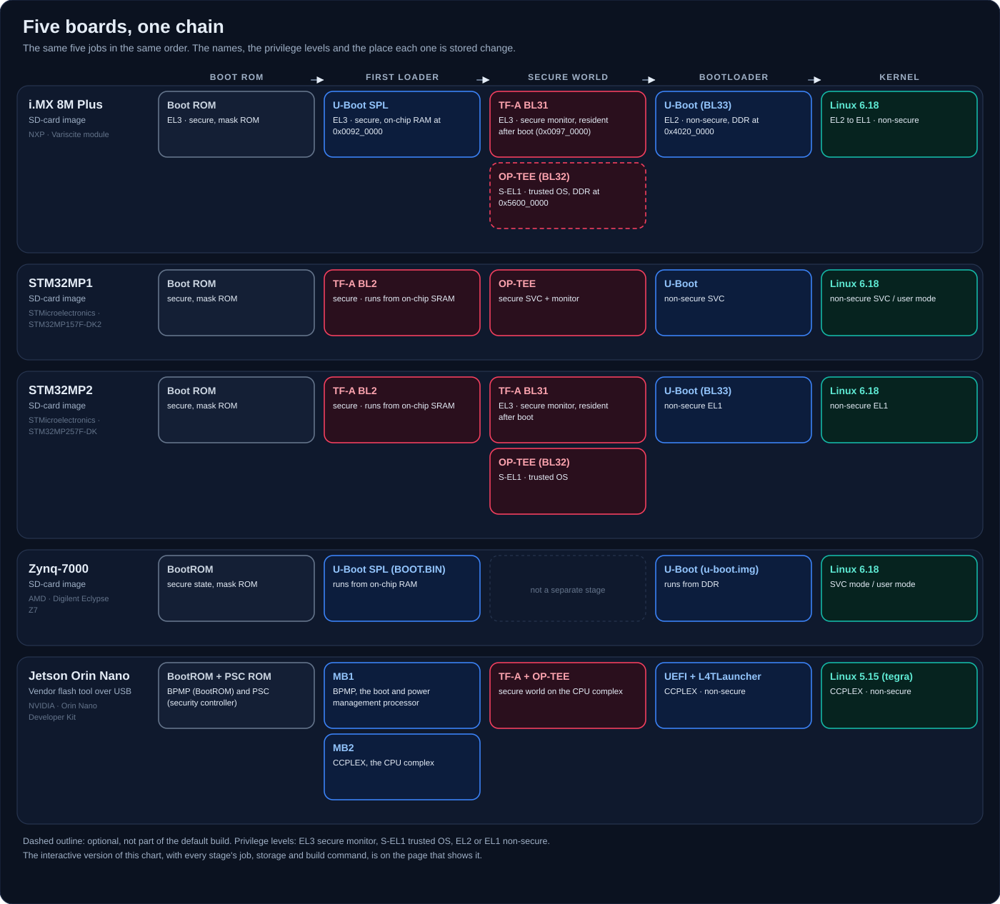

# 02 · The boot chains compared

Five boards, four silicon vendors, one job: get from a reset line to a login prompt. This chapter
puts their boot chains next to each other so you can see which parts are the same job under a
different name, and which parts are genuinely different.

*On the documentation site, click any box above to see where that stage runs, where it is stored and
which command builds it, and hover one to find the same job on the other boards. The picture below
is the same data, drawn as a diagram.*

## The five jobs

Read the chart in columns. Each column is one job, and every board has it, even when the vendor does
not give it a name.

| Job | What has to happen | i.MX 8M Plus | STM32MP1 and MP2 | Zynq-7000 | Jetson Orin Nano |
| --- | --- | --- | --- | --- | --- |
| **Boot ROM** | Start from reset, read the boot-mode setting, load the next stage | Boot ROM | Boot ROM | BootROM | BootROM and the PSC ROM |
| **First loader** | Run from on-chip RAM, train the DRAM, load everything else | U-Boot SPL | TF-A BL2 | U-Boot SPL (`BOOT.BIN`) | MB1 on the BPMP, then MB2 |
| **Secure world** | Own the highest privilege level, answer PSCI, optionally host a trusted OS | TF-A BL31 (OP-TEE optional) | OP-TEE (MP1) or BL31 and OP-TEE (MP2) | none | TF-A and OP-TEE, as one image |
| **Bootloader** | Pick the kernel and the device tree, build the command line, jump | U-Boot | U-Boot | U-Boot (`u-boot.img`) | UEFI, then L4TLauncher |
| **Kernel** | Take over, mount the root filesystem, start user space | Linux 6.18 | Linux 6.18 | Linux 6.18 | Linux 5.15 (NVIDIA's tree) |

## What is the same

- **The first stage runs from on-chip RAM.** DRAM does not work at power-on on any of them, so
  something small has to bring it up before anything big can load.
- **Linux almost never sees the secure world.** On four of the five, a secure monitor sits above the
  kernel at the highest privilege level. Linux reaches it only through a narrow call interface (PSCI for
  CPUs, SCMI on the STM32 boards for clocks, resets and regulators).
- **The bootloader's last act is to hand over a device tree.** The kernel does not discover the board; it
  is told what it is.

## What is different, and why it matters

**Where the first stages live.** On the SD-card boards, the first stages are bytes on the card: at a
fixed offset (i.MX 8M Plus), in partitions with fixed names (STM32MP1 and MP2), or as a file in the
first FAT partition (Zynq-7000). That is why you can rebuild them and test them with nothing but a
card reader. On the Jetson they live in a flash chip on the module, written by NVIDIA's tool, which is
why the flashing story is different ([chapter 03](03-two-build-models.md)).

**How many processors take part.** The i.MX 8M Plus, the STM32 boards and the Zynq-7000 run their whole
chain on the Arm cores that later run Linux. The Jetson starts on a small controller, the **BPMP**, and only
hands over to the CPU complex at MB2. The first stages are therefore not on the same processor as the
kernel, which is why Jetson's boot firmware is a signed binary package rather than source you rebuild.

**Who is the secure monitor.** On the i.MX 8M Plus and the STM32MP2 it is **TF-A**, built from source in
these directories; on the STM32MP1 OP-TEE itself takes that role. On the Jetson the secure monitor and
OP-TEE are packaged by NVIDIA as one image, shipped as a binary in the driver package. The Zynq-7000
has none: the Cortex-A9 cores start in the secure state and stay there, so there is nothing between U-Boot
and Linux.

**What the first loader needs to know about the board.** The Zynq-7000 is the clearest case: the memory
and pin setup is a file generated by the FPGA vendor's tools (`ps7_init`), and the SPL cannot start
without the one that matches the board. On the other chips, the DRAM setup is part of the source tree
or of a vendor binary.

**What the bootloader is.** U-Boot on four of the five (with `extlinux.conf` finding the kernel), UEFI on
the Jetson (with L4TLauncher reading `extlinux.conf`). The idea is identical; the tool for fixing a broken
boot is different, which is why each board's troubleshooting chapter starts with its own console prompt.

## Where to go next

| You want to see… | Read |
| --- | --- |
| the i.MX 8M Plus chain, with every address and source file | [i.MX 8M Plus · Boot flow](../boards/imx8mp-variscite/docs/01-boot-flow.md) |
| the STM32MP2 chain | [STM32MP2 · Boot flow](../boards/stm32mp2-dk/docs/01-boot-flow.md) |
| the STM32MP1 chain, and how it differs from the MP2 | [STM32MP1 · Boot flow](../boards/stm32mp1-dk2/docs/01-boot-flow.md) |
| the Zynq-7000 chain and what `ps7_init` does | [Zynq-7000 · Boot flow](../boards/zynq7000-eclypse-z7/docs/01-boot-flow.md) |
| the Jetson chain, with the BPMP and the PSC | [Jetson Orin Nano · Boot flow](../boards/jetson-orin-nano/docs/01-boot-flow.md) |
| how TrustZone is enforced | [i.MX 8M Plus · Secure world](../boards/imx8mp-variscite/docs/13-secure-world.md) |

Next: [03 · Two ways software reaches a board](03-two-build-models.md).
