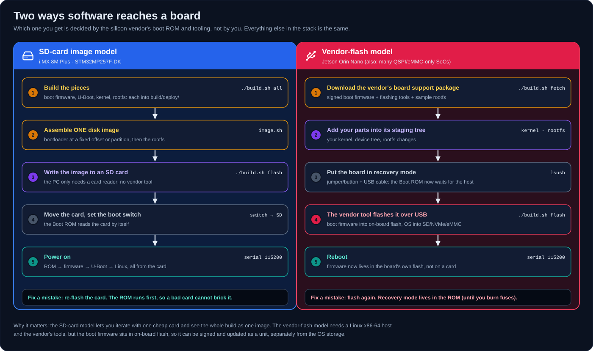

# 03 · Two ways software reaches a board

Chapter 01 listed what a board runs. This chapter is about **how it gets there**, because that is
where boards differ most, and it decides what your PC needs and how you recover from mistakes.



## Model A: you assemble one disk image (SD card)

The boot ROM of the i.MX 8M Plus, the STM32MP1 and MP2 and the Zynq-7000 will boot from an SD card. So the whole
software stack can be one file, a **disk image**, laid out byte for byte the way the ROM expects:

On the i.MX 8M Plus, everything sits at fixed byte offsets:

```text
offset 32 KiB   boot firmware (imx-boot)
offset 7 MiB    U-Boot environment
offset 8 MiB    ext4 root partition
```

On the STM32MP257F-DK (and, with other names, the MP1), the ROM and the firmware find their parts by partition *name* in a GPT table:

```text
partition "fsbla1"      first loader (TF-A BL2), found by the Boot ROM
partition "fip"         BL31, OP-TEE and U-Boot in one file, found by BL2
partition "u-boot-env"  U-Boot's saved environment
partition "rootfs"      ext4 root filesystem
```

On the Zynq-7000 the ROM wants a classic MBR disk whose first partition is FAT and holds a file called
`BOOT.BIN`; the kernel, device tree and boot menu sit beside it, and the root filesystem is the second partition.

What this buys you:

- **One artifact.** `build/deploy/` ends with a single `.img` you can share, version and flash.
- **No vendor tool.** Writing a card needs `dd` or `bmaptool` and a card reader.
- **Nothing to brick.** The boot switch picks the SD card; if the card is bad, the board does not
  boot from it, and you write another one. The board's own flash (eMMC) is never touched.
- **Everything is visible.** You can mount the image on your PC and look inside.

What it costs: you must know the ROM's rules (offsets, partition names and type GUIDs), and the
production medium (eMMC) needs a different procedure from the development medium (SD).

Boards in this primer: [`imx8mp-variscite`](../boards/imx8mp-variscite/README.md),
[`stm32mp1-dk2`](../boards/stm32mp1-dk2/README.md), [`stm32mp2-dk`](../boards/stm32mp2-dk/README.md) and
[`zynq7000-eclypse-z7`](../boards/zynq7000-eclypse-z7/README.md).

### A second route on the same boards: USB serial download

Some of the SD-card boards can also be loaded *without* any card: the i.MX 8M Plus Boot ROM has a
serial-download mode in which NXP's `uuu` tool pushes the boot firmware into the chip over USB, and then
flashes the on-module eMMC through U-Boot's fastboot support. It is the route for putting the image on the
board's own storage, and it works from Windows, macOS and Linux
([i.MX 8M Plus · booting from eMMC with uuu](../boards/imx8mp-variscite/docs/16-booting-from-emmc-with-uuu.md)).

## Model B: the vendor's tool flashes the board over USB

NVIDIA's Jetson Orin does not boot its first stages from an SD card. Its boot firmware lives in a
**QSPI NOR flash chip on the module**, and the operating system lives on an SD card, an NVMe drive
or eMMC. You do not build a disk image: you fill a **staging tree** (NVIDIA calls it
`Linux_for_Tegra`) with signed boot binaries, your kernel and a root filesystem, put the board in
**USB recovery mode**, and NVIDIA's flash scripts, running on your PC, write everything.

What this buys you:

- **Firmware as a unit.** The boot chain is signed and versioned by the vendor and updated as one
  piece, separately from the operating system.
- **Recovery is in the ROM.** Recovery mode is implemented by the Boot ROM, so a board with broken
  firmware can still be flashed (until you burn security fuses, which is one-way).
- **One flow for every storage.** The same tool flashes an NVMe drive, an SD card or eMMC.

What it costs: the vendor's tools only run on a specific host (**Linux x86-64**), you need a USB
cable and a way to enter recovery mode, a flash takes minutes rather than seconds, and part of the
boot chain is a binary you can only replace, not rebuild.

Board in this primer: [`jetson-orin-nano`](../boards/jetson-orin-nano/README.md).

## A third model you will meet: Yocto and friends

Most vendors ship their BSP as **Yocto/OpenEmbedded layers**, and many products are built with
**Buildroot**. Both are build systems that produce all of the layers above from recipes: they fetch
sources, patch, cross-compile and assemble a rootfs and an image, and they add package management,
licence tracking and SBOMs. They are the right tool for a product with a team and a lifecycle.

This primer deliberately does *not* use them, because a build system hides the very steps you are
trying to learn. The scripts in each board directory are the "hand-rolled" version of what a Yocto
recipe set does. Once you have read them, a vendor's `meta-*` layer stops being a black box: you can
tell which recipe builds the first-stage firmware, which one builds U-Boot, which one writes the
image, and why.

| | This primer | Yocto / Buildroot |
| --- | --- | --- |
| Goal | understand every step | reproduce a product build at scale |
| Package management | the rootfs distribution's (apt, apk) | built from recipes or by the build system |
| Reproducibility | pinned commits and checksums | pinned layers, sstate cache, SBOM |
| First build | 15–30 minutes | hours |
| Changing a kernel option | edit a fragment, rerun a step | edit a bbappend or `make menuconfig`, rebuild the image |
| When to choose it | learning, bring-up, prototypes | products, fleets, compliance |

## Which model for which job

- You are **bringing up a new board**: use the SD-card model if the SoC supports it. The fast loop
  (build, write card, boot) is worth a lot.
- You are **moving to production** on an SoC that boots from on-board flash: you will end up in the
  vendor-flash model whatever you prefer. Learn it early; Jetson is the board to read.
- You are **shipping a fleet**: use Yocto or Buildroot, and use this primer's board directory as the
  reference for what the build system should end up producing.

Next: [04 · Choosing a board](04-choosing-a-board.md).
